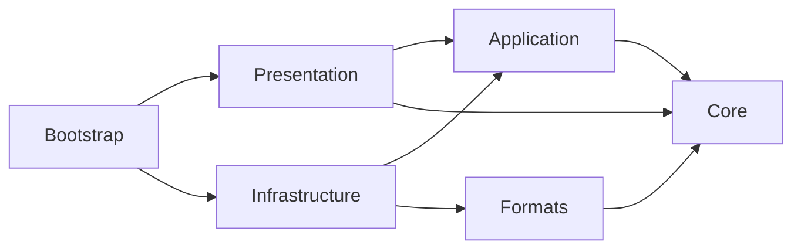

# VRC-00A 源码提取与依赖处理清单

日期：2026-11-03。对应实施规划第4—5、9节和分批部署指引00A。源根 `D:/DevOpus/ShoppingDash/`，源资产根 `D:/DevOpus/ShoppingDash Assets/` 均只读；本表不构成已迁入或已编译证明。

## 1. 提取规则与最小闭包

“提取”指迁入应用自有机制并替换DTO/命名空间/依赖；不是逐文件照抄。“重写”指已有职责可参考，但新合同/API需要新实现。“仅参考”不进入生产依赖；“剔除”无新产品运行目标。每个源文件在第3节单独列出，第4节记录完整SHA256。本轮没有复制任何源代码或模型。

| 闭包 | 最小输入与依赖处理 | 新责任边界 |
| --- | --- | --- |
| DTO / GEOM / VALIDATE | AuthoringDocuments中的VectorValue、CdtuPosition、MeshPlacement、DependencyReference、MeshTileDefinition、WallTopology/OpeningSlot等按需拆出；IMeshTile/Snapshot依赖这些值和校验。ContentGeometry/Layout/StructureMeshGeometry消费新DTO；不能迁整个旧文档以满足编译 | Core，仅BCL；Room/Group身份与共享结构为新增合同 |
| HISTORY / EDIT / PROFILE / TOOLS | AuthoringDelta→字段访问/压缩；History→Codec快照/新文档枚举/预算；NodeContent*→几何/索引/目录/历史；ProfileEdit→库草稿及几何 | Core纯规则、Application用例；JSON/压缩由独立适配与01探针确认，不从TriLib取DLL |
| CONTRACT / STORE / CODEC / LIB | 存储回执/预期hash→原子文件；库版本→目录发布→依赖manifest与resolver；ProfileMeshRequests递归依赖与别名冲突需保留。恢复/偏好用新用户目录，不直接调用原Library | Application声明消费者所需接口；Infrastructure实现，有界JSON；新schema不接受任意类型元数据 |
| UNITYCONTRACT / CACHE / IMPORTREF | 旧Contracts含GameObject/Bounds，必须拆CPU ModelScene与Unity租约。MeshTileFactory依赖IMeshTile、实例请求、缓存、碰撞；新输入统一来自IR。缓存持有固定版本/依赖hash，不能回收历史或导出快照的资源 | Formats纯Reader→Core模型；Presentation Realizer/租约；Infrastructure resolver/cache |
| VIEW / CDT / PROFILEUI | CdtWorkspaceController的所有partial文件共享字段和生命周期，不能遗漏拆分文件；重绑RoomSession、库服务、独立视口和工具状态。删InventoryDisplay与游戏属性后同步删字段/事件/构造参数 | Presentation依赖Application/Core及自身Unity服务；不能反向让Core引用Unity |
| SHELL / FILEREF / ENTRYREF | Shell原ServiceScope、BuildCapabilities、ILocalizationService和游戏回调改为明确注入；AuthoringInfrastructure原SDD/v2、官方库、商品显示、TriLib装配全部移除；文件框原TriLibCore.SFB重写 | Bootstrap唯一装配根；01A实际将中立IFileDialogService放在Core，平台实现在Infrastructure，Application后续消费该中立接口 |
| LEGACY | 只读源format/schema、固定Profile与NodeContent；自有兼容DTO仅存适配器，不导入旧运行程序集；输出新文档和来源/丢弃字段报告 | Infrastructure/LegacySddImport，06A显式调用 |

上述箭头是允许的程序集引用方向；UI调用导入/存储以Application接口为入口。Core/Formats禁止UnityEngine/UnityEditor；Application禁止UnityEngine及具体Infrastructure。Presentation持有Unity对象，Bootstrap配置生命周期。不得引入ShoppingDash.*、ShoppingDashDesigner.*、TriLib.*、HybridCLR、YooAsset游戏内容链、Steam/NGO/FMOD、旧Localization/Addressables链、Assimp/ufbx/FBX SDK/glTFast或外部转码进程为生产模型层。Editor验证工具可调用独立消费者，但不得泄漏到Player。

旧实际Core/Application都为noEngineReferences，Core另显式引用Newtonsoft.Json.dll；新项目不能照搬四份旧asmdef。旧Platform/AuthoringFileDialogs.cs直接依赖TriLibCore.SFB，因此仅迁IAuthoringFileDialogs接口思想仍不足以去依赖，Windows实现必须独立。

## 2. 来源与使用范围

| 来源 | 用途 | 随工具分发 / 原始几何可导出 | 处理 |
| --- | --- | --- | --- |
| 用户授权的ShoppingDash应用自有代码 | 提取本表机制 | 代码授权按本次用户任务；不由此推定附带第三方权利 | 保留来源记录，去游戏依赖 |
| TriLib源码、DLL、SFB、shader与附带库 | 有针对性的行为/格式研究 | 不进入本产品 | 不复制实现/解析表，不声称严格clean-room |
| 游戏内置437目录项、404 Toon身份及其他商店资产 | 仅来源核对和后续转换候选 | 未逐项核实，默认不分发 | 每项须记录作者、许可证据、可分发、可模型导出、署名；无证据用原创替代 |
| 原创解析/几何夹具与纹理 | 00C/01验证，后续可作样间 | 记录生成器、作者意图、日期、源hash后按项目原创使用 | 不含商标、角色、真实地址/可识别地点；参见validation-matrix |
| Blender / Unity原生FBX消费者 | 仅开发验证 | 不随工具隐式调用/打包 | 记录版本和选项，不复制消费者实现 |
| JSON/压缩/三角化等通用能力 | 待01运行后端探针选定 | 独立上游和许可审核后登记 | 不从TriLib目录拆出并改名；此表没有新增任何包 |

## 3. 逐文件决定

路径相对源根。依赖闭包代号见第1节；TESTREF仅迁验证意图，BASELINE/TRILIBREF/EXCLUDE不进入运行闭包。阅读状态与迁入状态不同：本表所有产品迁入状态均为NotRun，实际迁入批次必须先全文阅读尚未全文的实现/测试体。

| 实际源文件 | 决定 / 闭包 | 目标责任 | 首次批次 | 理由及依赖处理 |
| --- | --- | --- | --- | --- |
| [Assets/ShoppingDash/Runtime/AOT/Bootstrap/Services/AuthoringInfrastructure.cs](<D:/DevOpus/ShoppingDash/Assets/ShoppingDash/Runtime/AOT/Bootstrap/Services/AuthoringInfrastructure.cs>) | 重写 / SHELL | Presentation/Shell + Bootstrap | 01A/04A/04C | 改PanelRenderer/新主题/独立启动；不用BuildCapabilities或游戏退出/试玩回调；移除旧全局ServiceScope和商品目录，显式注入最小服务 |
| [Assets/ShoppingDash/Runtime/AOT/Content/Authoring/AuthoringDocuments.cs](<D:/DevOpus/ShoppingDash/Assets/ShoppingDash/Runtime/AOT/Content/Authoring/AuthoringDocuments.cs>) | 重写 / DTO | Core/Documents、Geometry | 02A/02B | 拆出布局/构件/固定引用值对象；删除地图、预算、库存、锚点与游戏类别，保留稳定ID、显式单位和冻结副本 |
| [Assets/ShoppingDash/Runtime/AOT/Content/Authoring/AuthoringRecoveryMetadata.cs](<D:/DevOpus/ShoppingDash/Assets/ShoppingDash/Runtime/AOT/Content/Authoring/AuthoringRecoveryMetadata.cs>) | 重写 / DTO | Core/Documents、Geometry | 02A/02B | 拆出布局/构件/固定引用值对象；删除地图、预算、库存、锚点与游戏类别，保留稳定ID、显式单位和冻结副本 |
| [Assets/ShoppingDash/Runtime/AOT/Content/Authoring/AuthoringRuleException.cs](<D:/DevOpus/ShoppingDash/Assets/ShoppingDash/Runtime/AOT/Content/Authoring/AuthoringRuleException.cs>) | 重写 / DTO | Core/Documents、Geometry | 02A/02B | 拆出布局/构件/固定引用值对象；删除地图、预算、库存、锚点与游戏类别，保留稳定ID、显式单位和冻结副本 |
| [Assets/ShoppingDash/Runtime/AOT/Content/Authoring/AuthoringValidation.cs](<D:/DevOpus/ShoppingDash/Assets/ShoppingDash/Runtime/AOT/Content/Authoring/AuthoringValidation.cs>) | 重写 / VALIDATE | Core/Validation | 02A/02B | 只迁结构/有限数/身份/引用规则；删除采购规则、homeGraphNode、导航与官方关卡校验 |
| [Assets/ShoppingDash/Runtime/AOT/Content/Authoring/CompiledNavigation.cs](<D:/DevOpus/ShoppingDash/Assets/ShoppingDash/Runtime/AOT/Content/Authoring/CompiledNavigation.cs>) | 剔除 / EXCLUDE | 无生产目标 | 00A | 城市/交通、历史二维设计器、游戏属性/库存/奖励/试玩、官方安装或游戏专用shader；不在新工具依赖闭包 |
| [Assets/ShoppingDash/Runtime/AOT/Content/Authoring/ContentGeometry.cs](<D:/DevOpus/ShoppingDash/Assets/ShoppingDash/Runtime/AOT/Content/Authoring/ContentGeometry.cs>) | 提取 / GEOM | Core/Geometry | 01B/02B | 保留占地中心/pivot、floor mask、洞口、附件、真实三角形与空间桶；改成新值类型，闭合/支撑归作者诊断 |
| [Assets/ShoppingDash/Runtime/AOT/Content/Authoring/ContentLayout.cs](<D:/DevOpus/ShoppingDash/Assets/ShoppingDash/Runtime/AOT/Content/Authoring/ContentLayout.cs>) | 提取 / GEOM | Core/Geometry | 01B/02B | 保留占地中心/pivot、floor mask、洞口、附件、真实三角形与空间桶；改成新值类型，闭合/支撑归作者诊断 |
| [Assets/ShoppingDash/Runtime/AOT/Content/Authoring/HomeProgressAnchors.cs](<D:/DevOpus/ShoppingDash/Assets/ShoppingDash/Runtime/AOT/Content/Authoring/HomeProgressAnchors.cs>) | 剔除 / EXCLUDE | 无生产目标 | 00A | 城市/交通、历史二维设计器、游戏属性/库存/奖励/试玩、官方安装或游戏专用shader；不在新工具依赖闭包 |
| [Assets/ShoppingDash/Runtime/AOT/Content/Authoring/IMeshTile.cs](<D:/DevOpus/ShoppingDash/Assets/ShoppingDash/Runtime/AOT/Content/Authoring/IMeshTile.cs>) | 重写 / DTO | Core/Documents、Geometry | 02A/02B | 拆出布局/构件/固定引用值对象；删除地图、预算、库存、锚点与游戏类别，保留稳定ID、显式单位和冻结副本 |
| [Assets/ShoppingDash/Runtime/AOT/Content/Authoring/NavigationCompiler.cs](<D:/DevOpus/ShoppingDash/Assets/ShoppingDash/Runtime/AOT/Content/Authoring/NavigationCompiler.cs>) | 剔除 / EXCLUDE | 无生产目标 | 00A | 城市/交通、历史二维设计器、游戏属性/库存/奖励/试玩、官方安装或游戏专用shader；不在新工具依赖闭包 |
| [Assets/ShoppingDash/Runtime/AOT/Content/Authoring/NavigationMapSnapshot.cs](<D:/DevOpus/ShoppingDash/Assets/ShoppingDash/Runtime/AOT/Content/Authoring/NavigationMapSnapshot.cs>) | 剔除 / EXCLUDE | 无生产目标 | 00A | 城市/交通、历史二维设计器、游戏属性/库存/奖励/试玩、官方安装或游戏专用shader；不在新工具依赖闭包 |
| [Assets/ShoppingDash/Runtime/AOT/Content/Authoring/StructureMeshGeometry.cs](<D:/DevOpus/ShoppingDash/Assets/ShoppingDash/Runtime/AOT/Content/Authoring/StructureMeshGeometry.cs>) | 提取 / GEOM | Core/Geometry | 01B/02B | 保留占地中心/pivot、floor mask、洞口、附件、真实三角形与空间桶；改成新值类型，闭合/支撑归作者诊断 |
| [Assets/ShoppingDash/Runtime/AOT/Contracts/Authoring/AuthoringItemCatalog.cs](<D:/DevOpus/ShoppingDash/Assets/ShoppingDash/Runtime/AOT/Contracts/Authoring/AuthoringItemCatalog.cs>) | 剔除 / EXCLUDE | 无生产目标 | 00A | 城市/交通、历史二维设计器、游戏属性/库存/奖励/试玩、官方安装或游戏专用shader；不在新工具依赖闭包 |
| [Assets/ShoppingDash/Runtime/AOT/Contracts/Authoring/AuthoringServices.cs](<D:/DevOpus/ShoppingDash/Assets/ShoppingDash/Runtime/AOT/Contracts/Authoring/AuthoringServices.cs>) | 重写 / CONTRACT | Application/Contracts、Core/DTO | 00B/02C | 存储回执、预期hash、库固定版本、草稿/目录登记与偏好合同独立命名；拆UI文件框与纯数据，避免带入旧工程枚举 |
| [Assets/ShoppingDash/Runtime/AOT/Contracts/Authoring/AuthoringShellAssets.cs](<D:/DevOpus/ShoppingDash/Assets/ShoppingDash/Runtime/AOT/Contracts/Authoring/AuthoringShellAssets.cs>) | 重写 / UNITYCONTRACT | Application/ImportContracts + Presentation/ResourceContracts | 00B/01B/03A | 拆引擎无关ModelScene/诊断与Unity对象租约；GameObject/Bounds/材质仅留Presentation，不反向污染Core/Formats |
| [Assets/ShoppingDash/Runtime/AOT/Contracts/Authoring/AuthoringUserPreferences.cs](<D:/DevOpus/ShoppingDash/Assets/ShoppingDash/Runtime/AOT/Contracts/Authoring/AuthoringUserPreferences.cs>) | 重写 / CONTRACT | Application/Contracts、Core/DTO | 00B/02C | 存储回执、预期hash、库固定版本、草稿/目录登记与偏好合同独立命名；拆UI文件框与纯数据，避免带入旧工程枚举 |
| [Assets/ShoppingDash/Runtime/AOT/Contracts/Authoring/IAuthoringFileDialogs.cs](<D:/DevOpus/ShoppingDash/Assets/ShoppingDash/Runtime/AOT/Contracts/Authoring/IAuthoringFileDialogs.cs>) | 重写 / CONTRACT | Application/Contracts、Core/DTO | 00B/02C | 存储回执、预期hash、库固定版本、草稿/目录登记与偏好合同独立命名；拆UI文件框与纯数据，避免带入旧工程枚举 |
| [Assets/ShoppingDash/Runtime/AOT/Contracts/Authoring/IAuthoringPackageService.cs](<D:/DevOpus/ShoppingDash/Assets/ShoppingDash/Runtime/AOT/Contracts/Authoring/IAuthoringPackageService.cs>) | 仅参考 / LEGACY | Infrastructure/LegacySddImport | 06A | 旧JSON节点/包仅为单向兼容和依赖闭包来源，不能充当FBX导出；新工具不默认提供旧地图/游戏包发布 |
| [Assets/ShoppingDash/Runtime/AOT/Contracts/Authoring/IAuthoringRecoveryStore.cs](<D:/DevOpus/ShoppingDash/Assets/ShoppingDash/Runtime/AOT/Contracts/Authoring/IAuthoringRecoveryStore.cs>) | 重写 / CONTRACT | Application/Contracts、Core/DTO | 00B/02C | 存储回执、预期hash、库固定版本、草稿/目录登记与偏好合同独立命名；拆UI文件框与纯数据，避免带入旧工程枚举 |
| [Assets/ShoppingDash/Runtime/AOT/Contracts/Authoring/IMapExchangeService.cs](<D:/DevOpus/ShoppingDash/Assets/ShoppingDash/Runtime/AOT/Contracts/Authoring/IMapExchangeService.cs>) | 剔除 / EXCLUDE | 无生产目标 | 00A | 城市/交通、历史二维设计器、游戏属性/库存/奖励/试玩、官方安装或游戏专用shader；不在新工具依赖闭包 |
| [Assets/ShoppingDash/Runtime/AOT/Contracts/Authoring/INodeContentExchange.cs](<D:/DevOpus/ShoppingDash/Assets/ShoppingDash/Runtime/AOT/Contracts/Authoring/INodeContentExchange.cs>) | 仅参考 / LEGACY | Infrastructure/LegacySddImport | 06A | 旧JSON节点/包仅为单向兼容和依赖闭包来源，不能充当FBX导出；新工具不默认提供旧地图/游戏包发布 |
| [Assets/ShoppingDash/Runtime/AOT/Contracts/Authoring/IProfileAssetService.cs](<D:/DevOpus/ShoppingDash/Assets/ShoppingDash/Runtime/AOT/Contracts/Authoring/IProfileAssetService.cs>) | 重写 / CONTRACT | Application/Contracts、Core/DTO | 00B/02C | 存储回执、预期hash、库固定版本、草稿/目录登记与偏好合同独立命名；拆UI文件框与纯数据，避免带入旧工程枚举 |
| [Assets/ShoppingDash/Runtime/AOT/Contracts/Authoring/IProfileRepositoryCatalog.cs](<D:/DevOpus/ShoppingDash/Assets/ShoppingDash/Runtime/AOT/Contracts/Authoring/IProfileRepositoryCatalog.cs>) | 重写 / CONTRACT | Application/Contracts、Core/DTO | 00B/02C | 存储回执、预期hash、库固定版本、草稿/目录登记与偏好合同独立命名；拆UI文件框与纯数据，避免带入旧工程枚举 |
| [Assets/ShoppingDash/Runtime/AOT/Contracts/MeshAssets/IStructureMeshValidator.cs](<D:/DevOpus/ShoppingDash/Assets/ShoppingDash/Runtime/AOT/Contracts/MeshAssets/IStructureMeshValidator.cs>) | 重写 / UNITYCONTRACT | Application/ImportContracts + Presentation/ResourceContracts | 00B/01B/03A | 拆引擎无关ModelScene/诊断与Unity对象租约；GameObject/Bounds/材质仅留Presentation，不反向污染Core/Formats |
| [Assets/ShoppingDash/Runtime/AOT/Contracts/MeshAssets/MeshImportContracts.cs](<D:/DevOpus/ShoppingDash/Assets/ShoppingDash/Runtime/AOT/Contracts/MeshAssets/MeshImportContracts.cs>) | 重写 / UNITYCONTRACT | Application/ImportContracts + Presentation/ResourceContracts | 00B/01B/03A | 拆引擎无关ModelScene/诊断与Unity对象租约；GameObject/Bounds/材质仅留Presentation，不反向污染Core/Formats |
| [Assets/ShoppingDash/Runtime/AOT/Contracts/MeshAssets/MeshTileInstanceContracts.cs](<D:/DevOpus/ShoppingDash/Assets/ShoppingDash/Runtime/AOT/Contracts/MeshAssets/MeshTileInstanceContracts.cs>) | 重写 / UNITYCONTRACT | Application/ImportContracts + Presentation/ResourceContracts | 00B/01B/03A | 拆引擎无关ModelScene/诊断与Unity对象租约；GameObject/Bounds/材质仅留Presentation，不反向污染Core/Formats |
| [Assets/ShoppingDash/Runtime/AOT/Contracts/MeshAssets/StockDisplayContracts.cs](<D:/DevOpus/ShoppingDash/Assets/ShoppingDash/Runtime/AOT/Contracts/MeshAssets/StockDisplayContracts.cs>) | 剔除 / EXCLUDE | 无生产目标 | 00A | 城市/交通、历史二维设计器、游戏属性/库存/奖励/试玩、官方安装或游戏专用shader；不在新工具依赖闭包 |
| [Assets/ShoppingDash/Runtime/AOT/MeshImport/BuiltInMeshCatalog.cs](<D:/DevOpus/ShoppingDash/Assets/ShoppingDash/Runtime/AOT/MeshImport/BuiltInMeshCatalog.cs>) | 仅参考 / CATALOGREF | Infrastructure/OriginalCatalog | 06B | 参考静态层级/实例目录结构；不搬运404个商业Toon身份或游戏内置资源，原创库单独来源清单 |
| [Assets/ShoppingDash/Runtime/AOT/MeshImport/CatalogMeshImportService.cs](<D:/DevOpus/ShoppingDash/Assets/ShoppingDash/Runtime/AOT/MeshImport/CatalogMeshImportService.cs>) | 仅参考 / CATALOGREF | Infrastructure/OriginalCatalog | 06B | 参考静态层级/实例目录结构；不搬运404个商业Toon身份或游戏内置资源，原创库单独来源清单 |
| [Assets/ShoppingDash/Runtime/AOT/MeshImport/DecorationMeshCollision.cs](<D:/DevOpus/ShoppingDash/Assets/ShoppingDash/Runtime/AOT/MeshImport/DecorationMeshCollision.cs>) | 提取 / CACHE | Presentation/Realization + Infrastructure/CpuCache | 01B/03A | 保留共享资源/独立实例/释放与校验意图；CPU IR为权威，Unity碰撞/预览转换分开；不让Unity Mesh成为导出唯一来源 |
| [Assets/ShoppingDash/Runtime/AOT/MeshImport/MeshAssetCache.cs](<D:/DevOpus/ShoppingDash/Assets/ShoppingDash/Runtime/AOT/MeshImport/MeshAssetCache.cs>) | 提取 / CACHE | Presentation/Realization + Infrastructure/CpuCache | 01B/03A | 保留共享资源/独立实例/释放与校验意图；CPU IR为权威，Unity碰撞/预览转换分开；不让Unity Mesh成为导出唯一来源 |
| [Assets/ShoppingDash/Runtime/AOT/MeshImport/MeshImportService.cs](<D:/DevOpus/ShoppingDash/Assets/ShoppingDash/Runtime/AOT/MeshImport/MeshImportService.cs>) | 仅参考 / IMPORTREF | Formats/Readers + Infrastructure/Resolver | 01C/03A—03D | 只参考几何/材质完成、取消、依赖和租约行为；重写所有TriLib类型/回调/mapper，不迁其实现 |
| [Assets/ShoppingDash/Runtime/AOT/MeshImport/MeshTileFactory.cs](<D:/DevOpus/ShoppingDash/Assets/ShoppingDash/Runtime/AOT/MeshImport/MeshTileFactory.cs>) | 提取 / CACHE | Presentation/Realization + Infrastructure/CpuCache | 01B/03A | 保留共享资源/独立实例/释放与校验意图；CPU IR为权威，Unity碰撞/预览转换分开；不让Unity Mesh成为导出唯一来源 |
| [Assets/ShoppingDash/Runtime/AOT/MeshImport/SdsMaterialConverter.cs](<D:/DevOpus/ShoppingDash/Assets/ShoppingDash/Runtime/AOT/MeshImport/SdsMaterialConverter.cs>) | 剔除 / EXCLUDE | 无生产目标 | 00A | 城市/交通、历史二维设计器、游戏属性/库存/奖励/试玩、官方安装或游戏专用shader；不在新工具依赖闭包 |
| [Assets/ShoppingDash/Runtime/AOT/MeshImport/SdsMaterialSettings.cs](<D:/DevOpus/ShoppingDash/Assets/ShoppingDash/Runtime/AOT/MeshImport/SdsMaterialSettings.cs>) | 剔除 / EXCLUDE | 无生产目标 | 00A | 城市/交通、历史二维设计器、游戏属性/库存/奖励/试玩、官方安装或游戏专用shader；不在新工具依赖闭包 |
| [Assets/ShoppingDash/Runtime/AOT/MeshImport/ShoppingDash.Integration.MeshImport.asmdef](<D:/DevOpus/ShoppingDash/Assets/ShoppingDash/Runtime/AOT/MeshImport/ShoppingDash.Integration.MeshImport.asmdef>) | 重写 / ASSEMBLY | 新六层程序集/测试友元 | 01A | 不复制旧ShoppingDash引用/旧友元/二进制预编译依赖；按新允许引用表创建，Core/Formats无Unity引用 |
| [Assets/ShoppingDash/Runtime/AOT/MeshImport/StockDisplayService.cs](<D:/DevOpus/ShoppingDash/Assets/ShoppingDash/Runtime/AOT/MeshImport/StockDisplayService.cs>) | 剔除 / EXCLUDE | 无生产目标 | 00A | 城市/交通、历史二维设计器、游戏属性/库存/奖励/试玩、官方安装或游戏专用shader；不在新工具依赖闭包 |
| [Assets/ShoppingDash/Runtime/AOT/MeshImport/StrictDependencyMappers.cs](<D:/DevOpus/ShoppingDash/Assets/ShoppingDash/Runtime/AOT/MeshImport/StrictDependencyMappers.cs>) | 仅参考 / IMPORTREF | Formats/Readers + Infrastructure/Resolver | 01C/03A—03D | 只参考几何/材质完成、取消、依赖和租约行为；重写所有TriLib类型/回调/mapper，不迁其实现 |
| [Assets/ShoppingDash/Runtime/AOT/MeshImport/StructureMeshValidator.cs](<D:/DevOpus/ShoppingDash/Assets/ShoppingDash/Runtime/AOT/MeshImport/StructureMeshValidator.cs>) | 提取 / CACHE | Presentation/Realization + Infrastructure/CpuCache | 01B/03A | 保留共享资源/独立实例/释放与校验意图；CPU IR为权威，Unity碰撞/预览转换分开；不让Unity Mesh成为导出唯一来源 |
| [Assets/ShoppingDash/Runtime/AOT/Persistence/Designer/AtomicAuthoringStore.cs](<D:/DevOpus/ShoppingDash/Assets/ShoppingDash/Runtime/AOT/Persistence/Designer/AtomicAuthoringStore.cs>) | 提取 / STORE | Infrastructure/Storage | 02C/05C | 保留同目录暂存、回读/前态hash、原子替换、版本目录和恢复副本；新产品私有目录/提交点，不能复用SDD/v2 |
| [Assets/ShoppingDash/Runtime/AOT/Persistence/Designer/AtomicTextFile.cs](<D:/DevOpus/ShoppingDash/Assets/ShoppingDash/Runtime/AOT/Persistence/Designer/AtomicTextFile.cs>) | 提取 / STORE | Infrastructure/Storage | 02C/05C | 保留同目录暂存、回读/前态hash、原子替换、版本目录和恢复副本；新产品私有目录/提交点，不能复用SDD/v2 |
| [Assets/ShoppingDash/Runtime/AOT/Persistence/Designer/AuthoringAtomicReplace.cs](<D:/DevOpus/ShoppingDash/Assets/ShoppingDash/Runtime/AOT/Persistence/Designer/AuthoringAtomicReplace.cs>) | 提取 / STORE | Infrastructure/Storage | 02C/05C | 保留同目录暂存、回读/前态hash、原子替换、版本目录和恢复副本；新产品私有目录/提交点，不能复用SDD/v2 |
| [Assets/ShoppingDash/Runtime/AOT/Persistence/Designer/AuthoringCodec.cs](<D:/DevOpus/ShoppingDash/Assets/ShoppingDash/Runtime/AOT/Persistence/Designer/AuthoringCodec.cs>) | 重写 / CODEC | Infrastructure/Serialization | 02A/02C | 替换shoppingdash格式、旧反射白名单和Unity向量解析；有界新schema，未知版本/非有限数/类型元数据拒绝；JSON依赖由01A探针确定 |
| [Assets/ShoppingDash/Runtime/AOT/Persistence/Designer/AuthoringDirectoryPublish.cs](<D:/DevOpus/ShoppingDash/Assets/ShoppingDash/Runtime/AOT/Persistence/Designer/AuthoringDirectoryPublish.cs>) | 提取 / STORE | Infrastructure/Storage | 02C/05C | 保留同目录暂存、回读/前态hash、原子替换、版本目录和恢复副本；新产品私有目录/提交点，不能复用SDD/v2 |
| [Assets/ShoppingDash/Runtime/AOT/Persistence/Designer/AuthoringPackageService.cs](<D:/DevOpus/ShoppingDash/Assets/ShoppingDash/Runtime/AOT/Persistence/Designer/AuthoringPackageService.cs>) | 仅参考 / LEGACY | Infrastructure/LegacySddImport | 06A | 旧JSON节点/包仅为单向兼容和依赖闭包来源，不能充当FBX导出；新工具不默认提供旧地图/游戏包发布 |
| [Assets/ShoppingDash/Runtime/AOT/Persistence/Designer/AuthoringPreferencesStore.cs](<D:/DevOpus/ShoppingDash/Assets/ShoppingDash/Runtime/AOT/Persistence/Designer/AuthoringPreferencesStore.cs>) | 提取 / STORE | Infrastructure/Storage | 02C/05C | 保留同目录暂存、回读/前态hash、原子替换、版本目录和恢复副本；新产品私有目录/提交点，不能复用SDD/v2 |
| [Assets/ShoppingDash/Runtime/AOT/Persistence/Designer/AuthoringRecoveryStore.cs](<D:/DevOpus/ShoppingDash/Assets/ShoppingDash/Runtime/AOT/Persistence/Designer/AuthoringRecoveryStore.cs>) | 提取 / STORE | Infrastructure/Storage | 02C/05C | 保留同目录暂存、回读/前态hash、原子替换、版本目录和恢复副本；新产品私有目录/提交点，不能复用SDD/v2 |
| [Assets/ShoppingDash/Runtime/AOT/Persistence/Designer/DesignerSchemaValidator.cs](<D:/DevOpus/ShoppingDash/Assets/ShoppingDash/Runtime/AOT/Persistence/Designer/DesignerSchemaValidator.cs>) | 重写 / CODEC | Infrastructure/Serialization | 02A/02C | 替换shoppingdash格式、旧反射白名单和Unity向量解析；有界新schema，未知版本/非有限数/类型元数据拒绝；JSON依赖由01A探针确定 |
| [Assets/ShoppingDash/Runtime/AOT/Persistence/Designer/MapExchangeService.cs](<D:/DevOpus/ShoppingDash/Assets/ShoppingDash/Runtime/AOT/Persistence/Designer/MapExchangeService.cs>) | 剔除 / EXCLUDE | 无生产目标 | 00A | 城市/交通、历史二维设计器、游戏属性/库存/奖励/试玩、官方安装或游戏专用shader；不在新工具依赖闭包 |
| [Assets/ShoppingDash/Runtime/AOT/Persistence/Designer/NodeContentExchange.cs](<D:/DevOpus/ShoppingDash/Assets/ShoppingDash/Runtime/AOT/Persistence/Designer/NodeContentExchange.cs>) | 仅参考 / LEGACY | Infrastructure/LegacySddImport | 06A | 旧JSON节点/包仅为单向兼容和依赖闭包来源，不能充当FBX导出；新工具不默认提供旧地图/游戏包发布 |
| [Assets/ShoppingDash/Runtime/AOT/Persistence/Designer/OfficialProfileInstallation.cs](<D:/DevOpus/ShoppingDash/Assets/ShoppingDash/Runtime/AOT/Persistence/Designer/OfficialProfileInstallation.cs>) | 剔除 / EXCLUDE | 无生产目标 | 00A | 城市/交通、历史二维设计器、游戏属性/库存/奖励/试玩、官方安装或游戏专用shader；不在新工具依赖闭包 |
| [Assets/ShoppingDash/Runtime/AOT/Persistence/Designer/ProfileAssetService.cs](<D:/DevOpus/ShoppingDash/Assets/ShoppingDash/Runtime/AOT/Persistence/Designer/ProfileAssetService.cs>) | 提取 / LIB | Infrastructure/Libraries | 02C/03E | 保留版本/hash、依赖闭包、别名冲突、复制/链接、暂存与目录登记；消费新AssetReference和导入服务，移除官方目录回退 |
| [Assets/ShoppingDash/Runtime/AOT/Persistence/Designer/ProfileImportStaging.cs](<D:/DevOpus/ShoppingDash/Assets/ShoppingDash/Runtime/AOT/Persistence/Designer/ProfileImportStaging.cs>) | 提取 / LIB | Infrastructure/Libraries | 02C/03E | 保留版本/hash、依赖闭包、别名冲突、复制/链接、暂存与目录登记；消费新AssetReference和导入服务，移除官方目录回退 |
| [Assets/ShoppingDash/Runtime/AOT/Persistence/Designer/ProfileMeshRequests.cs](<D:/DevOpus/ShoppingDash/Assets/ShoppingDash/Runtime/AOT/Persistence/Designer/ProfileMeshRequests.cs>) | 提取 / LIB | Infrastructure/Libraries | 02C/03E | 保留版本/hash、依赖闭包、别名冲突、复制/链接、暂存与目录登记；消费新AssetReference和导入服务，移除官方目录回退 |
| [Assets/ShoppingDash/Runtime/AOT/Persistence/Designer/ProfileRepositoryCatalog.cs](<D:/DevOpus/ShoppingDash/Assets/ShoppingDash/Runtime/AOT/Persistence/Designer/ProfileRepositoryCatalog.cs>) | 提取 / LIB | Infrastructure/Libraries | 02C/03E | 保留版本/hash、依赖闭包、别名冲突、复制/链接、暂存与目录登记；消费新AssetReference和导入服务，移除官方目录回退 |
| [Assets/ShoppingDash/Runtime/AOT/Persistence/Designer/TilemapProfileLibrary.cs](<D:/DevOpus/ShoppingDash/Assets/ShoppingDash/Runtime/AOT/Persistence/Designer/TilemapProfileLibrary.cs>) | 提取 / LIB | Infrastructure/Libraries | 02C/03E | 保留版本/hash、依赖闭包、别名冲突、复制/链接、暂存与目录登记；消费新AssetReference和导入服务，移除官方目录回退 |
| [Assets/ShoppingDash/Runtime/AOT/Platform/AuthoringFileDialogs.cs](<D:/DevOpus/ShoppingDash/Assets/ShoppingDash/Runtime/AOT/Platform/AuthoringFileDialogs.cs>) | 仅参考 / FILEREF | Infrastructure/WindowsFileDialog | 01A | 旧实现直接using TriLibCore.SFB；重新实现Windows接口/线程/owner/Unicode取消，不拆取附带StandaloneFileBrowser |
| [Assets/ShoppingDash/Runtime/Hotfix/Composition/GameModuleEntry.cs](<D:/DevOpus/ShoppingDash/Assets/ShoppingDash/Runtime/Hotfix/Composition/GameModuleEntry.cs>) | 仅参考 / ENTRYREF | Bootstrap | 01A | 只证明当前入口创建SddShellView；不迁Hotfix/游戏导航/资源启动 |
| [Assets/ShoppingDash/Tests/EditMode/SddAtomicReplaceTests.cs](<D:/DevOpus/ShoppingDash/Assets/ShoppingDash/Tests/EditMode/SddAtomicReplaceTests.cs>) | 仅参考 / TESTREF | Tests/STORE | 02—07 | 迁移测试意图；先阅读全文并改夹具/接口，不搬旧通过数；涉及游戏条目剔除 |
| [Assets/ShoppingDash/Tests/EditMode/SddAuthoringTests.cs](<D:/DevOpus/ShoppingDash/Assets/ShoppingDash/Tests/EditMode/SddAuthoringTests.cs>) | 仅参考 / TESTREF | Tests/EDIT/STORE | 02—07 | 迁移测试意图；先阅读全文并改夹具/接口，不搬旧通过数；涉及游戏条目剔除 |
| [Assets/ShoppingDash/Tests/EditMode/SddCameraFloorTests.cs](<D:/DevOpus/ShoppingDash/Assets/ShoppingDash/Tests/EditMode/SddCameraFloorTests.cs>) | 剔除 / TESTEXCLUDE | 无生产测试目标 | 00A | 旧游戏/导航/角色/发布或测试Host合同；新测试Host独立创建，不把这些旧用例纳入产品门槛 |
| [Assets/ShoppingDash/Tests/EditMode/SddContentGeometryTests.cs](<D:/DevOpus/ShoppingDash/Assets/ShoppingDash/Tests/EditMode/SddContentGeometryTests.cs>) | 仅参考 / TESTREF | Tests/GEOM/XFORM | 02—07 | 迁移测试意图；先阅读全文并改夹具/接口，不搬旧通过数；涉及游戏条目剔除 |
| [Assets/ShoppingDash/Tests/EditMode/SddDirectoryPublishTests.cs](<D:/DevOpus/ShoppingDash/Assets/ShoppingDash/Tests/EditMode/SddDirectoryPublishTests.cs>) | 仅参考 / TESTREF | Tests/EXPORT-TXN/STORE | 02—07 | 迁移测试意图；先阅读全文并改夹具/接口，不搬旧通过数；涉及游戏条目剔除 |
| [Assets/ShoppingDash/Tests/EditMode/SddFoundationTests.cs](<D:/DevOpus/ShoppingDash/Assets/ShoppingDash/Tests/EditMode/SddFoundationTests.cs>) | 剔除 / TESTEXCLUDE | 无生产测试目标 | 00A | 旧游戏/导航/角色/发布或测试Host合同；新测试Host独立创建，不把这些旧用例纳入产品门槛 |
| [Assets/ShoppingDash/Tests/EditMode/SddHistoryTests.cs](<D:/DevOpus/ShoppingDash/Assets/ShoppingDash/Tests/EditMode/SddHistoryTests.cs>) | 仅参考 / TESTREF | Tests/HISTORY | 02—07 | 迁移测试意图；先阅读全文并改夹具/接口，不搬旧通过数；涉及游戏条目剔除 |
| [Assets/ShoppingDash/Tests/EditMode/SddLevelLoadTests.cs](<D:/DevOpus/ShoppingDash/Assets/ShoppingDash/Tests/EditMode/SddLevelLoadTests.cs>) | 剔除 / TESTEXCLUDE | 无生产测试目标 | 00A | 旧游戏/导航/角色/发布或测试Host合同；新测试Host独立创建，不把这些旧用例纳入产品门槛 |
| [Assets/ShoppingDash/Tests/EditMode/SddMapEditingTests.cs](<D:/DevOpus/ShoppingDash/Assets/ShoppingDash/Tests/EditMode/SddMapEditingTests.cs>) | 剔除 / TESTEXCLUDE | 无生产测试目标 | 00A | 旧游戏/导航/角色/发布或测试Host合同；新测试Host独立创建，不把这些旧用例纳入产品门槛 |
| [Assets/ShoppingDash/Tests/EditMode/SddMapExchangeTests.cs](<D:/DevOpus/ShoppingDash/Assets/ShoppingDash/Tests/EditMode/SddMapExchangeTests.cs>) | 剔除 / TESTEXCLUDE | 无生产测试目标 | 00A | 旧游戏/导航/角色/发布或测试Host合同；新测试Host独立创建，不把这些旧用例纳入产品门槛 |
| [Assets/ShoppingDash/Tests/EditMode/SddNavigationTests.cs](<D:/DevOpus/ShoppingDash/Assets/ShoppingDash/Tests/EditMode/SddNavigationTests.cs>) | 剔除 / TESTEXCLUDE | 无生产测试目标 | 00A | 旧游戏/导航/角色/发布或测试Host合同；新测试Host独立创建，不把这些旧用例纳入产品门槛 |
| [Assets/ShoppingDash/Tests/EditMode/SddNodeEditingTests.cs](<D:/DevOpus/ShoppingDash/Assets/ShoppingDash/Tests/EditMode/SddNodeEditingTests.cs>) | 仅参考 / TESTREF | Tests/EDIT | 02—07 | 迁移测试意图；先阅读全文并改夹具/接口，不搬旧通过数；涉及游戏条目剔除 |
| [Assets/ShoppingDash/Tests/EditMode/SddNodeExchangeTests.cs](<D:/DevOpus/ShoppingDash/Assets/ShoppingDash/Tests/EditMode/SddNodeExchangeTests.cs>) | 仅参考 / TESTREF | Tests/MIGRATE | 02—07 | 迁移测试意图；先阅读全文并改夹具/接口，不搬旧通过数；涉及游戏条目剔除 |
| [Assets/ShoppingDash/Tests/EditMode/SddNodeTransitionTests.cs](<D:/DevOpus/ShoppingDash/Assets/ShoppingDash/Tests/EditMode/SddNodeTransitionTests.cs>) | 剔除 / TESTEXCLUDE | 无生产测试目标 | 00A | 旧游戏/导航/角色/发布或测试Host合同；新测试Host独立创建，不把这些旧用例纳入产品门槛 |
| [Assets/ShoppingDash/Tests/EditMode/SddOfficialLevelTests.cs](<D:/DevOpus/ShoppingDash/Assets/ShoppingDash/Tests/EditMode/SddOfficialLevelTests.cs>) | 剔除 / TESTEXCLUDE | 无生产测试目标 | 00A | 旧游戏/导航/角色/发布或测试Host合同；新测试Host独立创建，不把这些旧用例纳入产品门槛 |
| [Assets/ShoppingDash/Tests/EditMode/SddOfficialProfileTests.cs](<D:/DevOpus/ShoppingDash/Assets/ShoppingDash/Tests/EditMode/SddOfficialProfileTests.cs>) | 剔除 / TESTEXCLUDE | 无生产测试目标 | 00A | 旧游戏/导航/角色/发布或测试Host合同；新测试Host独立创建，不把这些旧用例纳入产品门槛 |
| [Assets/ShoppingDash/Tests/EditMode/SddPackageTests.cs](<D:/DevOpus/ShoppingDash/Assets/ShoppingDash/Tests/EditMode/SddPackageTests.cs>) | 仅参考 / TESTREF | Tests/STORE/INPUT | 02—07 | 迁移测试意图；先阅读全文并改夹具/接口，不搬旧通过数；涉及游戏条目剔除 |
| [Assets/ShoppingDash/Tests/EditMode/SddPreferencesTests.cs](<D:/DevOpus/ShoppingDash/Assets/ShoppingDash/Tests/EditMode/SddPreferencesTests.cs>) | 仅参考 / TESTREF | Tests/UI-INPUT/STORE | 02—07 | 迁移测试意图；先阅读全文并改夹具/接口，不搬旧通过数；涉及游戏条目剔除 |
| [Assets/ShoppingDash/Tests/EditMode/SddProfileEditingTests.cs](<D:/DevOpus/ShoppingDash/Assets/ShoppingDash/Tests/EditMode/SddProfileEditingTests.cs>) | 仅参考 / TESTREF | Tests/LIB/GEOM | 02—07 | 迁移测试意图；先阅读全文并改夹具/接口，不搬旧通过数；涉及游戏条目剔除 |
| [Assets/ShoppingDash/Tests/EditMode/SddProfileRepositoryTests.cs](<D:/DevOpus/ShoppingDash/Assets/ShoppingDash/Tests/EditMode/SddProfileRepositoryTests.cs>) | 仅参考 / TESTREF | Tests/LIB | 02—07 | 迁移测试意图；先阅读全文并改夹具/接口，不搬旧通过数；涉及游戏条目剔除 |
| [Assets/ShoppingDash/Tests/EditMode/SddProgressDecorationTests.cs](<D:/DevOpus/ShoppingDash/Assets/ShoppingDash/Tests/EditMode/SddProgressDecorationTests.cs>) | 剔除 / TESTEXCLUDE | 无生产测试目标 | 00A | 旧游戏/导航/角色/发布或测试Host合同；新测试Host独立创建，不把这些旧用例纳入产品门槛 |
| [Assets/ShoppingDash/Tests/EditMode/SddProjectPropertiesTests.cs](<D:/DevOpus/ShoppingDash/Assets/ShoppingDash/Tests/EditMode/SddProjectPropertiesTests.cs>) | 剔除 / TESTEXCLUDE | 无生产测试目标 | 00A | 旧游戏/导航/角色/发布或测试Host合同；新测试Host独立创建，不把这些旧用例纳入产品门槛 |
| [Assets/ShoppingDash/Tests/EditMode/SddRecoveryTests.cs](<D:/DevOpus/ShoppingDash/Assets/ShoppingDash/Tests/EditMode/SddRecoveryTests.cs>) | 仅参考 / TESTREF | Tests/STORE | 02—07 | 迁移测试意图；先阅读全文并改夹具/接口，不搬旧通过数；涉及游戏条目剔除 |
| [Assets/ShoppingDash/Tests/EditMode/SddRuntimeSessionTests.cs](<D:/DevOpus/ShoppingDash/Assets/ShoppingDash/Tests/EditMode/SddRuntimeSessionTests.cs>) | 剔除 / TESTEXCLUDE | 无生产测试目标 | 00A | 旧游戏/导航/角色/发布或测试Host合同；新测试Host独立创建，不把这些旧用例纳入产品门槛 |
| [Assets/ShoppingDash/Tests/EditMode/SddStructureMeshTests.cs](<D:/DevOpus/ShoppingDash/Assets/ShoppingDash/Tests/EditMode/SddStructureMeshTests.cs>) | 仅参考 / TESTREF | Tests/GEOM | 02—07 | 迁移测试意图；先阅读全文并改夹具/接口，不搬旧通过数；涉及游戏条目剔除 |
| [Assets/ShoppingDash/Tests/EditMode/SddToolTests.cs](<D:/DevOpus/ShoppingDash/Assets/ShoppingDash/Tests/EditMode/SddToolTests.cs>) | 仅参考 / TESTREF | Tests/UI-INPUT/HISTORY | 02—07 | 迁移测试意图；先阅读全文并改夹具/接口，不搬旧通过数；涉及游戏条目剔除 |
| [Assets/ShoppingDash/Tests/PlayMode/SddBuiltInLodTests.cs](<D:/DevOpus/ShoppingDash/Assets/ShoppingDash/Tests/PlayMode/SddBuiltInLodTests.cs>) | 仅参考 / TESTREF | Tests/LIFE | 02—07 | 迁移测试意图；先阅读全文并改夹具/接口，不搬旧通过数；涉及游戏条目剔除 |
| [Assets/ShoppingDash/Tests/PlayMode/SddInteractionBoundaryTests.cs](<D:/DevOpus/ShoppingDash/Assets/ShoppingDash/Tests/PlayMode/SddInteractionBoundaryTests.cs>) | 剔除 / TESTEXCLUDE | 无生产测试目标 | 00A | 旧游戏/导航/角色/发布或测试Host合同；新测试Host独立创建，不把这些旧用例纳入产品门槛 |
| [Assets/ShoppingDash/Tests/PlayMode/SddMeshLifetimeTests.cs](<D:/DevOpus/ShoppingDash/Assets/ShoppingDash/Tests/PlayMode/SddMeshLifetimeTests.cs>) | 仅参考 / TESTREF | Tests/LIFE | 02—07 | 迁移测试意图；先阅读全文并改夹具/接口，不搬旧通过数；涉及游戏条目剔除 |
| [Assets/ShoppingDash/Tests/PlayMode/SddMovementTests.cs](<D:/DevOpus/ShoppingDash/Assets/ShoppingDash/Tests/PlayMode/SddMovementTests.cs>) | 剔除 / TESTEXCLUDE | 无生产测试目标 | 00A | 旧游戏/导航/角色/发布或测试Host合同；新测试Host独立创建，不把这些旧用例纳入产品门槛 |
| [Assets/ShoppingDash/Tests/PlayMode/SddNodeContentTests.cs](<D:/DevOpus/ShoppingDash/Assets/ShoppingDash/Tests/PlayMode/SddNodeContentTests.cs>) | 剔除 / TESTEXCLUDE | 无生产测试目标 | 00A | 旧游戏/导航/角色/发布或测试Host合同；新测试Host独立创建，不把这些旧用例纳入产品门槛 |
| [Assets/ShoppingDash/Tests/PlayMode/SddPlayModeHost.cs](<D:/DevOpus/ShoppingDash/Assets/ShoppingDash/Tests/PlayMode/SddPlayModeHost.cs>) | 剔除 / TESTEXCLUDE | 无生产测试目标 | 00A | 旧游戏/导航/角色/发布或测试Host合同；新测试Host独立创建，不把这些旧用例纳入产品门槛 |
| [Assets/ShoppingDash/Tests/PlayMode/SddRuntimeMapTests.cs](<D:/DevOpus/ShoppingDash/Assets/ShoppingDash/Tests/PlayMode/SddRuntimeMapTests.cs>) | 剔除 / TESTEXCLUDE | 无生产测试目标 | 00A | 旧游戏/导航/角色/发布或测试Host合同；新测试Host独立创建，不把这些旧用例纳入产品门槛 |
| [Assets/ShoppingDash/Tests/PlayMode/SddShellLayoutTests.cs](<D:/DevOpus/ShoppingDash/Assets/ShoppingDash/Tests/PlayMode/SddShellLayoutTests.cs>) | 仅参考 / TESTREF | Tests/UI-LAYOUT/UI-INPUT | 02—07 | 迁移测试意图；先阅读全文并改夹具/接口，不搬旧通过数；涉及游戏条目剔除 |
| [Assets/ShoppingDashDesigner/Runtime/Application/ContentTileCatalog.cs](<D:/DevOpus/ShoppingDash/Assets/ShoppingDashDesigner/Runtime/Application/ContentTileCatalog.cs>) | 提取 / PROFILE | Application/LibraryEditing | 02C | 保留定义草稿与变换/命中框机制；改为新分类、LibraryDefinition和固定引用，纯Light显式建模 |
| [Assets/ShoppingDashDesigner/Runtime/Application/DesignerRecoveryService.cs](<D:/DevOpus/ShoppingDash/Assets/ShoppingDashDesigner/Runtime/Application/DesignerRecoveryService.cs>) | 重写 / SESSION | Application/RoomSession | 02A/02C | 新会话装配工程/库独立历史、保存和恢复；删除玩法/地图/试玩入口，保留代次和取消边界 |
| [Assets/ShoppingDashDesigner/Runtime/Application/DesignerSessionService.cs](<D:/DevOpus/ShoppingDash/Assets/ShoppingDashDesigner/Runtime/Application/DesignerSessionService.cs>) | 重写 / SESSION | Application/RoomSession | 02A/02C | 新会话装配工程/库独立历史、保存和恢复；删除玩法/地图/试玩入口，保留代次和取消边界 |
| [Assets/ShoppingDashDesigner/Runtime/Application/MapEditService.cs](<D:/DevOpus/ShoppingDash/Assets/ShoppingDashDesigner/Runtime/Application/MapEditService.cs>) | 剔除 / EXCLUDE | 无生产目标 | 00A | 城市/交通、历史二维设计器、游戏属性/库存/奖励/试玩、官方安装或游戏专用shader；不在新工具依赖闭包 |
| [Assets/ShoppingDashDesigner/Runtime/Application/NodeContentBrush.cs](<D:/DevOpus/ShoppingDash/Assets/ShoppingDashDesigner/Runtime/Application/NodeContentBrush.cs>) | 提取 / EDIT | Application/RoomEditing | 02B | 保留稳定ID编辑、空间索引、笔画和选区原子提交；删除SetStock、Spawn和GraphNode关联；按新RoomDocument及共享墙规则改写 |
| [Assets/ShoppingDashDesigner/Runtime/Application/NodeContentEditService.cs](<D:/DevOpus/ShoppingDash/Assets/ShoppingDashDesigner/Runtime/Application/NodeContentEditService.cs>) | 提取 / EDIT | Application/RoomEditing | 02B | 保留稳定ID编辑、空间索引、笔画和选区原子提交；删除SetStock、Spawn和GraphNode关联；按新RoomDocument及共享墙规则改写 |
| [Assets/ShoppingDashDesigner/Runtime/Application/NodeContentIndex.cs](<D:/DevOpus/ShoppingDash/Assets/ShoppingDashDesigner/Runtime/Application/NodeContentIndex.cs>) | 提取 / EDIT | Application/RoomEditing | 02B | 保留稳定ID编辑、空间索引、笔画和选区原子提交；删除SetStock、Spawn和GraphNode关联；按新RoomDocument及共享墙规则改写 |
| [Assets/ShoppingDashDesigner/Runtime/Application/NodeContentSelection.cs](<D:/DevOpus/ShoppingDash/Assets/ShoppingDashDesigner/Runtime/Application/NodeContentSelection.cs>) | 提取 / EDIT | Application/RoomEditing | 02B | 保留稳定ID编辑、空间索引、笔画和选区原子提交；删除SetStock、Spawn和GraphNode关联；按新RoomDocument及共享墙规则改写 |
| [Assets/ShoppingDashDesigner/Runtime/Application/ProfileEditService.cs](<D:/DevOpus/ShoppingDash/Assets/ShoppingDashDesigner/Runtime/Application/ProfileEditService.cs>) | 提取 / PROFILE | Application/LibraryEditing | 02C | 保留定义草稿与变换/命中框机制；改为新分类、LibraryDefinition和固定引用，纯Light显式建模 |
| [Assets/ShoppingDashDesigner/Runtime/Application/ProjectProperties.cs](<D:/DevOpus/ShoppingDash/Assets/ShoppingDashDesigner/Runtime/Application/ProjectProperties.cs>) | 剔除 / EXCLUDE | 无生产目标 | 00A | 城市/交通、历史二维设计器、游戏属性/库存/奖励/试玩、官方安装或游戏专用shader；不在新工具依赖闭包 |
| [Assets/ShoppingDashDesigner/Runtime/Application/ShoppingDashDesigner.Application.asmdef](<D:/DevOpus/ShoppingDash/Assets/ShoppingDashDesigner/Runtime/Application/ShoppingDashDesigner.Application.asmdef>) | 重写 / ASSEMBLY | 新六层程序集/测试友元 | 01A | 不复制旧ShoppingDash引用/旧友元/二进制预编译依赖；按新允许引用表创建，Core/Formats无Unity引用 |
| [Assets/ShoppingDashDesigner/Runtime/Application/VgeBenchmarkFixture.cs](<D:/DevOpus/ShoppingDash/Assets/ShoppingDashDesigner/Runtime/Application/VgeBenchmarkFixture.cs>) | 剔除 / EXCLUDE | 无生产目标 | 00A | 城市/交通、历史二维设计器、游戏属性/库存/奖励/试玩、官方安装或游戏专用shader；不在新工具依赖闭包 |
| [Assets/ShoppingDashDesigner/Runtime/Core/AssemblyInfo.cs](<D:/DevOpus/ShoppingDash/Assets/ShoppingDashDesigner/Runtime/Core/AssemblyInfo.cs>) | 重写 / ASSEMBLY | 新六层程序集/测试友元 | 01A | 不复制旧ShoppingDash引用/旧友元/二进制预编译依赖；按新允许引用表创建，Core/Formats无Unity引用 |
| [Assets/ShoppingDashDesigner/Runtime/Core/Authoring/AuthoringDelta.cs](<D:/DevOpus/ShoppingDash/Assets/ShoppingDashDesigner/Runtime/Core/Authoring/AuthoringDelta.cs>) | 提取 / HISTORY | Core/History | 02A | 保留字段差量/回滚/检查点/预算与矩形选择；替换旧文档类型、Newtonsoft字段访问和压缩入口；工程/库独立时间线 |
| [Assets/ShoppingDashDesigner/Runtime/Core/Authoring/AuthoringHistory.cs](<D:/DevOpus/ShoppingDash/Assets/ShoppingDashDesigner/Runtime/Core/Authoring/AuthoringHistory.cs>) | 提取 / HISTORY | Core/History | 02A | 保留字段差量/回滚/检查点/预算与矩形选择；替换旧文档类型、Newtonsoft字段访问和压缩入口；工程/库独立时间线 |
| [Assets/ShoppingDashDesigner/Runtime/Core/Authoring/AuthoringSelectionRect.cs](<D:/DevOpus/ShoppingDash/Assets/ShoppingDashDesigner/Runtime/Core/Authoring/AuthoringSelectionRect.cs>) | 提取 / HISTORY | Core/History | 02A | 保留字段差量/回滚/检查点/预算与矩形选择；替换旧文档类型、Newtonsoft字段访问和压缩入口；工程/库独立时间线 |
| [Assets/ShoppingDashDesigner/Runtime/Core/Authoring/DesignerTools.cs](<D:/DevOpus/ShoppingDash/Assets/ShoppingDashDesigner/Runtime/Core/Authoring/DesignerTools.cs>) | 提取 / TOOLS | Application/Tools | 02A/04B | 保留手势/快捷键冲突机制；去VGE工具，Ctrl+D改复制；文本/IME先消费输入 |
| [Assets/ShoppingDashDesigner/Runtime/Core/Authoring/VgeProjection.cs](<D:/DevOpus/ShoppingDash/Assets/ShoppingDashDesigner/Runtime/Core/Authoring/VgeProjection.cs>) | 剔除 / EXCLUDE | 无生产目标 | 00A | 城市/交通、历史二维设计器、游戏属性/库存/奖励/试玩、官方安装或游戏专用shader；不在新工具依赖闭包 |
| [Assets/ShoppingDashDesigner/Runtime/Core/DesignerDocument.cs](<D:/DevOpus/ShoppingDash/Assets/ShoppingDashDesigner/Runtime/Core/DesignerDocument.cs>) | 剔除 / EXCLUDE | 无生产目标 | 00A | 城市/交通、历史二维设计器、游戏属性/库存/奖励/试玩、官方安装或游戏专用shader；不在新工具依赖闭包 |
| [Assets/ShoppingDashDesigner/Runtime/Core/DesignerFileStore.cs](<D:/DevOpus/ShoppingDash/Assets/ShoppingDashDesigner/Runtime/Core/DesignerFileStore.cs>) | 剔除 / EXCLUDE | 无生产目标 | 00A | 城市/交通、历史二维设计器、游戏属性/库存/奖励/试玩、官方安装或游戏专用shader；不在新工具依赖闭包 |
| [Assets/ShoppingDashDesigner/Runtime/Core/PlaytestProfileRepository.cs](<D:/DevOpus/ShoppingDash/Assets/ShoppingDashDesigner/Runtime/Core/PlaytestProfileRepository.cs>) | 剔除 / EXCLUDE | 无生产目标 | 00A | 城市/交通、历史二维设计器、游戏属性/库存/奖励/试玩、官方安装或游戏专用shader；不在新工具依赖闭包 |
| [Assets/ShoppingDashDesigner/Runtime/Core/ShoppingDashDesigner.Core.asmdef](<D:/DevOpus/ShoppingDash/Assets/ShoppingDashDesigner/Runtime/Core/ShoppingDashDesigner.Core.asmdef>) | 重写 / ASSEMBLY | 新六层程序集/测试友元 | 01A | 不复制旧ShoppingDash引用/旧友元/二进制预编译依赖；按新允许引用表创建，Core/Formats无Unity引用 |
| [Assets/ShoppingDashDesigner/Runtime/Presentation/DesignerRuntimeView.cs](<D:/DevOpus/ShoppingDash/Assets/ShoppingDashDesigner/Runtime/Presentation/DesignerRuntimeView.cs>) | 剔除 / EXCLUDE | 无生产目标 | 00A | 城市/交通、历史二维设计器、游戏属性/库存/奖励/试玩、官方安装或游戏专用shader；不在新工具依赖闭包 |
| [Assets/ShoppingDashDesigner/Runtime/Presentation/DesignerViewport.cs](<D:/DevOpus/ShoppingDash/Assets/ShoppingDashDesigner/Runtime/Presentation/DesignerViewport.cs>) | 剔除 / EXCLUDE | 无生产目标 | 00A | 城市/交通、历史二维设计器、游戏属性/库存/奖励/试玩、官方安装或游戏专用shader；不在新工具依赖闭包 |
| [Assets/ShoppingDashDesigner/Runtime/Presentation/Shell/CdtBrush.cs](<D:/DevOpus/ShoppingDash/Assets/ShoppingDashDesigner/Runtime/Presentation/Shell/CdtBrush.cs>) | 提取 / CDT | Presentation/Workspace | 02B/04B | 这些为同一partial控制器的拆分文件；按新会话/服务整体重新接线，保留增量/隐藏候选/取消机制，移除库存/奖励/游戏样式 |
| [Assets/ShoppingDashDesigner/Runtime/Presentation/Shell/CdtContentProperties.cs](<D:/DevOpus/ShoppingDash/Assets/ShoppingDashDesigner/Runtime/Presentation/Shell/CdtContentProperties.cs>) | 提取 / CDT | Presentation/Workspace | 02B/04B | 这些为同一partial控制器的拆分文件；按新会话/服务整体重新接线，保留增量/隐藏候选/取消机制，移除库存/奖励/游戏样式 |
| [Assets/ShoppingDashDesigner/Runtime/Presentation/Shell/CdtDependencies.cs](<D:/DevOpus/ShoppingDash/Assets/ShoppingDashDesigner/Runtime/Presentation/Shell/CdtDependencies.cs>) | 提取 / CDT | Presentation/Workspace | 02B/04B | 这些为同一partial控制器的拆分文件；按新会话/服务整体重新接线，保留增量/隐藏候选/取消机制，移除库存/奖励/游戏样式 |
| [Assets/ShoppingDashDesigner/Runtime/Presentation/Shell/CdtDiagnosticsProjection.cs](<D:/DevOpus/ShoppingDash/Assets/ShoppingDashDesigner/Runtime/Presentation/Shell/CdtDiagnosticsProjection.cs>) | 提取 / CDT | Presentation/Workspace | 02B/04B | 这些为同一partial控制器的拆分文件；按新会话/服务整体重新接线，保留增量/隐藏候选/取消机制，移除库存/奖励/游戏样式 |
| [Assets/ShoppingDashDesigner/Runtime/Presentation/Shell/CdtEditOperations.cs](<D:/DevOpus/ShoppingDash/Assets/ShoppingDashDesigner/Runtime/Presentation/Shell/CdtEditOperations.cs>) | 提取 / CDT | Presentation/Workspace | 02B/04B | 这些为同一partial控制器的拆分文件；按新会话/服务整体重新接线，保留增量/隐藏候选/取消机制，移除库存/奖励/游戏样式 |
| [Assets/ShoppingDashDesigner/Runtime/Presentation/Shell/CdtGestures.cs](<D:/DevOpus/ShoppingDash/Assets/ShoppingDashDesigner/Runtime/Presentation/Shell/CdtGestures.cs>) | 提取 / CDT | Presentation/Workspace | 02B/04B | 这些为同一partial控制器的拆分文件；按新会话/服务整体重新接线，保留增量/隐藏候选/取消机制，移除库存/奖励/游戏样式 |
| [Assets/ShoppingDashDesigner/Runtime/Presentation/Shell/CdtInventoryDisplay.cs](<D:/DevOpus/ShoppingDash/Assets/ShoppingDashDesigner/Runtime/Presentation/Shell/CdtInventoryDisplay.cs>) | 剔除 / EXCLUDE | 无生产目标 | 00A | 城市/交通、历史二维设计器、游戏属性/库存/奖励/试玩、官方安装或游戏专用shader；不在新工具依赖闭包 |
| [Assets/ShoppingDashDesigner/Runtime/Presentation/Shell/CdtLibrary.cs](<D:/DevOpus/ShoppingDash/Assets/ShoppingDashDesigner/Runtime/Presentation/Shell/CdtLibrary.cs>) | 提取 / CDT | Presentation/Workspace | 02B/04B | 这些为同一partial控制器的拆分文件；按新会话/服务整体重新接线，保留增量/隐藏候选/取消机制，移除库存/奖励/游戏样式 |
| [Assets/ShoppingDashDesigner/Runtime/Presentation/Shell/CdtLights.cs](<D:/DevOpus/ShoppingDash/Assets/ShoppingDashDesigner/Runtime/Presentation/Shell/CdtLights.cs>) | 提取 / CDT | Presentation/Workspace | 02B/04B | 这些为同一partial控制器的拆分文件；按新会话/服务整体重新接线，保留增量/隐藏候选/取消机制，移除库存/奖励/游戏样式 |
| [Assets/ShoppingDashDesigner/Runtime/Presentation/Shell/CdtManipulation.cs](<D:/DevOpus/ShoppingDash/Assets/ShoppingDashDesigner/Runtime/Presentation/Shell/CdtManipulation.cs>) | 提取 / CDT | Presentation/Workspace | 02B/04B | 这些为同一partial控制器的拆分文件；按新会话/服务整体重新接线，保留增量/隐藏候选/取消机制，移除库存/奖励/游戏样式 |
| [Assets/ShoppingDashDesigner/Runtime/Presentation/Shell/CdtSelection.cs](<D:/DevOpus/ShoppingDash/Assets/ShoppingDashDesigner/Runtime/Presentation/Shell/CdtSelection.cs>) | 提取 / CDT | Presentation/Workspace | 02B/04B | 这些为同一partial控制器的拆分文件；按新会话/服务整体重新接线，保留增量/隐藏候选/取消机制，移除库存/奖励/游戏样式 |
| [Assets/ShoppingDashDesigner/Runtime/Presentation/Shell/CdtVisualProjection.cs](<D:/DevOpus/ShoppingDash/Assets/ShoppingDashDesigner/Runtime/Presentation/Shell/CdtVisualProjection.cs>) | 提取 / CDT | Presentation/Workspace | 02B/04B | 这些为同一partial控制器的拆分文件；按新会话/服务整体重新接线，保留增量/隐藏候选/取消机制，移除库存/奖励/游戏样式 |
| [Assets/ShoppingDashDesigner/Runtime/Presentation/Shell/CdtWorkspaceController.cs](<D:/DevOpus/ShoppingDash/Assets/ShoppingDashDesigner/Runtime/Presentation/Shell/CdtWorkspaceController.cs>) | 提取 / CDT | Presentation/Workspace | 02B/04B | 这些为同一partial控制器的拆分文件；按新会话/服务整体重新接线，保留增量/隐藏候选/取消机制，移除库存/奖励/游戏样式 |
| [Assets/ShoppingDashDesigner/Runtime/Presentation/Shell/ProfileGizmos.cs](<D:/DevOpus/ShoppingDash/Assets/ShoppingDashDesigner/Runtime/Presentation/Shell/ProfileGizmos.cs>) | 提取 / PROFILEUI | Presentation/LibraryWorkspace | 04B/04C | 保留隔离预览、拓扑/meshTransform和库/恢复操作；重绑新接口、活动历史和输入作用域，不保留旧Shell服务定位器 |
| [Assets/ShoppingDashDesigner/Runtime/Presentation/Shell/ProfileTopologyEditor.cs](<D:/DevOpus/ShoppingDash/Assets/ShoppingDashDesigner/Runtime/Presentation/Shell/ProfileTopologyEditor.cs>) | 提取 / PROFILEUI | Presentation/LibraryWorkspace | 04B/04C | 保留隔离预览、拓扑/meshTransform和库/恢复操作；重绑新接口、活动历史和输入作用域，不保留旧Shell服务定位器 |
| [Assets/ShoppingDashDesigner/Runtime/Presentation/Shell/ProfileWorkspaceController.cs](<D:/DevOpus/ShoppingDash/Assets/ShoppingDashDesigner/Runtime/Presentation/Shell/ProfileWorkspaceController.cs>) | 提取 / PROFILEUI | Presentation/LibraryWorkspace | 04B/04C | 保留隔离预览、拓扑/meshTransform和库/恢复操作；重绑新接口、活动历史和输入作用域，不保留旧Shell服务定位器 |
| [Assets/ShoppingDashDesigner/Runtime/Presentation/Shell/SddProfileRepositories.cs](<D:/DevOpus/ShoppingDash/Assets/ShoppingDashDesigner/Runtime/Presentation/Shell/SddProfileRepositories.cs>) | 提取 / PROFILEUI | Presentation/LibraryWorkspace | 04B/04C | 保留隔离预览、拓扑/meshTransform和库/恢复操作；重绑新接口、活动历史和输入作用域，不保留旧Shell服务定位器 |
| [Assets/ShoppingDashDesigner/Runtime/Presentation/Shell/SddProjectProperties.cs](<D:/DevOpus/ShoppingDash/Assets/ShoppingDashDesigner/Runtime/Presentation/Shell/SddProjectProperties.cs>) | 剔除 / EXCLUDE | 无生产目标 | 00A | 城市/交通、历史二维设计器、游戏属性/库存/奖励/试玩、官方安装或游戏专用shader；不在新工具依赖闭包 |
| [Assets/ShoppingDashDesigner/Runtime/Presentation/Shell/SddShellRecovery.cs](<D:/DevOpus/ShoppingDash/Assets/ShoppingDashDesigner/Runtime/Presentation/Shell/SddShellRecovery.cs>) | 提取 / PROFILEUI | Presentation/LibraryWorkspace | 04B/04C | 保留隔离预览、拓扑/meshTransform和库/恢复操作；重绑新接口、活动历史和输入作用域，不保留旧Shell服务定位器 |
| [Assets/ShoppingDashDesigner/Runtime/Presentation/Shell/SddShellView.cs](<D:/DevOpus/ShoppingDash/Assets/ShoppingDashDesigner/Runtime/Presentation/Shell/SddShellView.cs>) | 重写 / SHELL | Presentation/Shell + Bootstrap | 01A/04A/04C | 改PanelRenderer/新主题/独立启动；不用BuildCapabilities或游戏退出/试玩回调；移除旧全局ServiceScope和商品目录，显式注入最小服务 |
| [Assets/ShoppingDashDesigner/Runtime/Presentation/Shell/VgeSelection.cs](<D:/DevOpus/ShoppingDash/Assets/ShoppingDashDesigner/Runtime/Presentation/Shell/VgeSelection.cs>) | 剔除 / EXCLUDE | 无生产目标 | 00A | 城市/交通、历史二维设计器、游戏属性/库存/奖励/试玩、官方安装或游戏专用shader；不在新工具依赖闭包 |
| [Assets/ShoppingDashDesigner/Runtime/Presentation/Shell/VgeWorkspaceController.cs](<D:/DevOpus/ShoppingDash/Assets/ShoppingDashDesigner/Runtime/Presentation/Shell/VgeWorkspaceController.cs>) | 剔除 / EXCLUDE | 无生产目标 | 00A | 城市/交通、历史二维设计器、游戏属性/库存/奖励/试玩、官方安装或游戏专用shader；不在新工具依赖闭包 |
| [Assets/ShoppingDashDesigner/Runtime/Presentation/ShoppingDashDesigner.Runtime.asmdef](<D:/DevOpus/ShoppingDash/Assets/ShoppingDashDesigner/Runtime/Presentation/ShoppingDashDesigner.Runtime.asmdef>) | 重写 / ASSEMBLY | 新六层程序集/测试友元 | 01A | 不复制旧ShoppingDash引用/旧友元/二进制预编译依赖；按新允许引用表创建，Core/Formats无Unity引用 |
| [Assets/ShoppingDashDesigner/Runtime/Rendering/ContentThumbnailCache.cs](<D:/DevOpus/ShoppingDash/Assets/ShoppingDashDesigner/Runtime/Rendering/ContentThumbnailCache.cs>) | 提取 / VIEW | Presentation/Viewport | 02B | 保留独立相机/物理场景/RenderTexture/拾取/缩略图租约；层号、色彩、DPI和单位改配置，清理游戏内容引用 |
| [Assets/ShoppingDashDesigner/Runtime/Rendering/ContentViewport3D.cs](<D:/DevOpus/ShoppingDash/Assets/ShoppingDashDesigner/Runtime/Rendering/ContentViewport3D.cs>) | 提取 / VIEW | Presentation/Viewport | 02B | 保留独立相机/物理场景/RenderTexture/拾取/缩略图租约；层号、色彩、DPI和单位改配置，清理游戏内容引用 |
| [Assets/ShoppingDashDesigner/Runtime/Rendering/ContentViewportGizmos.cs](<D:/DevOpus/ShoppingDash/Assets/ShoppingDashDesigner/Runtime/Rendering/ContentViewportGizmos.cs>) | 提取 / VIEW | Presentation/Viewport | 02B | 保留独立相机/物理场景/RenderTexture/拾取/缩略图租约；层号、色彩、DPI和单位改配置，清理游戏内容引用 |
| [Assets/ShoppingDashDesigner/Runtime/Rendering/ShoppingDashDesigner.Rendering.asmdef](<D:/DevOpus/ShoppingDash/Assets/ShoppingDashDesigner/Runtime/Rendering/ShoppingDashDesigner.Rendering.asmdef>) | 重写 / ASSEMBLY | 新六层程序集/测试友元 | 01A | 不复制旧ShoppingDash引用/旧友元/二进制预编译依赖；按新允许引用表创建，Core/Formats无Unity引用 |
| [Assets/ShoppingDashDesigner/Runtime/Rendering/VgeCanvasElement.cs](<D:/DevOpus/ShoppingDash/Assets/ShoppingDashDesigner/Runtime/Rendering/VgeCanvasElement.cs>) | 剔除 / EXCLUDE | 无生产目标 | 00A | 城市/交通、历史二维设计器、游戏属性/库存/奖励/试玩、官方安装或游戏专用shader；不在新工具依赖闭包 |
| [Assets/ShoppingDashDesigner/UI/SddShell.uss](<D:/DevOpus/ShoppingDash/Assets/ShoppingDashDesigner/UI/SddShell.uss>) | 重写 / SHELL | Presentation/Shell + Bootstrap | 01A/04A/04C | 改PanelRenderer/新主题/独立启动；不用BuildCapabilities或游戏退出/试玩回调；移除旧全局ServiceScope和商品目录，显式注入最小服务 |
| [Assets/ShoppingDashDesigner/UI/SddShell.uxml](<D:/DevOpus/ShoppingDash/Assets/ShoppingDashDesigner/UI/SddShell.uxml>) | 重写 / SHELL | Presentation/Shell + Bootstrap | 01A/04A/04C | 改PanelRenderer/新主题/独立启动；不用BuildCapabilities或游戏退出/试玩回调；移除旧全局ServiceScope和商品目录，显式注入最小服务 |
| [Assets/TriLib/TriLibCore/Scripts/TriLibCore.Fbx/Binary/FBXBinaryReader.cs](<D:/DevOpus/ShoppingDash/Assets/TriLib/TriLibCore/Scripts/TriLibCore.Fbx/Binary/FBXBinaryReader.cs>) | 仅参考 / TRILIBREF | 格式研究记录 | 00C/01C | 研究接口/边界和来源；源码、解析表、DLL、附带库不进入产品；不声称严格clean-room |
| [Assets/TriLib/TriLibCore/Scripts/TriLibCore.Fbx/Reader/FbxReader.cs](<D:/DevOpus/ShoppingDash/Assets/TriLib/TriLibCore/Scripts/TriLibCore.Fbx/Reader/FbxReader.cs>) | 仅参考 / TRILIBREF | 格式研究记录 | 00C/01C | 研究接口/边界和来源；源码、解析表、DLL、附带库不进入产品；不声称严格clean-room |
| [Assets/TriLib/TriLibCore/Scripts/TriLibInstalledVersion.txt](<D:/DevOpus/ShoppingDash/Assets/TriLib/TriLibCore/Scripts/TriLibInstalledVersion.txt>) | 仅参考 / TRILIBREF | 格式研究记录 | 00C/01C | 研究接口/边界和来源；源码、解析表、DLL、附带库不进入产品；不声称严格clean-room |
| [Assets/TriLib/TriLibCore/Third-Party Notices.txt](<D:/DevOpus/ShoppingDash/Assets/TriLib/TriLibCore/Third-Party Notices.txt>) | 仅参考 / TRILIBREF | 格式研究记录 | 00C/01C | 研究接口/边界和来源；源码、解析表、DLL、附带库不进入产品；不声称严格clean-room |
| [Packages/manifest.json](<D:/DevOpus/ShoppingDash/Packages/manifest.json>) | 仅参考 / BASELINE | 版本/依赖基线 | 00A | 记录旧版本和包锁，不复制源manifest/lock、不升级旧工程 |
| [Packages/packages-lock.json](<D:/DevOpus/ShoppingDash/Packages/packages-lock.json>) | 仅参考 / BASELINE | 版本/依赖基线 | 00A | 记录旧版本和包锁，不复制源manifest/lock、不升级旧工程 |
| [ProjectSettings/ProjectVersion.txt](<D:/DevOpus/ShoppingDash/ProjectSettings/ProjectVersion.txt>) | 仅参考 / BASELINE | 版本/依赖基线 | 00A | 记录旧版本和包锁，不复制源manifest/lock、不升级旧工程 |

## 4. 源文件摘要与阅读边界

本表覆盖 154 个实际文件。hash用于发现迁移输入变化，不证明全文审计、许可或运行正确；读取清单之外的全仓文件不在本次hash不变结论内。上轮全文标记来自主规划附录B，本轮附录79行摘要均一致；本轮全文补读的五个接口/值对象/请求文件共304行。

| 实际源文件 | 字节 | SHA256 | 阅读证据 |
| --- | ---: | --- | --- |
| `Assets/ShoppingDash/Runtime/AOT/Bootstrap/Services/AuthoringInfrastructure.cs` | 4238 | `5c38fc3fbea46ad62baf5bb2684fce44ddb9b3eff0ca744ec2d5cf8319806c27` | 上轮团队全文；本轮hash复核 |
| `Assets/ShoppingDash/Runtime/AOT/Content/Authoring/AuthoringDocuments.cs` | 14764 | `e40bb06398e8fbaa3bece6d883f7ba90f21cfcca8b9da3a5fede6245127f0509` | 上轮团队全文；本轮hash复核 |
| `Assets/ShoppingDash/Runtime/AOT/Content/Authoring/AuthoringRecoveryMetadata.cs` | 520 | `72b083eff175072ad5c380767b8f12bb9f79dffe994d0674f7cc4882425e39bf` | 本轮路径/引用/类型检索；迁入前须全文 |
| `Assets/ShoppingDash/Runtime/AOT/Content/Authoring/AuthoringRuleException.cs` | 546 | `dd1114a0cd8f2e5bbfc408536ef3452d862b50d935196dc76c8e748ce6bb7b5f` | 本轮路径/引用/类型检索；迁入前须全文 |
| `Assets/ShoppingDash/Runtime/AOT/Content/Authoring/AuthoringValidation.cs` | 30151 | `7bcde7f3b79e3c8f8ee67f37cf34587004ae993d4c2da65e8ec3e0f49bbf9bd8` | 本轮路径/引用/类型检索；迁入前须全文 |
| `Assets/ShoppingDash/Runtime/AOT/Content/Authoring/CompiledNavigation.cs` | 5916 | `1da5768a6eb47eb66cfa8822b49b976d674a98c98e526e1170ecb2c2ce7ba354` | 本轮路径/引用/类型检索；迁入前须全文 |
| `Assets/ShoppingDash/Runtime/AOT/Content/Authoring/ContentGeometry.cs` | 13092 | `4574bff23a8ad19ce5c276fb777282df4088aa0ba5528d17a09f10607cecf24b` | 上轮团队全文；本轮hash复核 |
| `Assets/ShoppingDash/Runtime/AOT/Content/Authoring/ContentLayout.cs` | 12041 | `884592e5dcaee4e75f9e0091ad2ff08619be7368cb39454707f4eae2545d43e1` | 上轮团队全文；本轮hash复核 |
| `Assets/ShoppingDash/Runtime/AOT/Content/Authoring/HomeProgressAnchors.cs` | 444 | `859b487cb98c8586a7d3375c5868c2878fee5f3be118b3d1564e104fb28dbe43` | 本轮路径/引用/类型检索；迁入前须全文 |
| `Assets/ShoppingDash/Runtime/AOT/Content/Authoring/IMeshTile.cs` | 6766 | `bfa33a0383d9bfdd28f460f94784b8c014bfdf12339f2692a7eac154595607fc` | 本轮全文 |
| `Assets/ShoppingDash/Runtime/AOT/Content/Authoring/NavigationCompiler.cs` | 9327 | `cbcc2bb7f644c86124534d07b979235e8785b7c3e25157372989ff0357f2b85f` | 本轮路径/引用/类型检索；迁入前须全文 |
| `Assets/ShoppingDash/Runtime/AOT/Content/Authoring/NavigationMapSnapshot.cs` | 1523 | `a2e616e4baf59eb2b69becb63611136dce8e6e8c5b5324a58cd9d534c958c8ad` | 本轮路径/引用/类型检索；迁入前须全文 |
| `Assets/ShoppingDash/Runtime/AOT/Content/Authoring/StructureMeshGeometry.cs` | 12352 | `0357e25535351d97c7803783e649a0c0e2687ac9650cbe3a01e167e69a365066` | 本轮路径/引用/类型检索；迁入前须全文 |
| `Assets/ShoppingDash/Runtime/AOT/Contracts/Authoring/AuthoringItemCatalog.cs` | 524 | `a3e89e4dfe059413ea5174ffdefe46a64315c4f22d60bd5ae9dde8c9a59e32b6` | 本轮路径/引用/类型检索；迁入前须全文 |
| `Assets/ShoppingDash/Runtime/AOT/Contracts/Authoring/AuthoringServices.cs` | 3396 | `d552149e6878c5152f6eadf9e84a6fcc8a984a4b7745cf3a16bc9c862396c861` | 本轮全文 |
| `Assets/ShoppingDash/Runtime/AOT/Contracts/Authoring/AuthoringShellAssets.cs` | 854 | `66a8905db91b37503e8e0c6a3402b7984ebccc1b8724da0e0977be002291e0f9` | 本轮路径/引用/类型检索；迁入前须全文 |
| `Assets/ShoppingDash/Runtime/AOT/Contracts/Authoring/AuthoringUserPreferences.cs` | 896 | `e2eb7698177a6c4d28b77975ac073c01eea1b03eb34cc84ba50ae9411cc88169` | 本轮路径/引用/类型检索；迁入前须全文 |
| `Assets/ShoppingDash/Runtime/AOT/Contracts/Authoring/IAuthoringFileDialogs.cs` | 437 | `dbe02bdb3c3066ed297cf1c1c67cb5b1e176d945656cc334c7d67fa379e27116` | 本轮路径/引用/类型检索；迁入前须全文 |
| `Assets/ShoppingDash/Runtime/AOT/Contracts/Authoring/IAuthoringPackageService.cs` | 679 | `d537098a9f183ffcb0a4684f0cd4b7e2949635bfe7f6faac535011ec3938e39a` | 本轮路径/引用/类型检索；迁入前须全文 |
| `Assets/ShoppingDash/Runtime/AOT/Contracts/Authoring/IAuthoringRecoveryStore.cs` | 1506 | `960ab565bc69f3d6978d5ba5139af56b6de9d23bd05e4127dfb3310327db6f45` | 本轮路径/引用/类型检索；迁入前须全文 |
| `Assets/ShoppingDash/Runtime/AOT/Contracts/Authoring/IMapExchangeService.cs` | 960 | `573e52718932fbd22558602f1026dc5e5b8e60809c8f18653bc213deede849fe` | 本轮路径/引用/类型检索；迁入前须全文 |
| `Assets/ShoppingDash/Runtime/AOT/Contracts/Authoring/INodeContentExchange.cs` | 719 | `1dae891f8ba4d23bd0f29d59e24a6cae876ffe1204de95fef344141a8ba9f407` | 本轮路径/引用/类型检索；迁入前须全文 |
| `Assets/ShoppingDash/Runtime/AOT/Contracts/Authoring/IProfileAssetService.cs` | 2134 | `901f6da9539dbf5d0b2b655933871e7da9c7acca3bd4270c938062c88a6d674a` | 本轮全文 |
| `Assets/ShoppingDash/Runtime/AOT/Contracts/Authoring/IProfileRepositoryCatalog.cs` | 2112 | `0ac27bd3fe5f09977c79c5865be41d7090084c923d9a89060fadc27a229bcaad` | 本轮全文 |
| `Assets/ShoppingDash/Runtime/AOT/Contracts/MeshAssets/IStructureMeshValidator.cs` | 775 | `0cf7f04876c57a94504d3d73ccf99a1751a27d30721436e0d13605e5bfa88257` | 本轮路径/引用/类型检索；迁入前须全文 |
| `Assets/ShoppingDash/Runtime/AOT/Contracts/MeshAssets/MeshImportContracts.cs` | 5670 | `f5acc1c63ab5397f2e957a88bd4fdd2933491281ed02b9282bd736866d1636f3` | 上轮团队全文；本轮hash复核 |
| `Assets/ShoppingDash/Runtime/AOT/Contracts/MeshAssets/MeshTileInstanceContracts.cs` | 1365 | `d23eaf7cebb31280fb0da9195b0834ca97bebae60499036d26618d2f02fda712` | 本轮路径/引用/类型检索；迁入前须全文 |
| `Assets/ShoppingDash/Runtime/AOT/Contracts/MeshAssets/StockDisplayContracts.cs` | 1325 | `280004998fdce631c9c9614f5b4a46ebef6a0af300d940d2e1f6760b0517d2da` | 本轮路径/引用/类型检索；迁入前须全文 |
| `Assets/ShoppingDash/Runtime/AOT/MeshImport/BuiltInMeshCatalog.cs` | 3093 | `178952bc2ed5c6985be255b10b8f86232f2e559f06ade9e568bddc4382a7a3d0` | 本轮路径/引用/类型检索；迁入前须全文 |
| `Assets/ShoppingDash/Runtime/AOT/MeshImport/CatalogMeshImportService.cs` | 11197 | `ca3355e896f4d95c32f5142e262c9976feeedcbc543ffbc9c5e80b132d89d486` | 本轮路径/引用/类型检索；迁入前须全文 |
| `Assets/ShoppingDash/Runtime/AOT/MeshImport/DecorationMeshCollision.cs` | 2031 | `7227ae2b75f31da7c013f979bc9f7840ccefc3239a1e0b260c6e3533f63a8559` | 本轮路径/引用/类型检索；迁入前须全文 |
| `Assets/ShoppingDash/Runtime/AOT/MeshImport/MeshAssetCache.cs` | 14849 | `e8a5ba6d9a1c537a33d9dd83a7f8130431d46a9f63c36c4bf507041e27864c0a` | 本轮路径/引用/类型检索；迁入前须全文 |
| `Assets/ShoppingDash/Runtime/AOT/MeshImport/MeshImportService.cs` | 17226 | `2acae5ec2a7c3581fa106f347783ee63e30364f59d4878e07197e3ab0daed00c` | 上轮团队全文；本轮hash复核 |
| `Assets/ShoppingDash/Runtime/AOT/MeshImport/MeshTileFactory.cs` | 8696 | `2495fba9b9f4e90fa24c1bf4e249036ee9f9dbf90ca79c4dfaacac2638da7d40` | 上轮团队全文；本轮hash复核 |
| `Assets/ShoppingDash/Runtime/AOT/MeshImport/SdsMaterialConverter.cs` | 9827 | `ff53dbc3a3b99cc24b283d932e4f393c248931b7ab9de297a3ca82d1235146d9` | 本轮路径/引用/类型检索；迁入前须全文 |
| `Assets/ShoppingDash/Runtime/AOT/MeshImport/SdsMaterialSettings.cs` | 278 | `38ddafdb7e0637929ad6a17545ee77ae4199611f65e26e14b46cab005eb6211f` | 本轮路径/引用/类型检索；迁入前须全文 |
| `Assets/ShoppingDash/Runtime/AOT/MeshImport/ShoppingDash.Integration.MeshImport.asmdef` | 298 | `61fdf9eefa2afa875040b7984d5461d93379e76dc2c0c5243b9af9015b5d8281` | 本轮路径/引用/类型检索；迁入前须全文 |
| `Assets/ShoppingDash/Runtime/AOT/MeshImport/StockDisplayService.cs` | 12423 | `738233019ca1251114ccb8091268a16148d9721307de10d5a45326abab33f230` | 本轮路径/引用/类型检索；迁入前须全文 |
| `Assets/ShoppingDash/Runtime/AOT/MeshImport/StrictDependencyMappers.cs` | 5309 | `55aab0c9b273acb9ab24baa16cd422dc1666ddc9bca4795bd4c04b38ef5371e0` | 上轮团队全文；本轮hash复核 |
| `Assets/ShoppingDash/Runtime/AOT/MeshImport/StructureMeshValidator.cs` | 4852 | `e2ec4aa39820135c076bf60fc7cb6c0a24d3ea7452ed10d807202827a5a9d1de` | 本轮路径/引用/类型检索；迁入前须全文 |
| `Assets/ShoppingDash/Runtime/AOT/Persistence/Designer/AtomicAuthoringStore.cs` | 4613 | `a04a5d16687bf744e04b5cac3193db9ca87dc108ffa6ea9ef0ecb51dfbbe3c69` | 上轮团队全文；本轮hash复核 |
| `Assets/ShoppingDash/Runtime/AOT/Persistence/Designer/AtomicTextFile.cs` | 3070 | `ac28d2598f5a630b308aa22faca8834cdbe394bf08de17b5c340ac49ac7340d5` | 本轮路径/引用/类型检索；迁入前须全文 |
| `Assets/ShoppingDash/Runtime/AOT/Persistence/Designer/AuthoringAtomicReplace.cs` | 1474 | `3bb6df2082ef9060ec1ad70b1d2e3758065443cec3b9e9e49c20b1550b0a14f9` | 本轮路径/引用/类型检索；迁入前须全文 |
| `Assets/ShoppingDash/Runtime/AOT/Persistence/Designer/AuthoringCodec.cs` | 7912 | `47d295b07b5a700dd31654d423f813db99788e46ea73c2e8d3289f66dcd29767` | 上轮团队全文；本轮hash复核 |
| `Assets/ShoppingDash/Runtime/AOT/Persistence/Designer/AuthoringDirectoryPublish.cs` | 1787 | `7cd6e47ff84114394733e969e930cd46d3edbc1cedf57def1b0172ea72af434d` | 本轮路径/引用/类型检索；迁入前须全文 |
| `Assets/ShoppingDash/Runtime/AOT/Persistence/Designer/AuthoringPackageService.cs` | 21859 | `01d7f300ed655c74b66c0d8bdbe53afd5bd5d1f3b3b622e415ebe685ec4f1bf1` | 本轮路径/引用/类型检索；迁入前须全文 |
| `Assets/ShoppingDash/Runtime/AOT/Persistence/Designer/AuthoringPreferencesStore.cs` | 2559 | `f156ccaaa0f81eb98b35d6fc7c4a90525afbc800350b8ba91cb0ca6f7ebb7976` | 本轮路径/引用/类型检索；迁入前须全文 |
| `Assets/ShoppingDash/Runtime/AOT/Persistence/Designer/AuthoringRecoveryStore.cs` | 10039 | `e1f6c6425962c182a6563f9b2efd5a424b7e745263b9bae60eb3b96b777ff9fd` | 本轮路径/引用/类型检索；迁入前须全文 |
| `Assets/ShoppingDash/Runtime/AOT/Persistence/Designer/DesignerSchemaValidator.cs` | 18756 | `e9755944c3c617964ea700e80f38379bb4dd2548479b8e4244a7910f848c5c99` | 本轮路径/引用/类型检索；迁入前须全文 |
| `Assets/ShoppingDash/Runtime/AOT/Persistence/Designer/MapExchangeService.cs` | 7520 | `66a4db6412d784f0563fbba56ff24f6229457257ee1f625a3cbfe4544e041e53` | 本轮路径/引用/类型检索；迁入前须全文 |
| `Assets/ShoppingDash/Runtime/AOT/Persistence/Designer/NodeContentExchange.cs` | 3773 | `6bf72b6a300d4862cf27ad8e7f30a1fdc84d8a02c4bf3e4df3045445793bbe85` | 本轮路径/引用/类型检索；迁入前须全文 |
| `Assets/ShoppingDash/Runtime/AOT/Persistence/Designer/OfficialProfileInstallation.cs` | 2011 | `c690d85b7dda80f3d7cbc577dd0e92b62d2ad09aaf04fa256fbbde4228faaaa6` | 本轮路径/引用/类型检索；迁入前须全文 |
| `Assets/ShoppingDash/Runtime/AOT/Persistence/Designer/ProfileAssetService.cs` | 7222 | `a5faa49620e4e0d61b96993e98ae04c1e655ed8187648fbfbbfbb8d16f6c8bdc` | 本轮路径/引用/类型检索；迁入前须全文 |
| `Assets/ShoppingDash/Runtime/AOT/Persistence/Designer/ProfileImportStaging.cs` | 4591 | `3fd29488be7ef641845d8c90fc2564dc558b220cd37df3e8849b62a08f846b46` | 本轮路径/引用/类型检索；迁入前须全文 |
| `Assets/ShoppingDash/Runtime/AOT/Persistence/Designer/ProfileMeshRequests.cs` | 2687 | `1a61e6fffeadfd5791b1ff43e2790766baac6460c58c2a110d47fc6a35b9c935` | 本轮全文 |
| `Assets/ShoppingDash/Runtime/AOT/Persistence/Designer/ProfileRepositoryCatalog.cs` | 9467 | `44b304ab611011a205563d38d3b74f4867631096f693d453b2d61a4b7334035a` | 本轮路径/引用/类型检索；迁入前须全文 |
| `Assets/ShoppingDash/Runtime/AOT/Persistence/Designer/TilemapProfileLibrary.cs` | 17039 | `4ac1a1184120e0648ffef0b29a8093b72183978068f20a54b0466ea62cd93fad` | 本轮路径/引用/类型检索；迁入前须全文 |
| `Assets/ShoppingDash/Runtime/AOT/Platform/AuthoringFileDialogs.cs` | 1217 | `83ff5d8306edec7ee5e5d85832b0cda956b1626c22a27d158931a8c60b24ceae` | 本轮路径/引用/类型检索；迁入前须全文 |
| `Assets/ShoppingDash/Runtime/Hotfix/Composition/GameModuleEntry.cs` | 11088 | `c15403268fb4c5f413b095a94ee1fe7f7244f7efdebfe8dba28fd39e7514e7e4` | 上轮团队全文；本轮hash复核 |
| `Assets/ShoppingDash/Tests/EditMode/SddAtomicReplaceTests.cs` | 2467 | `048a7d6295183bf868010cf8dd1caea8f0d47bce56cb61ea2c3adc7fd82c142a` | 方法/文件索引；移植前须全文 |
| `Assets/ShoppingDash/Tests/EditMode/SddAuthoringTests.cs` | 14063 | `a706362747e6465665f4492cc4bafc6157763a52a421fdf5a96136fffae4b479` | 方法/文件索引；移植前须全文 |
| `Assets/ShoppingDash/Tests/EditMode/SddCameraFloorTests.cs` | 1592 | `ba1b0ea89468769ef0efee47402d25d339e3de4ac3eefdf264288fbd64fc2029` | 方法/文件索引；移植前须全文 |
| `Assets/ShoppingDash/Tests/EditMode/SddContentGeometryTests.cs` | 10666 | `cba074290f1bf26ce231e5eca013b6b352ebf764e4e47824d5c808f58c74e1c9` | 方法/文件索引；移植前须全文 |
| `Assets/ShoppingDash/Tests/EditMode/SddDirectoryPublishTests.cs` | 4184 | `c75fedc3d2a4210a0ce427dca5cbfe06294dc786cb6f2197b385a7f3459a9cb6` | 方法/文件索引；移植前须全文 |
| `Assets/ShoppingDash/Tests/EditMode/SddFoundationTests.cs` | 7355 | `35add46ab4990244be0919f00c878cc4d03c3a101e0012240d0fec1a88bf28c1` | 方法/文件索引；移植前须全文 |
| `Assets/ShoppingDash/Tests/EditMode/SddHistoryTests.cs` | 15000 | `936001691d5aa99987c827df2ae1442e1490bf16a1eea18c09bb0e8f4666caaa` | 上轮团队全文；本轮hash复核 |
| `Assets/ShoppingDash/Tests/EditMode/SddLevelLoadTests.cs` | 12599 | `b82f0c0ccbef136039e96b899e23141f11709b0bc9e6ee0e35ca209f752d7c74` | 方法/文件索引；移植前须全文 |
| `Assets/ShoppingDash/Tests/EditMode/SddMapEditingTests.cs` | 13512 | `c975db2ca3c3e4f52909095a3ab05e77972f2f558cb4a378ff0e789aea6b5865` | 方法/文件索引；移植前须全文 |
| `Assets/ShoppingDash/Tests/EditMode/SddMapExchangeTests.cs` | 7441 | `548fec33832bfef43046609d9fb5830fa94864470d749731c7fa59f63a1c96bd` | 方法/文件索引；移植前须全文 |
| `Assets/ShoppingDash/Tests/EditMode/SddNavigationTests.cs` | 6426 | `551341cc997715a46144f8a2254304baca50696193d9727f5aa4f1f99647c9ea` | 方法/文件索引；移植前须全文 |
| `Assets/ShoppingDash/Tests/EditMode/SddNodeEditingTests.cs` | 24797 | `b28edbfed1e68bd9621e3d02204df8d2ebdc0608f1b19458850e4965be1e13e9` | 方法/文件索引；移植前须全文 |
| `Assets/ShoppingDash/Tests/EditMode/SddNodeExchangeTests.cs` | 6206 | `04911ccddcb4c043ddd7713da15d8e0c4c05ece7c18c8b52af944e4a5723a576` | 方法/文件索引；移植前须全文 |
| `Assets/ShoppingDash/Tests/EditMode/SddNodeTransitionTests.cs` | 6517 | `18cbe49211f113a6cb2162b0e560cd6b1b6cc0e38b8b969d58f43e51163ef8ee` | 方法/文件索引；移植前须全文 |
| `Assets/ShoppingDash/Tests/EditMode/SddOfficialLevelTests.cs` | 8583 | `28050ac0d266f062e7f1d513a61c88eeae7cbd4fbc1673074303e0ea3ee73a78` | 方法/文件索引；移植前须全文 |
| `Assets/ShoppingDash/Tests/EditMode/SddOfficialProfileTests.cs` | 7724 | `0b021ce8daf41fcff89eaabfde1e4ba4b80f95363d9f5183b7fd9ca3ff2c7f4e` | 方法/文件索引；移植前须全文 |
| `Assets/ShoppingDash/Tests/EditMode/SddPackageTests.cs` | 11933 | `1459a95f5db2ff6092c981946ea1c4ed1fb1fd49d6c85f40f688ec5105ccd0ce` | 方法/文件索引；移植前须全文 |
| `Assets/ShoppingDash/Tests/EditMode/SddPreferencesTests.cs` | 4044 | `3a9ed226e8f27e4b3256512bc84753edc61073eca54d227097af27748109e1de` | 方法/文件索引；移植前须全文 |
| `Assets/ShoppingDash/Tests/EditMode/SddProfileEditingTests.cs` | 8557 | `c0a6882a808b0e33a24703950ec8ba60f81c06dfcf2979ac88ac36419d0874d6` | 方法/文件索引；移植前须全文 |
| `Assets/ShoppingDash/Tests/EditMode/SddProfileRepositoryTests.cs` | 9995 | `70e0f9cbf21ac8b2c33f737360b4554342af5a24f8e7c952ced908be859490db` | 方法/文件索引；移植前须全文 |
| `Assets/ShoppingDash/Tests/EditMode/SddProgressDecorationTests.cs` | 4393 | `bf02fd1ded89e9058c97402b9b4af0d3358551d42574f23694c27e5c81cc2b52` | 方法/文件索引；移植前须全文 |
| `Assets/ShoppingDash/Tests/EditMode/SddProjectPropertiesTests.cs` | 3645 | `d7a7daa11b648a227f82d84cb5dd327d0ee9f27c92513a8fd0fc3f99044a2d5a` | 方法/文件索引；移植前须全文 |
| `Assets/ShoppingDash/Tests/EditMode/SddRecoveryTests.cs` | 7068 | `5161aced11f0f2b221e67b64470084a0a4e2da8ff4275a38aca3d5f9f2224178` | 方法/文件索引；移植前须全文 |
| `Assets/ShoppingDash/Tests/EditMode/SddRuntimeSessionTests.cs` | 7981 | `39c20611cbd8e038323b7e430d8641687b2f182ee6c5035a79b9d1e770ec751d` | 方法/文件索引；移植前须全文 |
| `Assets/ShoppingDash/Tests/EditMode/SddStructureMeshTests.cs` | 5225 | `e9230c1f76ccc1766939d1671facc8f5708b87593012879678aad75f6bd5efbf` | 方法/文件索引；移植前须全文 |
| `Assets/ShoppingDash/Tests/EditMode/SddToolTests.cs` | 4838 | `dca1182a97cc11267be6e218ace6d7c0e0944e7cca2bb4a32e675078ab5097a4` | 方法/文件索引；移植前须全文 |
| `Assets/ShoppingDash/Tests/PlayMode/SddBuiltInLodTests.cs` | 6850 | `ac924efa5af9297444497dad74688ef5fb339e937c471a5430069e3e75334c38` | 方法/文件索引；移植前须全文 |
| `Assets/ShoppingDash/Tests/PlayMode/SddInteractionBoundaryTests.cs` | 8911 | `ce66c0c382139b161073b735eff21bf5edf1e9b3f2f7fefd23f67a1f01a99080` | 方法/文件索引；移植前须全文 |
| `Assets/ShoppingDash/Tests/PlayMode/SddMeshLifetimeTests.cs` | 12077 | `115f8354358a8811aa50aacd45d64535fff05dcc61315a0533b542b9254d88d9` | 方法/文件索引；移植前须全文 |
| `Assets/ShoppingDash/Tests/PlayMode/SddMovementTests.cs` | 23476 | `b641bfe697e19ec91292bc18dc72d5a01418f19ff58fba2946bf5cb959825557` | 方法/文件索引；移植前须全文 |
| `Assets/ShoppingDash/Tests/PlayMode/SddNodeContentTests.cs` | 15912 | `ab87f32bfd68b6f19eea1bfcf950df56521b337e27de97b429b624dd5dab1936` | 方法/文件索引；移植前须全文 |
| `Assets/ShoppingDash/Tests/PlayMode/SddPlayModeHost.cs` | 7206 | `8693ff02a316d34c144d152904b0b7ebbd96abdf946261ba925878ca36eedb15` | 方法/文件索引；移植前须全文 |
| `Assets/ShoppingDash/Tests/PlayMode/SddRuntimeMapTests.cs` | 3651 | `890744d7d41c202d137c0adb5a76084cc5d7b3bf96c9035b584a5342fa735179` | 方法/文件索引；移植前须全文 |
| `Assets/ShoppingDash/Tests/PlayMode/SddShellLayoutTests.cs` | 13582 | `6b01df015f2efa099e0e4f5eaa7e8b6650f13cd128763e217981f0068611c60e` | 方法/文件索引；移植前须全文 |
| `Assets/ShoppingDashDesigner/Runtime/Application/ContentTileCatalog.cs` | 1873 | `3c1705672660e3c5faa5f384dd54acde623240990eba89b0b01f1b280b5eb8b5` | 本轮路径/引用/类型检索；迁入前须全文 |
| `Assets/ShoppingDashDesigner/Runtime/Application/DesignerRecoveryService.cs` | 3397 | `e28c0e19f958e0f3bde206bfe8587dfc07fa584a233b4e14588b45125a0450e9` | 上轮团队全文；本轮hash复核 |
| `Assets/ShoppingDashDesigner/Runtime/Application/DesignerSessionService.cs` | 18136 | `bf5f38d9f487fb0df32629ceb7719e08eac786b1f5592fa678b31f02f22e57f1` | 上轮团队全文；本轮hash复核 |
| `Assets/ShoppingDashDesigner/Runtime/Application/MapEditService.cs` | 24803 | `5b57543fb22af7c5b0d13fddc41dc234a5c1f43960dd113f93096b1c62a0cdef` | 本轮路径/引用/类型检索；迁入前须全文 |
| `Assets/ShoppingDashDesigner/Runtime/Application/NodeContentBrush.cs` | 6992 | `3bc202212b9c259eced26c4d50ed6087302d992298e4fee16ed79415420646d9` | 上轮团队全文；本轮hash复核 |
| `Assets/ShoppingDashDesigner/Runtime/Application/NodeContentEditService.cs` | 20923 | `58b926ea6464234c0948125417a0c224c6980d9f2b367c74b193294fa19d4603` | 上轮团队全文；本轮hash复核 |
| `Assets/ShoppingDashDesigner/Runtime/Application/NodeContentIndex.cs` | 3780 | `377881d1c5df9185b5612f7c96a05e382133ab8bf7e485c238f04874d74bd8f6` | 本轮路径/引用/类型检索；迁入前须全文 |
| `Assets/ShoppingDashDesigner/Runtime/Application/NodeContentSelection.cs` | 4741 | `4dea2bbf57f7ea7b4c25cd4f59cce77dd1c33354b211927f49442536520ec1dd` | 上轮团队全文；本轮hash复核 |
| `Assets/ShoppingDashDesigner/Runtime/Application/ProfileEditService.cs` | 5473 | `5cb747daae8c83b31305d47420965a015ba3b08b90cd0936618be9b2462733c8` | 上轮团队全文；本轮hash复核 |
| `Assets/ShoppingDashDesigner/Runtime/Application/ProjectProperties.cs` | 1832 | `aae724c94ebe94769ffc678e4774aa9b14ed28327f80719d04ae39332a9511cb` | 本轮路径/引用/类型检索；迁入前须全文 |
| `Assets/ShoppingDashDesigner/Runtime/Application/ShoppingDashDesigner.Application.asmdef` | 285 | `dc9e4a587d64bf96046f7d4041615164cd7bad1274e2b8ab26727450feddd09e` | 本轮全文 |
| `Assets/ShoppingDashDesigner/Runtime/Application/VgeBenchmarkFixture.cs` | 3447 | `9d1ebded1e0f67106ad6fd87e28b67e9b15a13b2fe30eb99c7176cd6150a4e2d` | 本轮路径/引用/类型检索；迁入前须全文 |
| `Assets/ShoppingDashDesigner/Runtime/Core/AssemblyInfo.cs` | 107 | `23d39221d8b4bfc8b8f56643bb76bc5ecc89dc964263ef882421c0a630d11f67` | 本轮路径/引用/类型检索；迁入前须全文 |
| `Assets/ShoppingDashDesigner/Runtime/Core/Authoring/AuthoringDelta.cs` | 15929 | `674c1493e818da42eee886095b1f2a7ac24f693bb9140e196e82fbd07edafab5` | 本轮路径/引用/类型检索；迁入前须全文 |
| `Assets/ShoppingDashDesigner/Runtime/Core/Authoring/AuthoringHistory.cs` | 23346 | `78e30b56816f940d02693c6d8a00981b6c7a08e4ba8aa8aa92cb001d71277eb8` | 上轮团队全文；本轮hash复核 |
| `Assets/ShoppingDashDesigner/Runtime/Core/Authoring/AuthoringSelectionRect.cs` | 2037 | `87f7dea00407f78a680cb23d7a401052a2ccd83cc7146b0dda4d18bbe2e65dc0` | 本轮路径/引用/类型检索；迁入前须全文 |
| `Assets/ShoppingDashDesigner/Runtime/Core/Authoring/DesignerTools.cs` | 11158 | `53304fc1771adfa6b0fc54e6ee472d1392a3483764481d50a30e859379beaedc` | 本轮路径/引用/类型检索；迁入前须全文 |
| `Assets/ShoppingDashDesigner/Runtime/Core/Authoring/VgeProjection.cs` | 14423 | `14b48c4fe10460891cb911e39048032469886a60e37746637678408d121f6247` | 本轮路径/引用/类型检索；迁入前须全文 |
| `Assets/ShoppingDashDesigner/Runtime/Core/DesignerDocument.cs` | 4718 | `ae70cc9f6fa326e37b802393aca729131e9ca5ebbef8e5ea62b2702f42037f99` | 本轮路径/引用/类型检索；迁入前须全文 |
| `Assets/ShoppingDashDesigner/Runtime/Core/DesignerFileStore.cs` | 2287 | `e7f05bd1fe009b82866f611ae54bd59840f430c0fc3c71d53448d7e025a1e4b6` | 本轮路径/引用/类型检索；迁入前须全文 |
| `Assets/ShoppingDashDesigner/Runtime/Core/PlaytestProfileRepository.cs` | 720 | `4434d857eb9e5ed31e037ded59ce8d1826739c0cb68b80e626124df00966fc45` | 本轮路径/引用/类型检索；迁入前须全文 |
| `Assets/ShoppingDashDesigner/Runtime/Core/ShoppingDashDesigner.Core.asmdef` | 315 | `ad1f2e03ca9c9ad191e960e90eb4f05e9b6396ff49ba64e70aee7d3584bb514a` | 本轮全文 |
| `Assets/ShoppingDashDesigner/Runtime/Presentation/DesignerRuntimeView.cs` | 19595 | `5148bbf64bef619204347719ba4eb4dc78bd03c7578b088c579e8e458f9d2188` | 本轮路径/引用/类型检索；迁入前须全文 |
| `Assets/ShoppingDashDesigner/Runtime/Presentation/DesignerViewport.cs` | 6380 | `0df9685b25cdc73be230d9dde736d6e927bb79d7daa43b0c42627bc09c0326ff` | 本轮路径/引用/类型检索；迁入前须全文 |
| `Assets/ShoppingDashDesigner/Runtime/Presentation/Shell/CdtBrush.cs` | 3784 | `501ed4a9f834e16bffcb37933e14dd60cc4c63a71f1ccc2419df5d4a45468525` | 本轮路径/引用/类型检索；迁入前须全文 |
| `Assets/ShoppingDashDesigner/Runtime/Presentation/Shell/CdtContentProperties.cs` | 8932 | `a69aab4da872e288158a13b7aacdc3b37217521e63285b2aea8d6b6f5058a7d1` | 本轮路径/引用/类型检索；迁入前须全文 |
| `Assets/ShoppingDashDesigner/Runtime/Presentation/Shell/CdtDependencies.cs` | 2853 | `eb28d5356c1d8bc0b5cdf7937ec24f0d11a6c33c9085079a7f929dcc550b1d2b` | 本轮路径/引用/类型检索；迁入前须全文 |
| `Assets/ShoppingDashDesigner/Runtime/Presentation/Shell/CdtDiagnosticsProjection.cs` | 1342 | `b71cfaab9efa6df2e7b613b0d26783b769c8d417af646767c86e5d699fed845f` | 本轮路径/引用/类型检索；迁入前须全文 |
| `Assets/ShoppingDashDesigner/Runtime/Presentation/Shell/CdtEditOperations.cs` | 769 | `3869075fd8b28b87ea06da69776a8d8f4cc9e5e36f9caeeb7667c28c7e0d77e5` | 本轮路径/引用/类型检索；迁入前须全文 |
| `Assets/ShoppingDashDesigner/Runtime/Presentation/Shell/CdtGestures.cs` | 15992 | `b41e07e1f4140ae9eefb7259a45a2a825a6b1389c3ec00c97bd29392c106656c` | 本轮路径/引用/类型检索；迁入前须全文 |
| `Assets/ShoppingDashDesigner/Runtime/Presentation/Shell/CdtInventoryDisplay.cs` | 3158 | `bde7640824aa6a34c48dea6cf046c9812fa3eae167c8295eadf0c3886a853f32` | 本轮路径/引用/类型检索；迁入前须全文 |
| `Assets/ShoppingDashDesigner/Runtime/Presentation/Shell/CdtLibrary.cs` | 4503 | `827f2fc770b3e98d0f6e2d2f6316b000f63f3cb13a0a752c5f55bcce18254c6d` | 本轮路径/引用/类型检索；迁入前须全文 |
| `Assets/ShoppingDashDesigner/Runtime/Presentation/Shell/CdtLights.cs` | 6889 | `dac1682f5eed231048532583ca8addc62d0407b3adefce4e5eed43fc7d5d5e96` | 本轮路径/引用/类型检索；迁入前须全文 |
| `Assets/ShoppingDashDesigner/Runtime/Presentation/Shell/CdtManipulation.cs` | 5607 | `9d99941f5548878325d85851e1d20c006eaa4b1450b000a2f930d7505174c34f` | 本轮路径/引用/类型检索；迁入前须全文 |
| `Assets/ShoppingDashDesigner/Runtime/Presentation/Shell/CdtSelection.cs` | 4022 | `5bf3ffc9c6a92be9b7e3d16cab56ea185d6faba176b222ac24cbf6e735652415` | 本轮路径/引用/类型检索；迁入前须全文 |
| `Assets/ShoppingDashDesigner/Runtime/Presentation/Shell/CdtVisualProjection.cs` | 5742 | `3dbbf07ce6f222522c97aa239b9d8a1f4557957dbd68f4253414f8fc5806bea7` | 上轮团队全文；本轮hash复核 |
| `Assets/ShoppingDashDesigner/Runtime/Presentation/Shell/CdtWorkspaceController.cs` | 24055 | `ddf81088dcc7415eb83b8a59171ed8f783ebc08399576c00239bebc86c0797fd` | 上轮团队全文；本轮hash复核 |
| `Assets/ShoppingDashDesigner/Runtime/Presentation/Shell/ProfileGizmos.cs` | 7975 | `0751108afd6614f5777ffe741ecb04eb8994c74d4779490574c034625f47dc7f` | 本轮路径/引用/类型检索；迁入前须全文 |
| `Assets/ShoppingDashDesigner/Runtime/Presentation/Shell/ProfileTopologyEditor.cs` | 6226 | `548af76333bf3abc6364b4d50aecba426b6cdbd9cff230b9ee73441059328caf` | 本轮路径/引用/类型检索；迁入前须全文 |
| `Assets/ShoppingDashDesigner/Runtime/Presentation/Shell/ProfileWorkspaceController.cs` | 30677 | `5b75e468877bf2d26643832c548b6d857f56f5488663f8ef06c530c0c4ff1cbb` | 上轮团队全文；本轮hash复核 |
| `Assets/ShoppingDashDesigner/Runtime/Presentation/Shell/SddProfileRepositories.cs` | 5134 | `31d7a7edfa65146740dd6a834de1b58af85989258078c345a35bdb08db7c518e` | 本轮路径/引用/类型检索；迁入前须全文 |
| `Assets/ShoppingDashDesigner/Runtime/Presentation/Shell/SddProjectProperties.cs` | 6073 | `b83f1b1c120c9312899f7b54dbc1a9cfbebb97cda489468d9fbc15bfc06853fd` | 本轮路径/引用/类型检索；迁入前须全文 |
| `Assets/ShoppingDashDesigner/Runtime/Presentation/Shell/SddShellRecovery.cs` | 6126 | `f3cfc9d29c2fed3aacdeb81484dc175db914122c655e6593b8f07d30617a4ba2` | 本轮路径/引用/类型检索；迁入前须全文 |
| `Assets/ShoppingDashDesigner/Runtime/Presentation/Shell/SddShellView.cs` | 34399 | `1d2ae8b5e9c769c0d7bde15cbf3659bd4a5c7e36db00f7f6b2884b7f278e5274` | 上轮团队全文；本轮hash复核 |
| `Assets/ShoppingDashDesigner/Runtime/Presentation/Shell/VgeSelection.cs` | 3055 | `42c9ee2c387749dbc0136ead6b5d5032047ecc7fd4ae33151916f1e1425301c7` | 本轮路径/引用/类型检索；迁入前须全文 |
| `Assets/ShoppingDashDesigner/Runtime/Presentation/Shell/VgeWorkspaceController.cs` | 25442 | `df39fa2fc508b2104abab1ffb2108735f5e4ee5e654e579e3fec6cb0232e5bab` | 本轮路径/引用/类型检索；迁入前须全文 |
| `Assets/ShoppingDashDesigner/Runtime/Presentation/ShoppingDashDesigner.Runtime.asmdef` | 363 | `e15ee9a3bc4fcac4a37a0bca932a1673b7fda0bb288abb42f1807e95f50d6668` | 本轮全文 |
| `Assets/ShoppingDashDesigner/Runtime/Rendering/ContentThumbnailCache.cs` | 5407 | `a7db27427f64d17f4214b3a63b59118cdd1a4ce93573ee55cb3f25e50ca63a2f` | 本轮路径/引用/类型检索；迁入前须全文 |
| `Assets/ShoppingDashDesigner/Runtime/Rendering/ContentViewport3D.cs` | 10962 | `8bc3812832d15f9c8701cea57640bf351182416393f5daa04d9be57d8354340d` | 上轮团队全文；本轮hash复核 |
| `Assets/ShoppingDashDesigner/Runtime/Rendering/ContentViewportGizmos.cs` | 7650 | `08d6e266eabc6017e10426e8bfa3e40a03e5e3fbfb359655b8c2c8c49c0d08d9` | 本轮路径/引用/类型检索；迁入前须全文 |
| `Assets/ShoppingDashDesigner/Runtime/Rendering/ShoppingDashDesigner.Rendering.asmdef` | 248 | `14582d629e2bb75b5bdf83f444a4aaefbc3a9be0195d605b7df95e6d5bfa80c1` | 本轮全文 |
| `Assets/ShoppingDashDesigner/Runtime/Rendering/VgeCanvasElement.cs` | 21997 | `0fd107a4308c7861427b80178cd2687ef4f408fa4d3f01356df22bc3714602d5` | 本轮路径/引用/类型检索；迁入前须全文 |
| `Assets/ShoppingDashDesigner/UI/SddShell.uss` | 12389 | `2272338d1f3e3c2ae4e178a3190ab47d9cec1899108be85be3855f3ee9330108` | 上轮团队全文；本轮hash复核 |
| `Assets/ShoppingDashDesigner/UI/SddShell.uxml` | 4675 | `b67bc05df13fbbd042c88d33e55bc15b228d315863606307f40e667e403e88bc` | 上轮团队全文；本轮hash复核 |
| `Assets/TriLib/TriLibCore/Scripts/TriLibCore.Fbx/Binary/FBXBinaryReader.cs` | 7045 | `dc535f2e213eac8c68b2bbf38c9b1f6632899cf7e0b743837a0b3649d16c9185` | 上轮团队全文；本轮hash复核 |
| `Assets/TriLib/TriLibCore/Scripts/TriLibCore.Fbx/Reader/FbxReader.cs` | 4373 | `46feae83ceeb51b91d382045a4731d295e2a479075548da596cdcb604a32e6fb` | 上轮团队全文；本轮hash复核 |
| `Assets/TriLib/TriLibCore/Scripts/TriLibInstalledVersion.txt` | 5 | `6ab432912af92d8358ea1b30440c6bf99f4de73579947a94ba9deebd837d1023` | 上轮团队全文；本轮hash复核 |
| `Assets/TriLib/TriLibCore/Third-Party Notices.txt` | 936 | `0fa44191477af909514a89885068f459dd3efea6802b51af0fc710bd70abb93b` | 上轮前50行；本轮hash复核 |
| `Packages/manifest.json` | 3230 | `1d3352700a2593dcabbaa2483c9350bad1ce4f6b0b448899aa23b3c05b92d77a` | 上轮团队全文；本轮hash复核 |
| `Packages/packages-lock.json` | 23189 | `c2d4c74cd5587652e5f39aa3c0082aa2b79cc9120443a220d905f8f3884d0925` | 本轮hash基线；未逐包审计 |
| `ProjectSettings/ProjectVersion.txt` | 85 | `7a43a06dfe51c4e3933c5a7848320925ce96e667f8c7736557d13a02007e9860` | 本轮路径/引用/类型检索；迁入前须全文 |

## 5. 提取前的关闭条件

1. 对本批真正迁入的每个文件完成全文阅读，列出新文件和保留/删去成员；各partial控制器共同追踪，不靠同名文件数证明闭包完整。
2. 新程序集中检索ShoppingDash、TriLib、UnityEditor与未批准SDK引用；检查asmdef、预编译DLL和运行文件依赖，不仅检查using。
3. 独立文档/库/ModelScene合同先由00B统一；01C探针收敛后再扩大提取。旧游戏测试数不计入任何新门槛。
4. 逐批前后复核本表源hash，遇变化记录差异并补读；不能为使hash匹配而回写源文件。

本轮未调用Unity、编译器、测试运行器或SCM写操作；未更改源项目、源资产、包或场景。
