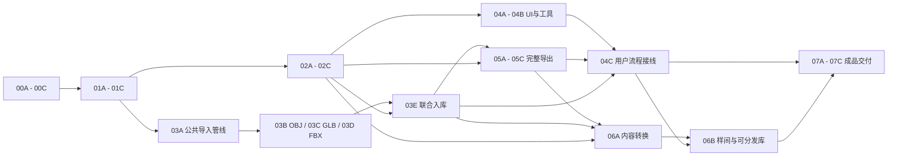

# visual-room-composer 分批部署指引

版本：0.2。日期：2026-11-03（Asia/Shanghai）。状态：已进入分批实施；实际完成状态和证据以[批次总览](batch_logs/部署状态总览.md)为准。

本文将[实施规划](D:/DevOpus/visual-room-composer/Assets/Docs/visual-room-composer实施规划.md)的 VRC-00—VRC-07 细化为 **8 个主批次、25 个子批次**。用于后续逐批施工、验证和交接，不表示本轮已经执行其中的命令、代码迁移或构建。

## 1. 使用方式与固定边界

实施规划负责产品范围、数据与格式合同；本文负责执行顺序、文件责任、进入条件、验证证据和失败恢复。执行时先读主规划相关章节，再按本文当前子批次施工。新增决定同时更新两份文档受影响的依赖、交付和验收；不以批次日志中的一句备注替代正式合同。

本指引依据主规划 0.1，读取时 SHA256 为 `7ea27366b6865ea71a00adadcf92538f5b9988acfffe485c5d9ab669aeee30a1`。若后续正文改变，记录差异并更新本指引对应章节，不强行要求文档永远保持此摘要。

| 已确认事项 | 执行约束 |
| --- | --- |
| Windows 独立程序 | 最终功能必须在没有 Unity Editor 作为运行依赖的 Windows x64 Player 中完成 |
| Unity 7000.0.0a12 | 源项目保持6000.3.24f1；不升级旧工程，不自行替换目标引擎版本 |
| UI Toolkit | 采用新项目主题及 apple-hig；用户已确认将营销网页风格适配成中央3D视口和工具面板 |
| FBX / GLB / OBJ 运行时导入 | 三种格式缺一不可；解析器中途完成不是完整导入服务完成 |
| FBX 运行时导出 | 属于新增核心功能；不得以SDD包、JSON、截图或其他模型格式替代 |
| 自行实现格式层 | 不复制TriLib实现或附带插件，不把模型SDK、外部转码进程作为隐含生产依赖 |
| 记录边界 | 本文是执行指引；所有功能批次状态须由批次日志、实际代码与验证证明 |

单层多房间、0.25米网格、四向放置、墙实例正比例缩放、FBX7400/7500输入与7400 Binary输出、预算和性能阈值，承接主规划的**工程建议**作为起始方案，不改称用户逐项确认。探针收敛参数可以在已授权实施范围内处理；改变三格式导入、FBX输出或平台等明确需求时才需重新取得用户决定。

## 2. 工作目录、保护范围与基线

### 2.1 路径及责任

| 路径 | 用途与允许操作 |
| --- | --- |
| `D:/DevOpus/ShoppingDash` | 只读源码、文档和历史验证来源；不修改、不签入，不复制整个项目 |
| `D:/DevOpus/ShoppingDash Assets` | 只读模型/工程来源；转换生成新副本，不覆盖源模型、贴图或固定Profile版本 |
| `D:/DevOpus/visual-room-composer` | 唯一产品施工工程；保留已有用户变更、版本设置和文件身份 |
| `Assets/VisualRoomComposer/` | 拟新增的产品源码、UI、场景及小型自动测试夹具根 |
| `Assets/Docs/batch_logs/` | 拟用于部署日志；每个实际施工子批次结束后记录 |
| `Validation/<子批次>/<运行标识>/` | 拟用于编译/测试/Player/互操作/性能原始证据，位于目标项目根下、Assets外 |
| `Tools/VRC/` | 拟用于验证与构建入口，不放进Player运行程序集 |
| `Builds/VRC/Windows/<候选标识>/` | 拟用于不可覆盖的Windows候选目录，位于目标项目根下、Assets外 |

上表中的拟新增目录和脚本不是现成工具。根据实际部署需要创建，不为写指引提前生成空工程或占位代码。原始日志、较大模型和成品留在 Assets 外；只有运行测试确需导入的夹具才进入测试资产目录。

禁止批量撤销继承变更、重置Git、写Plastic工作区、覆盖旧发布包或删除源资产。恢复只处理本批清单内且确认没有用户后续修改的文件；文件操作前核对最终绝对路径。继续遵守源码XML文档注释、方法体内普通单行注释、序列化文本不使用Emoji的纪律。

### 2.2 每批开始前的只读检查

1. 读取当前实施规划、本指引、上一子批日志、未关闭问题和当前版本锁。
2. 比对目标Git状态、拟修改文件及源文件摘要，区分继承变更和本批变更。
3. 发现运行中的Unity实例，核对项目根和版本，不复用旧端口/进程号假设；确认没有另一个任务正在操作目标Unity。
4. 核对目标manifest/lock、平台、脚本后端、场景、播放/编译状态；记录已有错误和警告，不能清空后宣称原本无错误。
5. 为本批确定可写文件、验收用例和证据目录；有未满足的依赖门槛时，不开始依赖该结果的工作。

以下命令仅为已知的只读入口示例，执行部署时再运行：

```powershell
$targetProject = 'D:\DevOpus\visual-room-composer'
Set-Location -LiteralPath $targetProject
unity pipeline list
unity status --json
git -C $targetProject status --short
Get-Content -LiteralPath (Join-Path $targetProject 'ProjectSettings\ProjectVersion.txt')
Get-Content -LiteralPath (Join-Path $targetProject 'Packages\manifest.json')
```

实际编译、测试、构建命令先读取本机CLI帮助或Pipeline命令目录，选定明确项目后写入批次证据。不要猜测参数，不使用不存在的 `unity --project` 全局选项，不同时用两条工具通道发起同一Unity任务。CLI故障可使用已验证的MCP能力恢复，保持目标项目核对。

### 2.3 指引编制时的只读复核结果

初始编制时，目标磁盘版本为7000.0.0a12，manifest为URP17.7.0、Input System7.0.0、Pipeline0.9.1-exp.1；主规划和Apple样式文件与上一轮摘要一致。该次文档编制没有运行Unity、测试或构建；后续实施现场另留基线，旧端口、ready状态和历史测试数字不作为后续运行证明。

## 3. 批次依赖与并行方式

### 3.1 主批次映射

| 主批次 | 子批次 | 最终门槛 |
| --- | --- | --- |
| VRC-00 基线与合同 | 00A 基线；00B 合同；00C 夹具与验证设计 | 输入、接口、格式子集和证据规则可以直接交给实施人员 |
| VRC-01 可行性 | 01A 引擎壳；01B 中间模型；01C FBX探针 | 目标Player、复杂变换、FBX读写及双消费者形成小型闭环 |
| VRC-02 编辑内核 | 02A 文档/历史；02B 编辑/视口；02C 存储/库 | 程序网格构件可以搭建、撤销、保存重开，库版本不串改 |
| VRC-03 生产导入 | 03A 公共管线；03B OBJ；03C GLB；03D FBX；03E 联合入库 | 三格式目标子集、失败取消和真实入库事务全部通过 |
| VRC-04 桌面工作区 | 04A 样式/布局；04B 工具交互；04C 用户流程接线 | 最终UI能够执行真实导入、编辑、存储与导出流程 |
| VRC-05 完整导出 | 05A 快照/范围；05B FBX/贴图；05C 发布事务/互操作 | 三种范围及完整产物集通过两种独立消费者读取 |
| VRC-06 内容转换 | 06A SDD单向适配；06B 样间与可分发库 | 原内容不变，转换报告可追溯，样间能导出 |
| VRC-07 联合交付 | 07A 回归/性能；07B 正式候选；07C 成品验收/交接 | 实际候选完整闭环、输入视觉与发布证据齐全 |

**编号表达职责，不要求所有子批次按数字串行。** 04C必须等待05C；05A—05C依赖服务与数据，不依赖完整04C，避免UI与导出互相等待。



单人实施的推荐顺序：00 → 01 → 02 → 03 → 04A/04B → 05 → 04C → 06 → 07。并行时，02与03A—03D可在01门槛后分别推进，04A/04B可在02完成后与03并行；03E必须使用02C的真实库事务，不能用模拟提交冒充入库完成。

协调者统一持有场景、ProjectSettings、manifest/lock、公共接口和最终验证入口。代理智能体按互不重叠的模块工作，如OBJ、GLB、FBX；公共IR/错误/预算接口变更由协调者合并，再通知消费者更新。Unity导入、编译、PlayMode、构建和最终门槛串行执行；纯数据测试可在隔离输出目录中并行。不要要求每个代理智能体自行安装依赖或修改同一UXML。

## 4. 所有子批次共用的完成规则

每个子批次均执行“核对输入 → 最小实现 → 静态/编译检查 → 对应自动验证 → 需要的Player或外部验证 → 记录与交接”。测试失败先保留证据、定位并修复普通故障；不因一次编译、Pipeline或测试启动失败就停止整个计划。

| 状态 | 使用条件 |
| --- | --- |
| 未开始 | 尚未进入实施；已有规划或旧代码不算部署完成 |
| 实施中 | 已产生本批变更，尚有必需功能或验证未完成 |
| 待验证 | 本批实现齐备，但必需证据未取得或仍在运行 |
| 通过 | 本批所有必需项在记录的输入版本上通过，无未解释的阻断错误 |
| 受阻 | 存在明确外部条件或不可恢复问题，注明受影响依赖；不阻止无关分支继续 |
| 已被后续批次替代 | 保留原证据并指向替代批次；不能删除失败记录或改写历史结果 |

主批次只有全部所属子批次通过才可标“通过”。局部编译通过、文件已生成、进度100%、退出码0或旧项目历史通过，均不能独立证明该批完成。

每批结束核对代码/资产差异、版本与包锁、源文件摘要、临时文件和后台任务；退出本批启动的PlayMode及验证进程，恢复记录中的用户编辑场景与工作状态。保留用户未保存内容，不擅自保存、关闭或重置。已经通过的检查不无理由反复运行；新变更或未解决风险影响哪个范围，就重验哪个范围。

## 5. VRC-00：基线、合同与验证输入

对应主规划第1—5、9—13节。本批交付设计和验证输入；已有全文阅读记录可以复用，只对变化和本批所需源码补读。

### 00A 基线与提取清单

**进入条件：** 两份规划及已确认问答可读，目标/源目录身份已核对。

1. 建立源/目标文件清单、初始hash、Git状态、版本/包锁、已有Unity状态记录；标记用户已有变更。
2. 将旧代码分为提取、重写、仅参考、剔除，按主规划第4节追踪实际依赖；包含旧SDD之外的Content/Contracts/Persistence。
3. 记录独立运行程序集的允许引用及禁止生产依赖；Editor工具另列。
4. 建立素材与通用库来源表，先选原创小夹具，未明权利的商业素材不进入默认发行库。

**交付：** baseline记录、逐文件提取表、依赖方向图、来源表。**通过：** 每个待提取模块有目标责任和依赖处理方式；没有“先复制整个游戏再删除”的未界定步骤。交接给00B/00C。

### 00B 数据、接口和错误合同

**依赖：** 00A。

1. 定义RoomDocument、Room/Group、Placement、LibraryDefinition、固定依赖和完整ModelScene的字段、身份、单位、版本及所有权。
2. 固定纯Reader→ModelScene→UnityRealizer的边界，以及导入确认、资源租约、快照导出、文件对话框接口；不让Formats引用UnityEngine。
3. 写明组树无环、组无额外变换、共享墙去重、宿主附件、隐藏与参与导出、工程原点；工程/库各自的历史、dirty/savepoint必须独立。
4. 将主规划格式矩阵转成“已承诺目标、实现状态、拒绝原因、对应夹具”表。未实现项初始为未实现，不能先填支持。
5. 定义诊断阶段、错误码、可恢复策略及资源上限配置；源schema、工程版本、导入器版本、缓存版本分开管理。

**交付：** schema/接口草案、格式能力表、错误与生命周期表。**通过：** 导入器、编辑器、UI和writer可依同一合同独立实现；无循环引用，未解决问题已绑定后续探针。交接给01。

### 00C 原创夹具与验证设计

**依赖：** 00B；素材来源准备可与00B并行。

1. 按第14节建立小型金样索引：来源、生成方法、字节摘要、单位、已知关键点/材质/UV及预期结果。
2. 准备独立创建的非对称模型、带洞墙、分离UV索引、镜像/非均匀缩放、两个材质与中文依赖路径；不能只用自写writer生成所有正样本。
3. 设计截断、越界、错误引用和超预算样本及隔离运行规则；异常输入仅作用于测试复制目录。
4. 确定Blender与Unity原生导入路径的版本/选项记录方式，设计结构比较报告，归档主规划引用中尚未完整获取的格式依据。

**交付：** fixture索引和预期数据、验证清单、证据目录约定。**通过：** 样例有独立预期值，能证明单位/轴/变换错误，而不只是“文件存在”。本批不报运行通过数。

## 6. VRC-01：引擎和FBX可行性

这是扩大迁移前的技术门槛。最小探针通过只证明所测路径，不代表03的完整格式子集已经实现。

### 01A Windows应用壳与引擎接口

**依赖：** 00A—00C。

1. 在新目录建立最小asmdef和独立启动场景，使用PanelRenderer、PanelSettings、UXML/USS；保留用户SampleScene及原设置。
2. 验证目标Input System、字体/TextSettings、中英文、RenderTexture、拾取坐标与简单聚焦/取消；检查事件是否被重复消费。
3. 实现最小Windows文件选择适配：打开、保存、取消、中文/空格路径、所有者窗口和线程边界；Player不调用UnityEditor文件框。
4. 验证当前安装支持的Windows x64后端、后台Task、JSON、压缩/解压、Unity主线程装配及释放；记录实际后端和依赖版本。
5. 生成独立Development探针Player，在Assets外隔离目录正常启动、执行并退出；不套用旧HybridCLR/YooAsset构建链。

**通过：** ENV用例取得编译、实际Player和输入/文件证据；UI对象和资源能够释放，Player没有Editor API依赖。**交付：** 引擎壳、文件接口、构建/验证入口的首版、backend记录。若后端或UI API失败，先解决兼容性，不迁完整Shell来掩盖问题。

### 01B 中间模型、坐标和共享变换

**依赖：** 01A；纯数据实现可在00B稳定后提前开发，最终门槛仍需01A的Player。

1. 实现中立ModelScene、显式单位/轴转换、完整仿射矩阵、顶点属性和材质/纹理引用。
2. 用程序网格验证源层级、meshTransform、实例比例、pivotOffset、贴地偏移与世界矩阵组合；将计算集中到共享服务。
3. UnityRealizer遇到剪切或复杂继承不能仅做有损TRS分解，明确烘焙/中间节点策略及已处理标记。
4. 验证镜像绕序、法线逆转置、切线handedness、奇异矩阵拒绝和多实例共享资源。

**通过：** XFORM金样在CPU预期、Player预览几何与可供导出的数据间一致；读/写两端不重复换轴或缩放。**交付：** IR v1、变换/几何服务、租约骨架和金样报告；接口变更由协调者统一通知后续批次。

### 01C FBX读取与二进制输出探针

**依赖：** 01B及00C的独立样例。

1. 打通7400/7500的ASCII/Binary最小静态读取路径，验证record边界、数组位宽、压缩/未压缩和对象连接。
2. 至少使用带层级、多材质、纹理、pivot及非均匀缩放/继承的代表样例，不用单个三角形写盘代替复杂变换可行性。
3. 在探针Player中读取、规范化、显示、取消/释放；分别记录几何与材质完成阶段。
4. 实现7400 Binary最小writer，写出所需头、对象、连接、offset及结束结构，使用显式轴/单位。
5. 将Player输出连同贴图复制到独立目录，由Blender和Unity原生FBX导入路径分别读入，对照尺寸、关键点、法线、UV、材质和层级。

**通过：** 两种消费者均取得可追踪结果，复杂静态变换和实际后端压缩路径可行。**交付：** 可行性报告、原始FBX/贴图、双消费者结果及尚未实现的能力表；将探针结论同步回00B合同并冻结IR、变换、资源所有权和实际后端基线，再交给后续分支。任一消费者不可用则该门槛待验证；可继续不依赖互操作结论的纯数据工作，不把自写reader回读当替代。

## 7. VRC-02：编辑内核与持久化

使用程序网格构件推进，不等待全部解析器。迁入前阅读对应源文件和测试体，提取机制后更换DTO及命名空间。

### 02A 文档、命令和独立历史

**依赖：** 01全部通过，00B合同与01B实测差异已同步。

1. 建立RoomSession与RoomDocument；提取稳定ID差量、原子命令、压缩检查点和历史跳转。
2. 分别建立工程与库草稿时间线，合并计入会话预算；实现保存标记、分支截断、无变化不入历史、超预算执行前拒绝。
3. 添加房间/组身份和成员操作，拒绝环/悬空引用；共享结构只指向同一placementId，不复制墙几何。
4. 取消后台跳转或收到旧revision结果时保持当前文档；事件仅发布已提交事实。

**通过：** EDIT/HISTORY用例覆盖失败回滚、独立撤销目标、共享预算、保存标记及组关系。**交付：** 纯编辑内核与有意义的移植测试，不依赖VGE、库存或游戏入口。

### 02B 房间工具与增量视口

**依赖：** 02A。

1. 提取地板mask、墙拓扑/洞口、占位、支撑、附件和空间索引；按草稿诊断与阻断错误分级。
2. 实现笔刷插值/去重、墙边吸附、矩形填充/清除、多选移动、四向中心旋转、墙XYZ正比例缩放；一次手势只提交一次命令。
3. 保留Prop贴地、悬挂投影、墙饰宿主及结构Y=0规则；允许保存语义无效草稿，不引入游戏可通关要求。
4. 提取Camera/RenderTexture与增量实例工厂，暂存实例准备完成后一次显示，取消回收；把旧硬编码层号和背景改为目标配置。
5. 使用程序网格验证两间房、共享墙、带门洞隔墙、悬挂物和附件；四次旋转后不产生位置漂移。

**通过：** EDIT/GEOM/XFORM用例通过，Player中可以操作并取消，场景更新不逐帧复制整份文档。**交付：** 编辑服务、视口和程序构件样间；完整Apple样式在04完成。

### 02C 工程保存、库事务与恢复

**依赖：** 02A；完整验收使用02B样间。

1. 实现新schema的有界JSON、固定依赖、同目录临时写入/回读/预期hash检查/原子替换。
2. 实现不可变库版本、复制/链接模式、多本地仓库、显式重定位与升级；移除仓库登记不删除文件。
3. 导入登记/引用提交只对完整候选生效；库发布与工程引用升级是独立事务，后者可撤销。
4. 实现当前与上一代恢复副本、dirty不被恢复写入清除、独立产品用户目录；不访问旧SDD档案。
5. 测试保存失败、外部修改、缺依赖、跨仓库同版本异hash和正常关闭重启；记录上一成功版本仍可读。

**通过：** STORE/LIB/HISTORY用例通过，退出重开恢复样间和固定版本；恢复不是完整历史持久化。**交付：** 可供03E调用的真实入库事务、可供04使用的保存/恢复服务。

## 8. VRC-03：三格式生产导入

03B/03C/03D可并行，但共用03A与IR合同；完整能力以主规划第6节为准。每个格式的扩展、版本和退化行为都要映射到用例，不能只实现“最常见三角网格”后关批。

### 03A 公共输入、资源与诊断管线

**依赖：** 01全部通过；不依赖完整02或04。

1. 实现格式探测、有界reader、统一resolver、固定文件快照/hash、路径根与符号链接校验。
2. 实现checked长度计算、解压/几何/纹理解码总预算、纹理预检、软超时和分批取消检查；超时后后台不能继续无界分配。
3. 将Parse/Normalize/Validate/Decode/Realize的进度、诊断和唯一终态统一，带文档/任务代次。
4. 实现共享CPU缓存与Unity租约、主线程分帧realize、材质色彩空间/通道和依赖登记；失败候选不写入正式库。

**通过：** INPUT/LIFE/XFORM公共用例通过。**交付：** 三格式共用实现和冻结的测试入口；可使用模拟库验证接口，不能因此标记03E通过。

### 03B OBJ / MTL

**依赖：** 03A。

实施 `v/vt/vn/f` 四种索引组合、负索引、独立属性拆分、对象/组/平滑、多材质、简单凹多边形三角化、相对MTL/贴图与声明的map参数。单位和上轴作为显式选项保存；错误面、自由曲线、缺依赖和不支持材质有明确诊断。

**通过：** OBJ全部目标行、INPUT异常和LIFE取消/释放用例通过，真实Player中的多材质/纹理与几何完成。**交付：** OBJ实现、样例及能力表；不得仅报告纯解析测试。

### 03C GLB 2.0

**依赖：** 03A，可与03B/03D并行。

实施header/chunk及对齐、buffer/accessor偏移/stride/normalized/sparse、索引与非索引、triangle/strip/fan、层级TRS/matrix、UV0/UV1/法线/切线/颜色及PBR材质。支持PNG/JPEG与统一外部资源resolver；required未知扩展拒绝，optional降级列明；不能把独立`.gltf`成功当GLB完成。

**通过：** GLB目标行、INPUT/LIFE用例及Player材质/透明/双面检查通过。**交付：** GLB实现与版本化能力表，清楚列出Draco/meshopt/KTX2和动画等未支持范围。

### 03D FBX目标子集

**依赖：** 03A和01C已有可行性结果，可与03B/03C并行。

将最小探针扩至7400/7500 ASCII与Binary目标矩阵：层级/实例、Objects/Connections、默认/模板属性、完整静态变换、材质槽、UV/法线/颜色、外部与受支持的嵌入纹理。逐项覆盖控制点映射的磁盘token/别名、polygon-vertex映射、Direct/IndexToDirect、凹面和压缩数组边界。

**通过：** FBX/XFORM/INPUT/LIFE用例通过；所有声明支持的rotation order、pivot、geometric transform和InheritType有代表证据。无法求值的形式必须被拒绝并列入能力表，不能偷偷用普通TRS代替；若影响既定目标子集，记录为未完成而非关批。**交付：** 生产Reader及与探针相区分的完整报告。

### 03E 联合入库与资源回归

**依赖：** 03B、03C、03D及02C。

1. 将三格式接入真实ImportJob、隔离预览、确认提交和不可变库版本，串通复制/链接依赖。
2. 逐格式取消每个阶段，覆盖关闭窗口、切文档、过期回调、重复导入、缓存命中与父对象提前销毁。
3. 测试库提交失败、外部源替换、重定位hash不匹配、撤销逻辑引用但历史仍持有资源。
4. 在实际Player通过服务测试入口完成三格式导入→库登记→重开引用；UI流程在04C再次验收。

**通过：** 三格式全部目标均有证据，入库只有完整终态，资源与文件锁无未解释残留。**交付：** 可供05/04C使用的生产导入服务。本批缺任何一种格式都不得标为完成。

## 9. VRC-04：Apple风格桌面工作区

继续采用[apple-design-docs.md](D:/DevOpus/visual-room-composer/Assets/Docs/apple-design-docs.md)及[apple-hig技能](C:/Users/25730/.codex/skills/HIGAgentSkills-main/SKILL.md)，执行主规划第8节已经明确的Windows适配。不要从旧暖纸色USS继续派生目标视觉，也不新增本轮未要求的Apple平台支持。

### 04A 主题与布局

**依赖：** 02全部通过；可与03并行，先用程序构件。

实现顶部菜单/工程状态、窄工具栏、中央视口、右侧独立滚动面板、底部可折叠库和历史显示。将来源颜色、圆角、字体/图标、间距转成目标USS与资源；单一蓝色主操作为“导出FBX”。验证无阴影、可读实色面板和合理工具密度，不依赖未经验证的浏览器CSS。

**通过：** UI-LAYOUT用例在小/大窗口及缩放下无关键裁切，主题与字体资源在Player实际生效。**交付：** UXML/USS、PanelSettings/字体资源、局部状态截图；静态布局通过不算用户流程通过。

### 04B 工具、焦点与双语

**依赖：** 04A及02B/02C。

接入选择/笔刷/移动/旋转/选区、房间/组/属性/库草稿、诊断定位、撤销与保存。实现手势状态、文本/IME/原生对话框/模态输入阻断、失焦取消及快捷键冲突检查。文本框撤销、工程撤销、库撤销各有明确目标；Ctrl+D按新工具复制行为处理，文档提示与实际绑定一致。内置文案中英切换，用户模型名不作为本地化键。

**通过：** UI-INPUT、HISTORY和STORE交互组合通过；真实键鼠/中文IME证据独立记录，不能用注入事件代替人工输入结论。**交付：** 可操作的程序构件工作区及输入回归证据。

### 04C 真实用户流程接线

**依赖：** 04B、03E、05C；本子批在05之后完成。

接入三格式导入向导、材质/缺依赖诊断、取消/重试、入库确认、重定位、库版本升级、未保存关闭、恢复副本、三范围导出、损失预检与打开输出目录。所有按钮调用生产服务，不保留假成功状态或仅测试入口。

**通过：** 用户从空工程经可见UI完成导入→搭建→保存重启→导出；错误状态有修复路径，取消不丢工程，导出不清dirty。**交付：** 完整UI流程证据和本地化/操作说明初稿。此前只可标04A/04B通过，不能提前宣布VRC-04完成。

## 10. VRC-05：完整FBX导出与发布事务

服务验证可使用开发期测试入口，不等待04C。最终可见UI接入仍由04C和07C验证。

### 05A 固定快照与导出集合

**依赖：** 02、03E及01C。

1. 冻结工程revision、依赖hash和ModelScene，建立导出计划；快照持有固定资源租约及变换规则版本直到结束，不能只固定JSON后读取已变化模型。排除编辑辅助和未完成候选实例。
2. 实现全工程、当前房间、选中组/实例三种范围，按placementId去重，共享墙只输出一次。
3. 纳入宿主附件与必要空父节点，不带未选兄弟网格；单独附件提示上下文缺失。默认保留工程原点，作者隐藏不等于排除导出。
4. 应用共享PlacementTransformResolver；无法无损TRS表示时按统一策略烘焙。对缺网格、非法索引/矩阵和不可解析依赖提前拒绝。

**通过：** EXPORT-SCOPE/XFORM用例得到精确对象集合和世界坐标，导出期间编辑不混入已冻结快照。**交付：** ExportSceneData/计划与预检报告。

### 05B FBX、材质与贴图集合

**依赖：** 05A。

完善7400 Binary writer、唯一稳定对象ID、层级、实例/几何复用、三角形、法线、UV0/UV1、材质槽、轴/单位和相对纹理引用。处理贴图同名冲突；顶点色/切线或无法映射的PBR特征明确输出或列入预检损失。灯光/阴影/后处理不承诺保真，纯灯光作品不伪报有效几何导出。

**通过：** EXPORT-DATA用例中结构和属性与快照一致，writer没有offset溢出或引用断链；产物不引用源机器绝对路径。**交付：** FBX、textures、材质伴随元数据和export-report；文件存在不能代替05C互操作。

### 05C 原子发布、取消与双消费者

**依赖：** 05B。

1. 在目标父目录下独立暂存整个产物集，全部完成/校验后再发布；覆盖时检查入口hash并保留旧成功版本。明确提交点：取消在提交前生效，提交后按已提交终态报告；不出现新产物已发布而UI显示未提交取消的矛盾。
2. 注入写FBX、写纹理、写报告、发布前及发布阶段失败；验证锁文件、磁盘不足、权限拒绝、取消、外部修改与跨卷处理，不用破坏用户文件来测。
3. 将输出复制到不含原始源/缓存的独立目录，以两种独立消费者检查三范围、层级/关键点/法线/UV/槽位及贴图。
4. 在同一Player中检查导出成功/失败均不改变工程dirty或保存点；确认未启动隐式转码进程。

**通过：** EXPORT-TXN/INTEROP全部要求完成，旧成功集合可保留，输出可搬迁。**交付：** 完整产物、消费者版本/选项/报告、失败原始日志；交接04C与06。无法取得消费者证据时保持待验证。

## 11. VRC-06：旧内容转换与样间

### 06A SDD单向适配

**依赖：** 02、03E、05C。

1. 按format/schema识别`.sddnode.json`及工程内NodeContent，兼顾实际`.sddproject.json`和旧文档`.sdd.json`命名。
2. 解析指定内容的固定Profile、网格/纹理依赖与源单位；缺依赖可定位，不能自动升级版本或修改源工程补齐。
3. 转为新RoomDocument副本；Shelf/SearchContainer变静态Prop，报告丢弃的库存、导航、预算和游戏锚点，默认不生成旧运行商品陈列。
4. 记录源路径/ID/schema/hash、转换参数和输出ID映射；用与真实结构相同的自有测试内容先验转换器。

**通过：** MIGRATE/GEOM/STORE验证通过，源文件转换前后摘要一致，输出只依赖新产品合同。**交付：** 独立适配器、转换报告与对照样例，不引回ShoppingDash运行程序集。

### 06B 原创样间与可分发构件

**依赖：** 06A、04C；原创素材和样间数据可提前准备，完整用户流程验收必须等04C。

构建至少一个覆盖双房间、共享墙、门洞、墙附件、悬挂构件、多材质和中英文命名的样间，使用已核实权利的素材；准备三格式导入来源与可搬迁工程/库。逐资产记录是否能随工具分发和允许模型导出；权利不明素材留在源项目，使用原创替代，不阻塞通用功能实现。

**通过：** 以用户流程搭建/保存/重开/导出，结构与材质可追溯，资源不静默改变固定版本，无第三方来源遗漏。**交付：** 样间、构件清单、署名/许可材料和导出样例；不得把全部游戏模型自动打包成默认库。

## 12. VRC-07：联合回归和Windows交付

### 07A 联合回归、规模与资源

**依赖：** VRC-00—06全部所属子批次通过。

1. 在冻结的代码/资源输入上运行当前完整EditMode/PlayMode及格式、文件和UI回归；保留完整XML与失败重跑过程。
2. 用真实Development Player建立1000/5000实例、共享/不共享几何、复杂模型和大纹理样本的性能基线。
3. 至少100轮导入/预览/释放，并覆盖反复开关工程、取消、库升级与历史淘汰；记录托管、Unity原生、GPU估算、对象计数及退出诊断。
4. 逐项核查主规划的建议门槛：1080p交互60FPS、P95≤16.67ms/P99≤33.3ms、点击反馈≤50ms、小型米制金样位置误差≤1e-4m/法线≤0.1°。如调整工程参数，先说明原因并同步合同，不能测后降低标准冒充原目标通过。

**通过：** 本批范围无未解释的正确性/资源阻断项，性能结论绑定机器、版本与数据规模。最低硬件未定单列，开发机通过不冒充最低配置通过。**交付：** 联合报告、性能原始数据、已解决/剩余问题及候选输入清单。

### 07B 非Development候选

**依赖：** 07A。

1. 固定经过探针验证的Windows x64后端、版本、包锁、shader和字体/纹理依赖，记录最终源码/资源摘要。
2. 关闭Development、脚本调试和自动Profiler连接，开启Player Log；裁剪诊断入口与测试资产，保留正常错误报告。
3. 构建到新的候选目录，记录Player版本/后端、构建日志、文件清单/hash、包与许可清单。
4. 审计运行依赖：无ShoppingDash程序集、TriLib、模型SDK、UnityEditor或外部转换工具；不读取开发机源仓库和旧SDD用户目录。

**通过：** 实际候选构建成功且依赖/输入一致；这只表示候选生成完成，不代表成品验收完成。**交付：** 不可覆盖的候选、输入清单和candidate manifest。

### 07C 成品全流程与交接

**依赖：** 07B，使用该候选本身，不以Development Player替代。

1. 在新建隔离用户数据目录中，分别导入FBX、GLB、OBJ并入库；通过UI完成搭建、共享墙/附件操作、撤销/重做、保存、正常退出与重启。
2. 从候选导出全工程/房间/选中范围的FBX，移出源/缓存目录后再由Blender和Unity两条独立路径读取；报告绑定候选hash。
3. 复核中文IME、键鼠、文件对话框、窗口尺寸/DPI/文字放大、焦点与错误恢复；自动注入和人工观察分别记证据。
4. 在候选上完成代表性能/资源复核；排除开发诊断开关或裁剪改变造成的功能、shader、字体、解析差异。
5. 最后一次对照输入摘要、已知问题、日志、用户说明与许可证据；恢复目标编辑器状态，列出待用户自行签入的文件分类。

**通过：** 当前候选的三输入→保存重启→FBX→双消费者闭环完整，所有必需人工/设备验证已完成，没有用静态审计替代必需运行验收。仍有必需项待验时，本子批及VRC-07保持待验证，不能以记录了缺口为由标为通过。**交付：** 候选路径、操作说明、最终验证矩阵、剩余边界和变更清单。正式代码签名、在线发布或商店上传不属于当前交付，不伪称已发行。

## 13. 验证运行器与证据组织

### 13.1 在01建立真实入口

建议在 `Tools/VRC/` 建立可重复的验证入口，由协调者维护。入口名字与参数在实施时固定，本文不假定某个脚本已经存在。至少支持明确目标项目、子批次/用例筛选、输出目录、实际后端和候选身份，能够等待异步任务的最终结果并返回可解释的退出码。

先核对test-framework及相容测试适配器是否存在；需要引入时只增加本批必要开发依赖、锁版本并记录理由。运行器不能因为返回了job ID、`0/0`或`Total=0`就写成功：持续查询到明确完成，保存完整XML，确认期望集合不是零项且未被意外筛掉。失败和取消分别记录。

测试级别由本批职责决定：纯Reader/历史规则先跑纯数据或EditMode；Unity生命周期/事件跑PlayMode；运行时格式、文件接口、裁剪和真实UI要跑Windows Player；导出兼容要跑独立消费者。一个小变更通过对应检查后，不无理由重跑整套重型矩阵；最终联合门槛必须使用冻结输入重新执行。

### 13.2 每次运行的证据结构

```text
Validation/<子批次>/<运行标识>/
  baseline.json
  changes.json
  commands.txt
  compile.log
  tests/editmode.xml
  tests/playmode.xml
  player/<case-id>/Player.log
  player/<case-id>/result.json
  interop/<consumer>/<case-id>/result.json
  reports/format-capabilities.json
  reports/resources.json
  captures/
  artifacts/
  summary.json
```

仅创建本批实际产生的项目，不用空文件充数。运行标识采用唯一时间戳或随机ID；前次失败不覆盖。摘要至少记录批次、源/候选hash、引擎/包/后端、机器、fixture hash、用例ID、开始/结束、实际命令、结果与证据路径。

`summary.json` 中逐项结果使用 Passed、Failed、NotRun、Blocked、Skipped、NotApplicable，并注明原因；预期拒绝用例“按合同拒绝并无副作用”才是Passed。对阻断输入的正确拒绝不代表该格式正常模型导入已实现。必需项NotRun/Blocked/Skipped均阻止相关门槛通过，填写跳过理由不豁免门槛；只有正式合同已经界定为本次不适用的项，才可记NotApplicable并引用依据。

## 14. 可追踪用例矩阵

以下ID是用例族，不是已执行测试数量；每族在实现时展开为稳定子ID，覆盖主规划对应能力行。扩展后保留ID历史，不用更名隐藏失败。

| 用例族 | 必查内容 | 首次/最终责任批次 | 必需证据层 |
| --- | --- | --- | --- |
| ENV | 引擎/后端/字体/PanelRenderer、原生文件框、Task/压缩、正常退出 | 01A / 07C | 编译、Player、必要人工观察 |
| XFORM | 单位/轴、pivot/贴地/源层级、剪切、非均匀比例、镜像、法线/绕序 | 01B/01C / 03D/05C/07C | 独立预期数据、Player、外部消费者 |
| EDIT | 网格/墙吸附、笔刷插值、矩形、多选、四转、共享墙、附件 | 02B / 04C/07C | EditMode、PlayMode、Player |
| HISTORY | 原子回滚、独立时间线、预算、分支、跳转取消、dirty/savepoint | 02A / 04B/07C | 自动规则测试、真实交互 |
| GEOM | floor mask、凹面、门洞、T/十字、支撑、结构与草稿诊断 | 02B / 06B/07C | 几何数据与视口对照 |
| STORE | 原子保存/恢复、外部改写、锁/磁盘失败、退出重开 | 02C / 07C | 隔离故障注入、Player |
| LIB | 不可变版本、复制/链接、重定位、多仓库、显式升级撤销 | 02C / 03E/04C | 数据与文件摘要、Player |
| INPUT | 伪后缀、截断/越界、压缩炸弹、路径逃逸、缺依赖、预算 | 03A / 03B—03E | 有界读取测试及负例副作用检查 |
| LIFE | 各阶段取消、超时停止、换文档迟到、重复缓存、租约/锁释放 | 01A / 03E/07A/07C | PlayMode、Player、资源计数 |
| OBJ | 索引组合/负索引、UV接缝/平滑组、凹面、多MTL、路径/单位 | 03B / 07C | Reader、Player、FBX导出后互操作 |
| GLB | chunk/offset/stride/sparse/normalized、拓扑、PBR、required扩展 | 03C / 07C | Reader、Player、FBX导出后互操作 |
| FBX | 7400/7500 ASCII/Binary、压缩、连接、layer/模板/变换/材质 | 01C / 03D/07C | Reader、Player、独立来源夹具 |
| UI-LAYOUT | 小/大窗口、DPI、200%文字、滚动/折叠、主题/对比和双语 | 04A / 07C | 动态截图及人工视觉检查 |
| UI-INPUT | IME、焦点、文本撤销、模态/文件框、失焦取消、不穿透 | 04B / 07C | 自动事件与真实键鼠/IME分别留证 |
| EXPORT-SCOPE | 三范围、组展开、共享墙、附件/父级、隐藏/排除、原点 | 05A / 07C | 精确集合与世界坐标对照 |
| EXPORT-DATA | FBX层级/实例、UV/法线/材质、贴图、颜色/切线损失报告 | 05B / 07C | 文件结构、Player输出、人工材质对照 |
| EXPORT-TXN | 各写出/发布阶段失败、取消、hash冲突、旧产物/dirty不变 | 05C / 07C | 隔离故障注入和磁盘摘要 |
| INTEROP | 输出迁出源路径，Blender和Unity分别读取，固定版本/选项 | 01C / 05C/07C | 两套独立消费者报告，不能只自写回读 |
| MIGRATE | schema识别、源hash不变、固定依赖、游戏字段移除和ID映射 | 06A / 06B/07C | 转换前后对照、Player |
| PERF | 1000/5000实例、共享/非共享、帧分位、停顿、100轮释放 | 07A / 07C | 实际机器与候选数据、资源原始记录 |
| RELEASE | 非Development、PlayerLog、依赖/来源清单、候选输入一致 | 07B / 07C | 构建/成品审计与候选运行 |

首版FBX互操作矩阵至少区分输入格式、文件版本/编码、压缩状态、变换案例和输出范围；不是所有笛卡尔组合都强制穷举，但每项承诺能力和高风险组合必须有明确样例。模型数量、材质槽和关键点采用可解释的预期值；不同渲染器的材质对照不要求像素完全一致。

## 15. 失败处理、恢复与接续

| 情况 | 处理方式 | 对后续批次的影响 |
| --- | --- | --- |
| 编译/测试/普通Pipeline错误 | 保留日志，修复本批错误或重连正确实例后重试 | 相关门槛不通过；不必反复请求用户确认普通修复 |
| 运行中仅返回job/零计数 | 等待并查询最终状态，保留运行ID | 未完成前不发第二个相同任务，不宣布通过 |
| 引擎/实例/包版本不一致 | 停止向该实例写入，查明配置/连接差异 | 依赖该环境的工作等待；纯文档/离线分析可继续 |
| Reader不支持既定目标能力 | 诊断并补实现/金样，保留失败 | 不把该能力移到“以后”来完成03；确需改需求时明确提出 |
| 预算/取消失败导致持续分配 | 隔离复现、修复有界循环与资源所有权 | 暂停相关大输入测试，保护当前编辑会话 |
| 用户文件或源资源hash改变 | 保留两份状态，停止覆盖，重新建立前态 | 不使用全仓reset；无冲突模块可继续 |
| 文件发布中断 | 先核对入口hash及候选/旧集合完整性；已提交则恢复已提交终态，未提交则保留旧入口；状态不明或外部修改时停止覆盖并留证 | 不误回滚已成功提交的结果；不清dirty伪装工程保存成功 |
| 权限拒绝、锁文件或空间不足 | 结束该事务，保留旧成功集合；在已授权可写目标、明确锁释放或空间恢复后重试 | 不自动提权、修改ACL或删除用户文件；相关发布门槛等待恢复 |
| 外部消费者/人工条件缺失 | 写NotRun/Blocked及缺失条件 | 不影响无关开发，但相关互操作/成品验收门槛不能通过 |
| 资产权利证据缺失 | 从发行清单排除该项，使用原创替代验证流程 | 不阻塞通用导入/编辑能力；不默认开放导出商业素材库 |
| 严重不可恢复故障或明确需求冲突 | 保存现场和最小复现，说明影响并请求必要决定 | 仅暂停依赖受影响结果的工作，不宣称目标已完成 |

恢复不等于删除日志或覆盖失败包。网络/聊天中断后，读取最后批次日志和summary，重新核对真实进程、文件hash和未提交任务；从最后一个证据完整的子批次接续，不根据上一条文字“即将完成”推断成功。

## 16. 批次记录与交接模板

实际部署时写入 `Assets/Docs/batch_logs/<子批次>-<主题>.md`；一次子批次可以有多个运行记录，最终日志关联全部必要证据。记录应至少包含以下内容：

```text
批次与状态：
目标及对应主规划章节：
进入条件：上游批次、summary路径、输入hash
环境：Unity/包锁/后端/目标平台/实例项目根
继承变更与本批允许修改范围：
实际完成：修改前后行为、源码/资产清单
未完成：功能与验证分别列明
合同调整：来源、理由、受影响文档及消费者
验证：用例ID、实际命令、结果、原始证据路径
失败与修复：保留失败记录，说明最后一次结果
资源与数据：源hash、固定依赖、缓存/锁/临时文件处理
现场恢复：场景、PlayMode、进程、用户未保存内容
剩余问题：是否阻断、影响批次、恢复条件
下一批：可用接口、入口、夹具与禁止假设
版本控制：仅报告变更；未代用户提交/签入
```

交接必须给出“从哪里调用、输入是什么、怎样证明结果、还有什么未实现”，不能只留“已完成基础框架”。实现文件、测试脚本、产物报告与文档描述名称一致；暂定命名如有调整，更新实际入口和链接。

## 17. 下一次部署的起点

首次部署从 **00A** 开始，复用已完成的仓库阅读与主规划清单，再形成00B合同和00C验证输入；随后先完成01的Windows/FBX可行性门槛。接续部署先读批次总览，避免从零重复已验收批次。

建议下一次执行指令直接指定范围，例如：“按分批部署指引执行VRC-00与VRC-01，普通故障自行修复，按门槛留证并更新批次记录，源项目只读，不执行SCM写操作。”这是后续任务示例，不是本轮已执行授权或结果。

本指引最初仅进行了文档一致性、子批次依赖、覆盖范围和链接检查。后续编译、Player和模型互操作的实际结果记入批次总览及原始证据，不将指引中的通过条件当作已经通过的结果。
