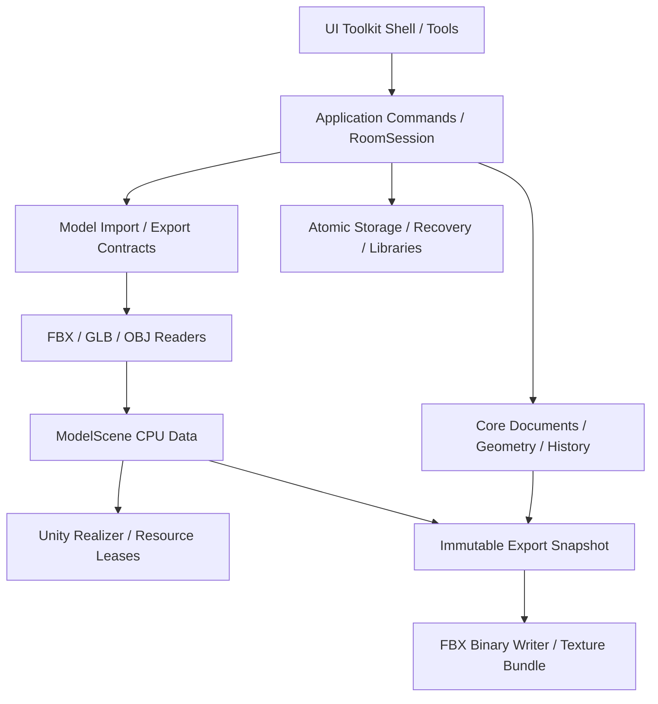

# visual-room-composer 实施规划

版本：0.1。日期：2026-11-03（Asia/Shanghai）。状态：仓库阅读与实施设计完成，尚未部署功能。

本文件规划从 ShoppingDash 实际运行的 SDD 中提取房间编辑能力，在 Unity 7000.0.0a12 项目中建设 Windows 独立程序。最终闭环为：运行时导入 FBX / GLB / OBJ，制作构件库，搭建房间，保存可继续编辑的工程，运行时导出可被外部工具读取的 FBX。

## 1. 已确认范围与本次交付

| 项目 | 决定及来源 |
| --- | --- |
| 产品名与目标目录 | `visual-room-composer`；`D:/DevOpus/visual-room-composer` |
| 交付形态 | Windows 独立程序；用户在本次问答中明确确认。Unity Editor 用于开发和验证，不能作为用户运行工具的前提 |
| 引擎 | 源项目 6000.3.24f1，目标 7000.0.0a12；不自动升级或降级目标版本 |
| UI | UI Toolkit；遵循本项目 `apple-design-docs.md`，应用 apple-hig 技能 |
| 样式解释 | 用户已确认按桌面编辑工具适配营销网页规范，保留黑底、单一蓝色主操作、圆角、字体层级，允许中央 3D 视口及工具面板 |
| 模型输入 | 自行实现运行时 FBX、GLB、OBJ 导入层；TriLib 仅作为旧实现的研究对象，不作为新工具运行依赖 |
| 模型输出 | 运行时 FBX 导出为必需能力；工程 JSON、截图、OBJ 或 GLB 输出均不能替代这项交付 |
| 当前任务 | 阅读、分析并形成实施文档。本轮没有迁移代码、安装依赖、修改场景、执行构建或测试 |

以下属于本规划的工程建议，尚不是用户逐项确认的产品承诺：静态模型优先、单层多房间、0.25 米吸附、四向放置、首版格式子集、具体预算、二进制 FBX 7.4 输出、性能阈值和程序集名称。实施探针可以修订工程参数，但不能据此取消三种导入或 FBX 导出。

## 2. 阅读覆盖与现场基线

### 2.1 全量文档阅读

主控与三个代理智能体分工全文阅读并汇总：Guidebook 下全部 **38 份 Markdown、1 份 JSON、1 份 CSS**；另完整读取配置工作簿的 4 个工作表、458 个非空单元格。工作簿借助 spreadsheets 技能进行只读解析，没有修改或重算。相邻资产目录 `ShoppingDash Assets/docs` 的三份玩法/UI/图片来源文档，以及目标 `apple-design-docs.md` 也已全文阅读。逐文件清单见附录 A。

本次不是全仓源码逐行审计。代码审计覆盖当前编辑器入口、核心数据、历史、房间编辑、预设库、三维呈现、持久化、导入适配及关键测试；TriLib 的 FBX 读取与变换实现进行有针对性的核对，未宣称完整阅读其全部格式模块。附录 B 区分全文读取与局部检索。

源文档的权威顺序：本次用户要求与明确问答 > 当前 SDD 重构规划及后续覆盖记录 > 未被覆盖的旧开发路线 > 历史部署说明。源项目的 UGUI、游戏规则和热更新要求不能直接变成新工具的架构约束。

### 2.2 已现场核实

| 项目 | 源项目 | 目标项目 |
| --- | --- | --- |
| `ProjectVersion.txt` | 6000.3.24f1 / 4e7b9b5b6244 | 7000.0.0a12 / 8751f7c83ed7 |
| URP | 17.3.0 | 17.7.0 |
| Input System | 1.20.1 | 7.0.0 |
| Unity Pipeline | 0.9.0-exp.1 | 0.9.1-exp.1 |
| 模型导入 | TriLib 2.6.7，经项目自己的服务包装 | 未安装 TriLib 或模型解析包 |
| 项目内容 | 完整游戏、SDD 与历史实现并存 | 基础 SampleScene、URP/Input 配置和 Docs，未见业务代码 |

`unity pipeline list`、`unity status --json` 和 MCP 项目根查询一致指向目标目录；本次查询时可达实例为 `Main Editor`，端口 7804，状态 ready，未播放、未编译。端口和进程号是现场信息，后续操作须重新发现，不写死。

初次只读检查时，目标 Git 工作区存在大量暂存/未暂存模板变更和文档；本轮没有重置、提交或清理它们。本文写入后的最终状态检查仅列出本文为新增未跟踪文件。源项目继续保持只读，不执行 Plastic SCM 写操作。迁移时也不将整个源项目直接交给 Unity 7 打开升级。

### 2.3 对现状的关键纠正

当前实际入口为 [GameModuleEntry.cs](D:/DevOpus/ShoppingDash/Assets/ShoppingDash/Runtime/Hotfix/Composition/GameModuleEntry.cs:90) 创建的 `SddShellView`。它已有运行时 UI Toolkit Shell、CDT 房间编辑器、Profile 预设集和增量历史；旧 `DesignerRuntimeView` / `DesignerDocument` 仍在源码中，但不是应提取的主入口。

**未在当前产品源码中找到运行时 FBX 场景导出器。** [DesignerSessionService.cs](D:/DevOpus/ShoppingDash/Assets/ShoppingDashDesigner/Runtime/Application/DesignerSessionService.cs:197) 的导出是工程包、地图和节点；Shell 对应 `.sddpack`、`.sddmap.json`、`.sddnode.json`。TriLib 私有 `OutputNode` 是调试输出，不能作为 FBX writer。故本计划将导出器列为新增核心模块，不以“复制现成导出功能”估算工作。

旧项目的测试结果只用于选取回归案例。B24 的 EditMode 528/528、初轮 PlayMode 80/83 后专项复测、平台成品离线审计，均不证明新工具在 Unity 7 的编译、渲染、输入或导出正确。

## 3. 产品边界与最小可交付闭环

首版建议面向静态房间、店铺、展陈等模块搭建，不扩展成通用 DCC 建模软件。一个工程包含一个连续搭建空间，可有多个房间、组和放置实例；房间是组织与导出范围，不要求先创建城市地图或游戏关卡。

1. 新建工程，选择或导入构件；导入向导显示尺寸、单位、轴向、层级、材质、缺失资源和不支持项。
2. 为构件设置类别、网格偏移/比例、占位、地板掩码、墙连接/门洞和必要的光源预览参数。
3. 使用连续笔刷、墙边吸附、选区填充/清除、多选移动、四向旋转和墙体缩放搭建；支持取消、一笔一次撤销、重做和历史跳转。
4. 保存工程及依赖；关闭并重开后保持布局、构件版本、材质和单位。源文件改变时提示重新定位或显式升级。
5. 导出全工程、当前房间或选中实例的 FBX 与贴图；输出报告明确导出范围、版本、遗漏项和材质转换。
6. 将导出目录移到没有源文件的另一目录，在 Blender 和 Unity 的独立导入路径中检查几何、层级、材质及尺寸。

默认承接已存在的单层、多房间、0.25 单位网格和 90 度旋转。正式定义新工具 1 Unity 单位 = 1 米；旧内容转换必须带显式单位假设。任意 Euler 旋转、多楼层/楼梯/地形、布尔建模、骨骼动画、光照烘焙、联网协作及跨平台发布不列入首版必需交付。

普通家具可在构件定义中调整比例；首版沿用已存在的墙实例 XYZ 正比例缩放。镜像来自导入文件时必须正确处理，首版编辑手柄不默认提供负比例缩放。地板/墙语义与通用静态装饰分开：不能因为普通网格看起来像墙就自动推导出可靠拓扑。

保留放置策略诊断：Floor/Wall 结构位于同一 Y=0 基准；普通 Prop 底面贴地；悬挂 Prop 可调高度但投影须受地板支撑；墙附件绑定宿主墙/槽位。允许无效草稿与开放房间导出，不等于取消这些辅助校验。

房间/组的命名管理是新增产品能力，旧 NodeContent 没有现成的 room/group 实体。首版房间归属由作者显式指定，组只作逻辑组织，不引入额外变换；自动识别封闭房间不是前置条件。房间与组分别有稳定 ID，组树禁止环和悬空引用；放置实例有一个主归属，共用墙可被多个房间显式登记为共享结构，物理上仍是同一 placementId。

结构未闭合、悬空或交叠属于作者诊断，允许保存草稿。几何导出不要求完成购物任务、存在出生点、拥有 NavMesh 或形成封闭建筑；可读有效的开放房间也能导出。缺失网格、非法索引、非有限数、不可表达变换或依赖不完整则阻止对应导出，不能悄悄省略对象。

## 4. 从实际源码提取的范围

下表 `SDD` 表示 `Assets/ShoppingDashDesigner/Runtime`，`Game` 表示 `Assets/ShoppingDash/Runtime/AOT`，均位于源仓库。路径定位到实际文件，不按旧“拟建程序集”表机械复制。

| 处理 | 实际源文件/模块 | 新工具处理 |
| --- | --- | --- |
| 提取并改 DTO | `SDD/Core/Authoring/AuthoringHistory.cs`、`AuthoringDelta.cs` | 保留差量、事务回滚、检查点、分支、保存标记、预算；替换 SddProject/Map/Node 类型限制 |
| 提取并拆分 | `SDD/Application/NodeContentEditService.cs`、`NodeContentBrush.cs`、`NodeContentSelection.cs`、`NodeContentIndex.cs` | 保留放置、中心旋转、墙吸附、批量和索引；移除库存、必需 Spawn、GraphNode 关联 |
| 提取几何规则 | `Game/Content/Authoring/ContentGeometry.cs`、`ContentLayout.cs`、结构网格验证 | 保留 floor mask、墙端口、洞口、占位、附件关系；游戏发布校验改为房间诊断策略 |
| 改造库管理 | `SDD/Application/ProfileEditService.cs`、`Presentation/Shell/ProfileWorkspaceController.cs` | 隔离导入预览、确认提交、固定版本、复制/链接、拓扑编辑；换自研导入接口 |
| 提取呈现机制 | `SDD/Rendering/ContentViewport3D.cs`、`ContentViewportGizmos.cs`、`ContentThumbnailCache.cs` | 保留 Camera/RenderTexture、独立拾取和缩略图；背景、层号、材质及单位改为配置 |
| 拆分呈现控制器 | `Presentation/Shell/CdtWorkspaceController.cs`、`CdtVisualProjection.cs`、`CdtGestures.cs`、`CdtManipulation.cs` 等 | 保留稳定 ID 增量装配和取消；移除商品陈列、双模式库存及游戏参数 |
| 改造工厂和缓存 | `Game/MeshImport/MeshTileFactory.cs`、`MeshAssetCache.cs` | 保留实例/共享资源的释放关系；接入 CPU 中间数据，不把 GameObject 作为唯一模型来源 |
| 提取文件机制 | `Game/Persistence/Designer/AtomicAuthoringStore.cs`、`AuthoringCodec.cs`；`SDD/Application/DesignerRecoveryService.cs` | 新 schema、独立用户目录、并发哈希、恢复副本与原子发布；复核 JSON 依赖和预算 |
| 重写装配与外观 | `SddShellView.cs`、`SddShell.uxml`、`SddShell.uss`、`DesignerSessionService.cs` | 建立 RoomSession、独立启动场景和新主题；不保留游戏进入/返回/试玩回调 |
| 剔除 | `MapEditService`、VGE 全部 UI/交通编译、ProjectRules、SKU/Stock、游戏锚点 | 不建立城市地图、路线费用、采购、搜索、背包或游戏结果系统 |
| 剔除运行依赖 | HybridCLR、YooAsset 游戏内容链、Steam、NGO、FMOD、UGUI 游戏页面、Inori/Ayako、TriLib 及附带运行插件 | 新工具普通编译、直接启动；不复制旧包清单、AOT 元数据、签名载荷和生成 DLL |
| 新增 | 原仓库没有对应闭环 | ModelScene 中间表示、三格式解析器、FBX writer、导出事务/损失报告、Windows 文件接口、VRC 工程 schema |

只复制 `ShoppingDashDesigner` 不能形成独立工程：数据和接口还在 `Content/Authoring`、`Contracts/Authoring`、`Contracts/MeshAssets` 等目录。应逐类提取最小依赖闭包并改命名空间；不让 `VisualRoomComposer.*` 继续引用 `ShoppingDash.*` 程序集。

迁移已有内容采用单向适配器：从 `.sddnode.json`，或工程内用户选定的 NodeContent 创建新工程副本；实际 Shell 保存名为 `.sddproject.json`，旧文档也有 `.sdd.json` 简称，识别以 format/schemaVersion 为准；记录源 ID、schema、hash、单位假设和转换报告。Shelf/SearchContainer 转为静态装饰，移除库存与游戏锚点语义；导出外观是否包含原商品陈列必须明确，首版默认只取作者放置网格。固定 Profile 引用逐项解析，不修改原 profile，不自动升级官方修订，不回写源工程。

## 5. 新架构与数据合同

### 5.1 建议分层

建议目录为 `Assets/VisualRoomComposer/{Runtime,Editor,UI,Shaders,Scenes,Tests}`。运行程序集使用 `VisualRoomComposer.Core`、`.Application`、`.Formats`、`.Infrastructure`、`.Presentation`、`.Bootstrap`；Editor 辅助代码单独 Editor-only。Core/Formats 不引用 UnityEngine；Presentation 持有 Unity 对象；Bootstrap 是装配根，不承载业务规则。接口放在其消费者可依赖的中立层，避免 Application 与 Infrastructure 双向引用。

命令执行原子操作，事件只发布已经发生的事实。UI 绑定只读状态、提交意图，不直接写 document 或销毁共享 Mesh。作用域至少区分 App、Document、ImportJob、Viewport 和 ExportJob；关闭时依次取消任务、解除事件/输入、释放实例、释放资源租约。

### 5.2 中间模型是导入、预览和导出的共同基础

`ModelScene` 必须包含稳定节点 ID、父子关系、双精度变换、网格/实例引用、三角形索引、顶点/法线/切线/UV0/UV1/颜色、子网格材质槽、基础 PBR 材质描述、纹理字节/摘要/色彩空间/采样/UV 变换、源单位/轴向及诊断。不将源脚本、组件或任意类型信息反序列化执行。

源解析数据、规范化模型、Unity Mesh/Material 实例分开管理。ModelScene 保存完整仿射矩阵；Unity Transform 不能无损表达剪切时，Realizer 与 exporter 共用经过验证的几何烘焙/中间节点策略，保持子节点世界矩阵并标记已烘焙部分，防止重复应用。不能只修正导出却让预览使用有损 TRS 分解。导出不能扫描当前可见视口代替完整文档：视口可能有隐藏对象、异步暂存、LOD、不可读 Mesh、格线或选择轮廓。可重建的 CPU 缓存使用 `sourceHash + dependencyDigest + importOptions + importerVersion + cacheSchemaVersion` 作为键，源文件和工程仍是权威输入。CPU 数据可以按预算落盘缓存，不能无界保留所有源/解码/Unity 副本。

### 5.3 工程与库

| 记录 | 建议内容 |
| --- | --- |
| `*.vrc.json`，schema 1 | projectId、revision、metadata、unit、rooms/groups、placements、固定依赖、编辑设置；不包含运行库存 |
| `Placement` | placementId、roomId/groupId、definitionRef、整数网格位置、quarterTurns、正比例 scale、pivotOffset、attachment、材质/灯光覆盖 |
| `LibraryDefinition` | definitionId、category、ModelScene 引用、meshTransform、hitbox、floorMask、wallTopology、placementPolicy、预览光源 |
| `AssetReference` | id/revision/contentHash、复制或链接模式、相对依赖、导入选项、解析器版本、来源记录 |
| `ExportReport` | 工程 revision/hash、范围、FBX 版本、轴/单位、对象/三角形/材质数量、依赖摘要、转换和未输出项 |

保留整数网格长度与任意导入顶点精度的区别：吸附不意味着把模型所有顶点量化到 0.25 米。类别建议简化为 Floor、Wall、WallAttachment、Prop、Light；门窗是带结构槽位/附件语义的构件，不能只靠类别名决定是否填住洞口。

工程与 FBX 是不同产物。FBX 不保存笔刷、库版本、结构规则及可完整还原的历史；导出成功不能清除工程 dirty 标记。历史沿用 500 步/256 MiB 会话共享预算作起始值，超过整条事务预算时在执行前拒绝；保存、恢复和历史各有独立状态。

工程与当前库草稿各有独立历史、dirty 和 savepoint，共享预算不等于共享撤销时间线。撤销作用于当前活动工作区文档，历史面板明确显示目标；文本框内部编辑先消费自己的撤销。发布库生成不可变新版本，工程引用升级是另一笔可撤销工程命令；撤销库草稿不删除已发布版本，也不改变其他工程的固定引用。该作用域、版本升级与保存标记组合进入 VRC-02/04 验收。

默认导入复制完整依赖；链接模式显式选择并锁 hash，缺失时可重定位，变化时需显式建立新版本。库仓库支持本地多目录，移除登记不删除文件。配置、缓存、恢复放新产品自己的 persistentDataPath 子目录，不访问旧 `SDD/v2` 档案。

保存先写同目录临时文件、落盘、回读验证并检查旧 hash，再原子替换。多文件库/导出使用新版本目录准备全部文件，最后提交入口或发布新目录；跨卷不假定 rename 原子。失败保留旧成功版本，恢复文件以副本方式打开。

## 6. 三格式运行时导入

### 6.1 流程与合同

`Probe → Parse → Normalize → Validate → DecodeTextures → RealizePreview → CommitLibrary`。后台只操作纯数据；Unity 对象在主线程按预算分批生成。任何阶段失败或取消都不能登记半成品。任务持有文档代次，迟到结果只释放，不写入后来打开的工程。

`IModelImportService` 接收来源、允许的依赖根、单位/轴策略、预算、取消令牌和进度；返回自有 `ImportedSceneLease`、诊断和依赖清单。阶段进度来自实际工作，不能在几何就绪但材质未完成时报告成功。复用旧服务的生命周期思想，删除 TriLib 类型和调用。[旧 MeshImportService](D:/DevOpus/ShoppingDash/Assets/ShoppingDash/Runtime/AOT/MeshImport/MeshImportService.cs:101) 是行为参考，不是迁入目标的实现。

### 6.2 首版支持矩阵（实施目标）

| 格式 | 必须实现与验证 | 首版明确限制 |
| --- | --- | --- |
| OBJ + MTL | `v/vt/vn/f`、四种 face 索引、正/负索引、独立属性索引、对象/组、平滑组、材质槽、三角/四边/简单凹多边形、相对 MTL/PNG/JPEG、基本 Kd/Ks/Ns/d/Tr 和声明支持的 map 参数 | 曲线/NURBS、自交面、退化面拒绝；未知影响外观的材质参数报告，不静默宣称保真；单位与上轴由导入设置明确选择 |
| GLB 2.0 | header/chunk/4字节对齐、JSON/BIN、bufferView/accessor offset/stride/normalized/sparse、索引/非索引、triangle/strip/fan、节点 TRS/matrix、UV/法线/切线/颜色、metallic-roughness、normal/AO/emissive、alpha/doubleSided、PNG/JPEG | 未支持且列入 extensionsRequired 的扩展拒绝；Draco/meshopt/KTX2 等在未实现时清楚报错；动画/skin/morph/点线不属首版；独立 `.gltf` 是后续可选输入，不用它替代 GLB |
| FBX | ASCII/Binary 7.4、7.5 是首版必测档；对象/连接图、静态 mesh、实例/层级、单位/轴、材质槽、UV/法线/颜色、外部及受支持的嵌入纹理、完整静态变换求值 | 其他 7.x 版本逐版本有 fixture 才扩入；6.x、骨骼/动画、NURBS、约束和程序/分层材质不默认支持；未实现的继承或变换形式必须拒绝，不能用普通 TRS 冒充 |

共同支持静态几何；存在骨骼或形变的文件不能默默取 bind pose 充当原外观。以后若提供“只取静态部分”，它必须是用户明确选择且列出损失的转换流程。

GLB 即使是单文件也可能引用外部资源，应经过统一 resolver。未知非必需扩展按规范允许忽略时仍报告可能损失；`extensionsRequired` 的判断不能只看扩展是否影响当前缩略图。[Khronos glTF 规范](https://github.com/KhronosGroup/glTF/blob/main/specification/2.0/Specification.adoc) 是解析基准。

### 6.3 FBX 专项设计

FBX 划分为有界二进制/ASCII词法、节点树、Objects/Connections、几何/材质/变换语义四层。公开资料不构成完整的开放 FBX 标准；[Blender Foundation 的编码说明](https://code.blender.org/2013/08/fbx-binary-file-format-specification/)明确只覆盖部分二进制编码。实施必须将来源、支持版本及实测兼容表一起维护。

- 7400 使用 32 位 record offset/count/length 和 13 字节结束记录；7500 使用 64 位和 25 字节记录。递归深度、文件范围、属性长度和结束位置交叉验证。
- 压缩数组处理 encoding 0/1，按 checked 运算预估元素数乘元素宽度；解压输出必须精确匹配预期长度且受预算约束。先读字节树不等于成功导入场景。
- PolygonVertexIndex 结束编码、ControlPoint 与 polygon-vertex 拆分、控制点映射（文件 token `ByVertice`，并测试 `ByVertex` 别名）、`ByPolygonVertex/ByPolygon/AllSame` 和 `Direct/IndexToDirect` 组合逐项覆盖；旧 `Index` 别名须明确支持或拒绝。不要将 SDK 枚举 `ByControlPoint` 当作唯一磁盘 token。[Autodesk FBX tokens](https://help.autodesk.com/cloudhelp/2018/ENU/FBX-Developer-Help/cpp_ref/fbxfiletokens_8h_source.html)可核对拼写。凹面需可靠三角化，不能全部使用 triangle fan。
- 处理 GlobalSettings、模板/默认属性、rotation order、pre/post rotation、rotation/scaling pivot 和 offset、geometric transform 及 InheritType。父节点 geometric transform 不直接传给子节点；按[Autodesk 变换语义](https://help.autodesk.com/cloudhelp/2019/ENU/FBX-Developer-Help/nodes_and_scene_graph/fbx_nodes/computing_transformation_matrix.html)建立金样。
- `InheritType` 的非均匀缩放案例是早期可行性门槛。完整静态求值失败时拒绝对应文件并定位节点；不得静默转成看似合理的矩阵。

### 6.4 坐标和材质

内部米制坐标与 Unity 一致。定义显式 source→canonical 矩阵 C：顶点变换与节点共轭 `C × M × C⁻¹` 使用同一约定，禁止重复换轴或缩放。法线使用相应线性变换的逆转置，镜像同时检查绕序与切线 handedness。奇异矩阵、NaN/Infinity、越界索引在创建 Unity 对象前拒绝。

原始交换材质与预览材质分离。UI/视口采用 URP 兼容材质，不默认把全部内容转换为旧游戏 SDS 风格。baseColor/emissive 与 normal/metallic/roughness/AO 的色彩空间、通道、UV 集、wrap/filter 必须明确；原图与生成的通道转换图都记录来源。首版不能保证 FBX 传统材质与 glTF PBR 在不同引擎像素一致。

### 6.5 输入安全与资源预算

以下为探针起始值，不是已测性能或承诺的硬件容量：单源/单依赖 256 MiB、单模型 200 万顶点/4096 网格、纹理边长 4096、解析深度128、导入并发1；额外限制源依赖总量、三角数、节点/属性/字符串数量、解压几何缓冲总量和纹理解码总量。解析缓冲512 MiB、纹理解码512 MiB、30秒软超时可作为首批可调配置，必须记录同时驻留的源/IR/解码/GPU峰值，不能简单相加当机器最低内存。

文件长度/像素/数组长度均在分配前检查。依赖限制在用户选择的源根或明确加入的根内，解析符号链接后的真实路径；默认拒绝自动 URL/UNC 访问及路径逃逸。原始资源只读，复制后按 hash 验证；保留固定读取快照或防替换句柄，防止检查后文件改变。导出目标也不得覆盖输入依赖。

错误包含格式、阶段、文件、字节偏移或节点路径、错误码与修复建议。三角化、解压及大量元素循环按有界批次检查取消与耗时；软超时不能只用 Task.WhenAny 返回而放任后台持续分配。取消覆盖解析、纹理解码、Unity 装配和库提交前阶段；可测取消延迟，释放候选对象/纹理/文件锁/租约。缓存清理不能回收当前文档或历史仍引用的版本。

## 7. 自研 FBX 导出

### 7.1 输出合同

建议正式输出 **FBX 7.4 Binary**；ASCII 仅作调试辅助。原因是需要覆盖包括 Blender legacy importer 在内的常见读取路径，不能只生成某个自写 reader 能读的文本文件。[Blender legacy 文档](https://docs.blender.org/manual/id/latest/files/import_export/fbx_legacy.html)的二进制限制只适用于该路径，不推断所有新版 importer 都相同。

Writer 独立实现 Header、GlobalSettings、Documents、Definitions、Objects、Connections、record offsets、结束记录与 footer；生成稳定唯一的 64 位对象 ID，记录输出轴向和单位。7400 的 record offset 范围有界，超出支持大小在发布前失败，不写溢出文件。

默认保留房间/组/实例/子网格名称与逻辑层级，输出三角形、法线、UV0/UV1、材质槽、基础颜色/透明度和相对贴图引用。普通实例可共享几何；若存在输出 TRS 无法无损表示的剪切/复杂继承，则使用经过验证的几何烘焙策略，并为不同烘焙矩阵生成独立几何，不错误共享。

首版顶点色与切线的写出能力也须纳入支持表：能够映射时输出对应 layer，未实现时在导出预检及报告中逐项列出丢失，不能静默成功。

范围合同：全工程按 placementId 去重；当前房间包含其主归属对象及明确登记的共享结构；选中组递归展开，宿主所附墙饰随宿主纳入，单独选中附件则仅输出附件并提示缺少宿主上下文。为保留命名层级可输出必要的空父节点，不连带导出未选中的兄弟网格。作者隐藏仅影响编辑视图，默认仍参与全工程/房间导出；如需排除，使用独立的“参与导出”状态并在预检列明。默认保留工程原点与世界位置，不自动居中。新增房间/组归属、共享墙、隐藏对象和范围去重在 VRC-02/05 分别验收。

首版灯光用于编辑预览，FBX 不承诺保留其强度、阴影和 URP 效果；报告逐项列出未输出灯光。相机、格线、gizmo、选择描边、碰撞辅助、暂存对象和 UI 均不导出。若作品仅有灯光而无几何，说明没有可导出的网格，不生成“成功”的空房间文件。

### 7.2 变换统一

导出使用与预览相同的 `PlacementTransformResolver`，组合作者位置、四向朝向、实例比例、`pivotOffset`、贴地偏移 `GroundPivotOffset`、定义级 `meshTransform` 和源节点层级变换。当前这些步骤分散在 [ContentGeometry.cs](D:/DevOpus/ShoppingDash/Assets/ShoppingDash/Runtime/AOT/Content/Authoring/ContentGeometry.cs:30)、呈现投影和 [MeshTileFactory.cs](D:/DevOpus/ShoppingDash/Assets/ShoppingDash/Runtime/AOT/MeshImport/MeshTileFactory.cs:13)。只导出 position/rotation 会导致旋转中心和落地位置错误。

矩阵求值、烘焙、法线变换和 winding 转换建立独立金样；导出不受编辑视口的近墙虚化、隐藏辅助或当前相机影响。几何源来自固定文档 revision 和 ModelScene；导出期间继续编辑时，结果标明旧快照 revision，不把后来修改混入产物。

### 7.3 材质与产物事务

FBX 传统材质映射是明确的有损边界：基础颜色/透明度和可映射纹理正常输出；metallic/roughness/AO/自定义 shader 无法可靠对应时，在报告及伴随材质元数据中列出，不宣传完整 PBR 保真。首版不承诺烘焙 shader 或全场景光照。

导出至用户选择目录下的新产物文件夹，例如 `RoomName-export/RoomName.fbx`、`textures/`、`export-report.json`。纹理以稳定 ID/hash 防重名，用相对引用；不写回源素材。临时版本完成写出和结构验证后才发布整个集合。覆盖已有导出时检查其入口摘要并保留旧版本直至成功；取消、磁盘满、锁文件、权限不足、跨卷失败均不留下成功标记。

本工具运行时不得依赖 UnityEditor、AssetDatabase、ModelExporter，也不启动 Blender 做隐式转码。Unity FBX 包并非技术上绝对不能运行时使用：官方说明存在 `FBXSDK_RUNTIME` 与自定义 Autodesk.Fbx 脚本的桌面方案；本项目选择自研是为了满足去依赖要求，不采用该 SDK 作为生产依赖。[Unity FBX API 文档](https://docs.unity3d.com/Packages/com.unity.formats.fbx@5.1/api/index.html#export-fbx-at-runtime)

## 8. UI Toolkit 与 Apple 风格落实

### 8.1 规范来源与适配边界

已应用 [apple-hig 技能](C:/Users/25730/.codex/skills/HIGAgentSkills-main/SKILL.md)，读取16项基础参考，另针对文件管理、撤销、焦点和工具栏读取专项条目。技能快照为2026-09-12；本项目是 Windows 工具，Apple 平台 API、pt 尺寸和系统行为不能直接当作 Windows/UI Toolkit 的实现事实。

[apple-design-docs.md](D:/DevOpus/visual-room-composer/Assets/Docs/apple-design-docs.md)是 Apple 营销网页样式参考，包含“无侧栏”“无3D渲染”“Buy专用”等上下文描述。用户已确认按桌面编辑工具适配：上述网页内容结构不限制房间视口与工具面板。下表中的应用数值为项目选择，来源数值与工程选择分别标识。

| 项目 | 采用方式 |
| --- | --- |
| 底色与表面 | 来源：`#000000`、`#1d1d1f`、`#333336`；工具界面以黑/炭灰区分层级，3D 视口可独立调整中性背景便于观察黑色模型 |
| 主操作 | 来源：`#0071e3` + 白字，圆角9999；映射为“导出 FBX”，同一界面保留一个显著主操作，其余采用中性色/幽灵按钮 |
| 文字/链接 | 来源：主文 `#f5f5f7`、次文 `#86868b`、链接 `#2997ff`；逐状态测对比，不用低对比灰标识必要操作 |
| 间距与圆角 | 来源：4px基础步长、卡片28px、链接10px、无阴影；面板采用28逻辑像素圆角，输入/按钮采用合适胶囊比例，不引入小于10的交互圆角 |
| 字体 | 来源允许 Inter 替代 SF；建议 Inter + 经核实许可的中文字体。不要把 SF 字体或 SF Symbols 直接打包到 Windows；图标用自有或明确可分发资源 |
| 字号 | 来源正文17px、caption12px、标题28px以上；工具主要文字建议17、辅助14、弱信息12，面板标题28。大号56–80仅适用于欢迎/空状态，不能挤占编辑视口；这些为项目适配值 |
| 玻璃与动效 | 不把 CSS `backdrop-filter` 当作 USS 已支持。首版优先实色可读面板；必要效果先探针验证，并有不透明/减少动画模式 |

HIG 指引与本项目应用分开记录：

| 技能原文短句 | 本项目应用 |
| --- | --- |
| “Build forgiveness into the design so people can reverse actions or return to a previous state without losing time or work.” — design-principles | 所有布局编辑经过可撤销命令，连续笔画为一个事务 |
| “Avoid relying solely on color to differentiate objects, indicate interactivity or communicate essential information” — color | 选中、警告和错误同时提供轮廓/图标/文字，XYZ轴带字母，不靠彩色区分 |
| “Highlight results even when content is offscreen (scroll to a restored paragraph), or people may repeat the action.” — undo-and-redo | 撤销后指出受影响对象，支持定位；不在后台导入结束时抢走焦点 |
| “Write clear error messages.” — writing | 显示具体缺失贴图/不支持扩展与修复入口，不把堆栈当常规文案 |

### 8.2 工作区与状态

顶部：文件、编辑、视图、帮助，工程名称/未保存状态，撤销/重做，右侧“导出 FBX”。左侧窄工具栏提供选择、笔刷、移动、旋转、选区和定位；中央保持主要3D视口；右侧层级/属性/诊断分别滚动；底部构件缩略图库可折叠。房间和库是面向用户的名称，不继续暴露 VGE/CDT/Profile 代码缩写。

重要动作同时能从菜单或可见控件访问。初始 Windows 快捷键采用 Ctrl+S/Z/Y、Ctrl+Shift+Z、Delete、Esc；工具 V/B/W/R/F 可沿用。旧 Ctrl+D“取消选区”与常见复制习惯冲突，建议新工具 Ctrl+D 为复制、Esc 取消选区，并在迁移说明中列明变化；最终绑定集中配置并检查冲突。

工具具有 Idle/Preview/Dragging/Commit/Cancel 状态。文本输入、中文 IME 组合输入、原生对话框、模态及焦点捕获阻止场景快捷键。拖拽从 UI 开始不进入世界；失焦、切房间和关闭窗口取消未提交手势。Tab 顺序、可见焦点、菜单可达与键盘替代操作必须在 Player 测试。

必需界面状态：无工程、空构件库、导入进度/取消/失败、缺依赖重定位、未保存关闭、恢复副本、库版本冲突、导出损失预览、导出完成及打开输出目录。文件/格式技术细节放诊断详情，主流程只显示对用户有用的修复动作。

### 8.3 Unity 7 适配

旧 [SddShellView.cs](D:/DevOpus/ShoppingDash/Assets/ShoppingDashDesigner/Runtime/Presentation/Shell/SddShellView.cs:88)直接创建 `UIDocument`。当前[Unity 7000 runtime UI 文档](https://docs.unity.com/en-us/engine/7000.0/manual/uitoolkits/uielements/uie-support-for-runtime-ui/uie-render-runtime-ui)使用 `PanelRenderer` 并将 UI Document 标为 obsolete；本机7000.0.0a12的 UIElementsModule.xml 也存在 PanelRenderer。首批应建立 PanelRenderer + PanelSettings + UXML/USS 最小壳，验证字体、主题、事件与重载，再迁完整 Shell；API存在不等于迁移已通过。

目标 Input System 本地文档说明 UI Toolkit 可使用 project-wide actions，不应未经检查再添加 UGUI EventSystem 形成双消费。保留 InputSystem_Actions 输入配置的用户变更，在新独立 action map 中划分 UI/Viewport/Text/Modal。RenderTexture 尺寸随可用视口/DPI调整，坐标拾取与面板缩放使用同一映射。

首版建议可调整窗口，在1280×720、1920×1080与4K、100%/150%/200%系统缩放下检查；文字可放大至200%作为工程可访问性目标，必要时面板折叠/堆叠而非裁掉关键按钮。这些是本工具验收建议，不是把Apple pt表换成USS px。屏幕阅读器/UI自动化可达性需用目标平台实测，不能因PanelRenderer存在无障碍属性就宣布已支持。

## 9. 来源、依赖与素材处理

TriLib 本地 notices 指向 Asset Store EULA，且包含其他第三方库。本规划只参考接口行为、文件语义和边界案例，不复制其源码、解析表、DLL、shader、文件选择器或附带插件。已经阅读商业实现，因此不把后续工作宣传为严格 clean-room。若需要通用 JSON、压缩或三角化库，从独立上游评估并锁版本/许可，不能从 TriLib 目录拆出后改名当自研。

“自己实现导入层”具体指自行掌握格式读取、规范化、依赖解析和 Unity 适配；不暗中接入 Assimp、ufbx、FBX SDK、glTFast 或外部进程作为三格式实现。标准运行库 JSON/压缩能力可用，但需先验证目标运行后端；不得把 `.NET` 某 API 的存在当作 Unity7000所有后端都可用。

旧项目静态模型含第三方素材，404个Toon预制件身份不代表404件自有可再分发模型。面向可导出原始几何的工具，素材利用方式不同于仅在游戏中显示；建立 `来源/作者/许可证据/可随工具分发/可导出给用户/署名要求` 清单，不能以访问仓库授权代替素材权利证明。[Unity Asset Store条款](https://unity.com/legal/as-terms)需按具体资产许可复核，本文不替代对具体许可的判断。

首批样板使用原创几何、原创纹理或有明确对应权利的素材；不将整套ShoppingDash资产作为默认可导出库。不迁移商标、角色、真实地址/可识别地点等无关内容。已确定允许使用的结构源模型可以在后期显式转换，保留原文件和原固定修订。

## 10. Unity 版本与工程兼容门槛

冻结目标 `ProjectVersion.txt`、manifest 和 lock；按最小依赖引入代码，不复制源 manifest。先验证 Windows x64 开发 Player 的当前受支持后端，再固定候选后端；IL2CPP 仅在该 alpha 安装实际支持并通过探针时纳入构建矩阵，不沿用旧 HybridCLR 流程。

当前 alpha [官方发布说明](https://unity.com/releases/editor/alpha)包含已知问题，具体条目会变化；实施开始需归档7000.0.0a12对应说明。首批检查 UI Toolkit、CoreCLR/后台Task、JSON/压缩、文件接口、RenderTexture、URP shader、内存释放和构建模块。采用单场景应用壳切换文档内容，减少旧游戏反复场景切换依赖；用户输入错误走受控诊断，不用可能终止进程的断言。

Windows文件选择/保存对话框经独立 `IFileDialogService` 适配，不能用 `UnityEditor.EditorUtility` 顶替 Player 实现。建议自有最小 Windows 原生接口，验证线程模型、Unicode/长路径、取消及所有者窗口；若选择第三方文件框库，必须单独列依赖、许可与Player验证。

## 11. 实施批次、依赖、交付与验收

以下按依赖推进，不作日历或工期承诺。每批将状态分为“规划/已实现/本批已验证”，写入目标 `Assets/Docs/batch_logs`，记录实际证据与未完成项。后续范围调整同步修改数据合同、依赖、交付和验收，不只追加一句备注。

| 批次 | 前置依赖 | 交付物 | 通过条件 |
| --- | --- | --- | --- |
| VRC-00 基线与合同 | 本文及用户两项确认 | 源码提取清单、独立schema草案、格式支持表、素材来源表、原创fixture、版本/包锁定记录 | 区分旧能力和新开发；无游戏运行依赖；所有默认值有来源；未解决问题有对应后续门槛 |
| VRC-01 引擎与格式可行性 | VRC-00 | PanelRenderer最小壳、原生文件框、CPU模型IR、单位/矩阵金样；FBX7400/7500读取与7400 Binary输出最小探针 | Windows Player中有材质静态模型导入/显示/释放；自写FBX经两种独立消费者读取；复杂变换与zlib/AOT或CoreCLR路径可行。失败先修正方案，不等UI完成后再研究FBX |
| VRC-02 编辑内核提取 | VRC-01数据合同稳定 | RoomSession、命令/差量历史、Geometry/Layout、库定义、JSON原子保存/恢复；程序网格构件 | 单层多房间笔刷/选区/移动/旋转/墙缩放/取消/撤销闭环，四转不漂移，草稿保存，失败无半提交 |
| VRC-03 三格式生产导入 | VRC-01；OBJ/GLB前端可并行 | 完整目标子集的OBJ/GLB/FBX读取、resolver、材质/纹理映射、预算、CPU缓存和Unity租约 | 三格式正常/恶意fixture矩阵通过；真实Player取消和重复释放通过；不支持项可定位。缺任一格式不得标该批或产品完成 |
| VRC-04 桌面工作区 | VRC-02；可先用程序网格与VRC-03并行 | 新主题UXML/USS、构件库/导入向导、层级/属性/诊断/历史、响应布局与双语文案 | 用户完整搭建任务可完成；DPI/中文IME/焦点/窗口缩放/模态/输入不穿透；动态截图人工检查，旧暖纸色不作为目标 |
| VRC-05 完整FBX导出 | VRC-01 writer探针；VRC-02/03快照和IR | 三种范围导出、完整变换/材质/贴图、损失报告、文件集事务 | 不依赖UnityEditor/SDK/转码进程；迁出目录后Blender及Unity读取正确；取消、磁盘满、并发修改保留旧成功产物 |
| VRC-06 旧内容迁入与样间 | VRC-02/03/05；对应素材权利清单 | 单向SDD节点转换器、来源/忽略项报告、原创多房间样间、可分发构件包 | 原工程/profile字节不变，固定引用显式转换，家具无库存；门洞/法线/尺度/贴图与原几何对照；无权利依据的素材不随工具分发 |
| VRC-07 联合回归与Windows候选 | 前述功能闭环 | 自动测试、真实Player全流程、性能/资源报告、非Development候选、版本/依赖/许可清单、用户操作说明 | 三格式导入→搭建→保存重启→导出→双消费者回读全部通过；长时编辑/反复导入无未解释增长；手工输入/视觉证据分别列明 |

三格式解析、UI工作区可按接口并行；源项目/Unity实例/最终资源导入与候选构建由一个协调者串行管理，避免同时修改场景或包设置。任何阶段不得通过临时加入TriLib使验收“通过”后再把它当已完成去依赖。

## 12. 验收设计与证据要求

### 12.1 正确性与互操作

| 类别 | 代表用例与可观察结果 |
| --- | --- |
| 编辑内核 | 稳定ID、同笔一次历史、无变化不入栈、前态冲突回滚、分支截断、保存标记、预算淘汰、历史跳转取消、附件随宿主移动/删除/撤销 |
| 几何 | 1m非对称标尺模型、XYZ朝向、五种floor mask、凹面、门洞、墙角/T/十字、四转中心不漂移、pivotOffset/贴地偏移、嵌套非均匀比例和镜像 |
| OBJ | 负索引、独立UV/法线索引、平滑组、凹多边形、多MTL、带空格/中文路径、缺贴图和非法面 |
| GLB | offset/stride/sparse/normalized、无indices、strip/fan、UV1、PBR通道、嵌入/外部纹理、required未知扩展、截断与越界 |
| FBX | ASCII/Binary7400/7500，压缩/未压缩数组，各layer映射，多材质，单位/上轴，pivot/pre/post/rotation order/InheritType，坏Connections、环和越界 |
| 输出 | mesh/material/节点数、关键世界坐标、AABB、法线、UV、材质槽、镜像绕序、相对路径；输出中无gizmo/隐藏staging/UI或源机器绝对路径 |
| 文件与生命周期 | 取消、迟到回调、失败清理、输入替换、磁盘满、锁文件、路径逃逸、超预算、重复缓存命中、关闭视口后释放、异常恢复副本 |

自写导出器再由自写导入器回读只证明内部一致性。独立兼容验收至少使用 Blender + Unity Editor 原生 FBX 导入路径，记录各自版本和选项。开发验证不要求把这些消费者随工具发布，也不要求运行时启动它们。

建议米制小型fixture关键点误差≤1e-4m、法线角误差≤0.1°，大尺度模型同时记录相对误差；这是新门槛提案。对模型数量、几何和贴图依赖做结构比较，对材质做中性光照人工对照，不要求不同渲染器像素完全相等。未映射材质特征必须出现在loss report。

### 12.2 性能与资源

以1000/5000放置实例、共享和不共享几何两组、多个复杂导入模型建立可重复样例；记录三角数、唯一网格数、纹理预算、可见数量及机器配置。旧VGE的30000节点/100000道路边不作为房间工具指标。

建议1080p视口交互目标60FPS、常规交互P95≤16.67ms/P99≤33.3ms，点击反馈≤50ms；重操作分阶段报告进度并可取消。同步记录CPU/GPU、GC、托管/原生/GPU估算内存、导入解码/装配/导出耗时和主线程最长停顿。初始主线程装配预算可参考旧5ms让帧机制，再按实测收敛。

至少100轮导入/预览/释放，加反复开关工程、库升级、撤销和取消，检查资源数量及稳态内存；一次GC下降不算无泄漏，进程退出报告单独保留。最低硬件未定，开发机通过不宣称最低机型合格。

### 12.3 可迁移测试意图

参考旧 `SddHistoryTests`、`SddNodeEditingTests`、`SddContentGeometryTests`、`SddStructureMeshTests`、`SddAtomicReplaceTests`、`SddRecoveryTests`、`SddProfileRepositoryTests`、`SddDirectoryPublishTests` 和 `SddMeshLifetimeTests`。迁移前阅读对应测试体，替换新文档夹具与接口；库存/游戏输入用例不成为新工具依赖。新加真正检测格式边界和跨工具结果的测试，避免只镜像实现细节。

证据目录建议 `Validation/<batch>/<timestamp>/`：源版本/包锁、fixture摘要、完整测试XML、Player日志、导入/导出报告、性能数据和动态截图。静态审查、EditMode、PlayMode、独立Player、人工键鼠/IME、外部消费者验证分开报告；不拼接专项结果冒充全量通过。

## 13. 待收敛问题与开始实施条件

| 问题 | 当前采用的建议 | 在何处收敛 |
| --- | --- | --- |
| FBX实际版本覆盖 | 7400/7500 ASCII与Binary必测，其余逐版本扩入 | VRC-01建立矩阵；VRC-03完成目标子集，发布兼容表 |
| 灯光/高级材质输出 | 首版静态几何与基础材质；灯光和不可映射PBR列明损失 | VRC-05输出报告与样间评审；若要求完整保真需另设交付 |
| 自由旋转/楼层/家具实例缩放 | 先承接现有规则，后续扩展不阻碍导入内部任意静态变换 | VRC-00 schema评审，不能实施中无声扩大 |
| 旧素材可分发/可导出权利 | 先用原创fixture，逐项审核后才迁入发行库 | VRC-06内容交付门槛，不阻塞解析器/编辑内核开发 |
| 字体/图标与中英本地化载体 | 合法可分发字体/图标；独立字符串表，验证Unity7实际本地化接口 | VRC-01/04，不复制旧游戏Addressables链 |
| 运行后端和最低硬件 | Windows x64，实际可用后端由探针固定；最低机型待选 | VRC-01冻结构建路径，VRC-07单列硬件范围 |

开始编码时先执行VRC-00/01，复查现场与源文件变化；若格式探针发现某个承诺子集不可实现，修改对应合同和验收后再继续，不将FBX降为“将来支持”。本轮文档没有把未知项标成通过，也没有要求先迁整个游戏才能做工具。

## 14. 外部依据与研究边界

查阅日期：2026-11-03。以下用于设计和实施核对，不能替代目标版本实验。

| 来源 | 用途与边界 |
| --- | --- |
| [Khronos glTF 2.0官方规范源](https://github.com/KhronosGroup/glTF/blob/main/specification/2.0/Specification.adoc) | GLB、accessor、材质和扩展合同；registry页面读取超时，使用官方仓库版本 |
| [Blender Foundation FBX编码说明](https://code.blender.org/2013/08/fbx-binary-file-format-specification/) | 公开、不完整的二进制记录说明；本次部分内容经搜索索引核对，不称全文语义标准 |
| [Blender官方FBX编码器](https://github.com/blender/blender-addons/blob/main/io_scene_fbx/encode_bin.py) | 7.5位宽变化与互操作研究；不复制其代码作为新实现 |
| [Autodesk变换矩阵](https://help.autodesk.com/cloudhelp/2019/ENU/FBX-Developer-Help/nodes_and_scene_graph/fbx_nodes/computing_transformation_matrix.html) | 静态层级、pivot与geometric transform语义 |
| [Wavefront OBJ原始手册托管副本](https://www.paulbourke.net/dataformats/obj/) | OBJ/MTL语法来源；本次直接读取遇超时，仅核对可读摘录，VRC-00须归档确切手册再逐条实现 |
| [Unity FBX API](https://docs.unity3d.com/Packages/com.unity.formats.fbx@5.1/api/index.html#export-fbx-at-runtime) | 区分Editor exporter与可配置SDK runtime，不把后者选作生产依赖 |
| [Unity7000 UI配置](https://docs.unity.com/en-us/engine/7000.0/manual/uitoolkits/uielements/uie-support-for-runtime-ui/uie-render-runtime-ui) | PanelRenderer迁移；同时核对本机安装API |
| [Unity alpha发行说明](https://unity.com/releases/editor/alpha) | 版本风险；动态页面实施时归档对应版本 |
| [Apple HIG设计原则](https://developer.apple.com/design/human-interface-guidelines/design-principles/) | 与本地技能参考一起指导工作区；Apple平台原生API不等于Unity实现 |

## 附录 A. 全量文档阅读清单

下方清单在本轮写入时根据磁盘生成；`Guidebook/` 相对 `D:/DevOpus/ShoppingDash/Assets/Guidebook/`，`AssetsDocs/` 相对 `D:/DevOpus/ShoppingDash Assets/docs/`。`.meta` 是Unity导入元数据，不作为规划正文；工作簿单独标记。

| 已完整阅读的文件 | 字节 | 行/工作表 | SHA256前12位 | 阅读分工 |
| --- | ---: | ---: | --- | --- |
| [Guidebook/docs-v1-preview/baseline/base_guideline.md](<D:/DevOpus/ShoppingDash/Assets/Guidebook/docs-v1-preview/baseline/base_guideline.md>) | 3500 | 29 | `c6f403c81c0b` | 主控 |
| [Guidebook/docs-v1-preview/baseline/内测关卡设计器使用说明.md](<D:/DevOpus/ShoppingDash/Assets/Guidebook/docs-v1-preview/baseline/内测关卡设计器使用说明.md>) | 3789 | 33 | `c17076762a3e` | 源码审计代理智能体 |
| [Guidebook/docs-v1-preview/baseline/开发路线.md](<D:/DevOpus/ShoppingDash/Assets/Guidebook/docs-v1-preview/baseline/开发路线.md>) | 74790 | 495 | `369c603e5e49` | 规划审计代理智能体 |
| [Guidebook/docs-v1-preview/baseline/程序集与源码文件参考.md](<D:/DevOpus/ShoppingDash/Assets/Guidebook/docs-v1-preview/baseline/程序集与源码文件参考.md>) | 89330 | 698 | `e18ede844ced` | 源码审计代理智能体 |
| [Guidebook/docs-v1-preview/baseline/自建服务端规划（未启用）.md](<D:/DevOpus/ShoppingDash/Assets/Guidebook/docs-v1-preview/baseline/自建服务端规划（未启用）.md>) | 13260 | 119 | `8895ce15a28b` | 主控 |
| [Guidebook/docs-v1-preview/baseline/首版临时决断记录.md](<D:/DevOpus/ShoppingDash/Assets/Guidebook/docs-v1-preview/baseline/首版临时决断记录.md>) | 5290 | 25 | `752cb4422b73` | 主控 |
| [Guidebook/docs-v1-preview/baseline/首版部署记录.md](<D:/DevOpus/ShoppingDash/Assets/Guidebook/docs-v1-preview/baseline/首版部署记录.md>) | 11011 | 71 | `f22009d8c556` | 主控 |
| [Guidebook/docs-v1-preview/batch_logs/SDD-B00-规划与需求核对.md](<D:/DevOpus/ShoppingDash/Assets/Guidebook/docs-v1-preview/batch_logs/SDD-B00-规划与需求核对.md>) | 3589 | 38 | `5f3d638ef463` | 规划审计代理智能体 |
| [Guidebook/docs-v1-preview/batch_logs/SDD-B01-技术探针与基础适配.md](<D:/DevOpus/ShoppingDash/Assets/Guidebook/docs-v1-preview/batch_logs/SDD-B01-技术探针与基础适配.md>) | 10985 | 93 | `120b17a4003c` | 规划审计代理智能体 |
| [Guidebook/docs-v1-preview/batch_logs/SDD-B02-作者数据与资源服务.md](<D:/DevOpus/ShoppingDash/Assets/Guidebook/docs-v1-preview/batch_logs/SDD-B02-作者数据与资源服务.md>) | 4384 | 35 | `581757485e66` | 规划审计代理智能体 |
| [Guidebook/docs-v1-preview/batch_logs/SDD-B03-Shell与增量历史.md](<D:/DevOpus/ShoppingDash/Assets/Guidebook/docs-v1-preview/batch_logs/SDD-B03-Shell与增量历史.md>) | 4731 | 36 | `eb6737899a9e` | 规划审计代理智能体 |
| [Guidebook/docs-v1-preview/batch_logs/SDD-B04-VGE与交通图.md](<D:/DevOpus/ShoppingDash/Assets/Guidebook/docs-v1-preview/batch_logs/SDD-B04-VGE与交通图.md>) | 6104 | 39 | `69835d8c55c0` | 规划审计代理智能体 |
| [Guidebook/docs-v1-preview/batch_logs/SDD-B05-Profile与CDT.md](<D:/DevOpus/ShoppingDash/Assets/Guidebook/docs-v1-preview/batch_logs/SDD-B05-Profile与CDT.md>) | 8259 | 43 | `7b5e3fcdf239` | 规划审计代理智能体 |
| [Guidebook/docs-v1-preview/batch_logs/SDD-B06-官方预设集与资产制作.md](<D:/DevOpus/ShoppingDash/Assets/Guidebook/docs-v1-preview/batch_logs/SDD-B06-官方预设集与资产制作.md>) | 7390 | 44 | `506e86adf53f` | 规划审计代理智能体 |
| [Guidebook/docs-v1-preview/batch_logs/SDD-B07-游戏接入与断代.md](<D:/DevOpus/ShoppingDash/Assets/Guidebook/docs-v1-preview/batch_logs/SDD-B07-游戏接入与断代.md>) | 9836 | 48 | `12aae5941680` | 规划审计代理智能体 |
| [Guidebook/docs-v1-preview/batch_logs/SDD-B08-官方关卡与玩家流程.md](<D:/DevOpus/ShoppingDash/Assets/Guidebook/docs-v1-preview/batch_logs/SDD-B08-官方关卡与玩家流程.md>) | 9278 | 43 | `272230fe3e54` | 规划审计代理智能体 |
| [Guidebook/docs-v1-preview/batch_logs/SDD-B09-Windows候选与验收.md](<D:/DevOpus/ShoppingDash/Assets/Guidebook/docs-v1-preview/batch_logs/SDD-B09-Windows候选与验收.md>) | 16373 | 108 | `1bf986f6bc64` | 规划审计代理智能体 |
| [Guidebook/docs-v1-preview/batch_logs/SDD-B10-交互与编辑体验修订.md](<D:/DevOpus/ShoppingDash/Assets/Guidebook/docs-v1-preview/batch_logs/SDD-B10-交互与编辑体验修订.md>) | 8696 | 69 | `d9fc0c6e4706` | 规划审计代理智能体 |
| [Guidebook/docs-v1-preview/batch_logs/SDD-B11-角色与编辑体验.md](<D:/DevOpus/ShoppingDash/Assets/Guidebook/docs-v1-preview/batch_logs/SDD-B11-角色与编辑体验.md>) | 7274 | 45 | `e07d16c6c301` | 规划审计代理智能体 |
| [Guidebook/docs-v1-preview/batch_logs/SDD-B12-本地加载优化.md](<D:/DevOpus/ShoppingDash/Assets/Guidebook/docs-v1-preview/batch_logs/SDD-B12-本地加载优化.md>) | 5674 | 44 | `1c533e83e40f` | 规划审计代理智能体 |
| [Guidebook/docs-v1-preview/batch_logs/SDD-B13-角色服装与操作优化.md](<D:/DevOpus/ShoppingDash/Assets/Guidebook/docs-v1-preview/batch_logs/SDD-B13-角色服装与操作优化.md>) | 4890 | 45 | `06d37f37d5be` | 规划审计代理智能体 |
| [Guidebook/docs-v1-preview/batch_logs/SDD-B14-安卓大关卡与角色物理.md](<D:/DevOpus/ShoppingDash/Assets/Guidebook/docs-v1-preview/batch_logs/SDD-B14-安卓大关卡与角色物理.md>) | 5381 | 38 | `4e94e26b02dc` | 规划审计代理智能体 |
| [Guidebook/docs-v1-preview/batch_logs/SDD-B15-安卓关卡进入修复.md](<D:/DevOpus/ShoppingDash/Assets/Guidebook/docs-v1-preview/batch_logs/SDD-B15-安卓关卡进入修复.md>) | 7458 | 65 | `ea64c5cf039a` | 规划审计代理智能体 |
| [Guidebook/docs-v1-preview/batch_logs/SDD-B16-角色自适应界面与内容扩建.md](<D:/DevOpus/ShoppingDash/Assets/Guidebook/docs-v1-preview/batch_logs/SDD-B16-角色自适应界面与内容扩建.md>) | 25611 | 168 | `601dbcce4ca1` | 规划审计代理智能体 |
| [Guidebook/docs-v1-preview/batch_logs/SDD-B17-编辑笔刷库存陈列与点地交互.md](<D:/DevOpus/ShoppingDash/Assets/Guidebook/docs-v1-preview/batch_logs/SDD-B17-编辑笔刷库存陈列与点地交互.md>) | 11638 | 66 | `f8cab3218f02` | 规划审计代理智能体 |
| [Guidebook/docs-v1-preview/batch_logs/SDD-B18-采购进度与Inori点地运动.md](<D:/DevOpus/ShoppingDash/Assets/Guidebook/docs-v1-preview/batch_logs/SDD-B18-采购进度与Inori点地运动.md>) | 18364 | 110 | `1bca0e66e4d1` | 规划审计代理智能体 |
| [Guidebook/docs-v1-preview/batch_logs/SDD-B19-画面抗锯齿与循环动画.md](<D:/DevOpus/ShoppingDash/Assets/Guidebook/docs-v1-preview/batch_logs/SDD-B19-画面抗锯齿与循环动画.md>) | 2029 | 17 | `20a5c77154c6` | 规划审计代理智能体 |
| [Guidebook/docs-v1-preview/batch_logs/SDD-B20-章节导航与原版折线选关.md](<D:/DevOpus/ShoppingDash/Assets/Guidebook/docs-v1-preview/batch_logs/SDD-B20-章节导航与原版折线选关.md>) | 2513 | 21 | `d906e9376f28` | 规划审计代理智能体 |
| [Guidebook/docs-v1-preview/batch_logs/SDD-B21-纹理压缩与资产分包.md](<D:/DevOpus/ShoppingDash/Assets/Guidebook/docs-v1-preview/batch_logs/SDD-B21-纹理压缩与资产分包.md>) | 1754 | 24 | `70592f259e60` | 规划审计代理智能体 |
| [Guidebook/docs-v1-preview/batch_logs/SDD-B22-原创暖色街景.md](<D:/DevOpus/ShoppingDash/Assets/Guidebook/docs-v1-preview/batch_logs/SDD-B22-原创暖色街景.md>) | 1285 | 15 | `ff12a2a8d20d` | 规划审计代理智能体 |
| [Guidebook/docs-v1-preview/batch_logs/SDD-B23-暖城十二关与多房间验证.md](<D:/DevOpus/ShoppingDash/Assets/Guidebook/docs-v1-preview/batch_logs/SDD-B23-暖城十二关与多房间验证.md>) | 3135 | 27 | `cca5151c819c` | 规划审计代理智能体 |
| [Guidebook/docs-v1-preview/batch_logs/SDD-B24-联合回归与双平台构建.md](<D:/DevOpus/ShoppingDash/Assets/Guidebook/docs-v1-preview/batch_logs/SDD-B24-联合回归与双平台构建.md>) | 8073 | 57 | `cdaa05013dc1` | 规划审计代理智能体 |
| [Guidebook/docs-v1-preview/designer/DESIGN.md](<D:/DevOpus/ShoppingDash/Assets/Guidebook/docs-v1-preview/designer/DESIGN.md>) | 19799 | 365 | `582f4cb82fc2` | 规划审计代理智能体 |
| [Guidebook/docs-v1-preview/designer/tokens.json](<D:/DevOpus/ShoppingDash/Assets/Guidebook/docs-v1-preview/designer/tokens.json>) | 9301 | 333 | `c9c16549dc7e` | 规划审计代理智能体 |
| [Guidebook/docs-v1-preview/designer/variables.css](<D:/DevOpus/ShoppingDash/Assets/Guidebook/docs-v1-preview/designer/variables.css>) | 1896 | 74 | `b76478177546` | 规划审计代理智能体 |
| [Guidebook/docs-v1-preview/SDD使用说明.md](<D:/DevOpus/ShoppingDash/Assets/Guidebook/docs-v1-preview/SDD使用说明.md>) | 14745 | 80 | `bc92ab6d8c6e` | 源码审计代理智能体 |
| [Guidebook/docs-v1-preview/SDD文档阅读与现状核对.md](<D:/DevOpus/ShoppingDash/Assets/Guidebook/docs-v1-preview/SDD文档阅读与现状核对.md>) | 6850 | 82 | `43c729378083` | 源码审计代理智能体 |
| [Guidebook/docs-v1-preview/SDD重构规划.md](<D:/DevOpus/ShoppingDash/Assets/Guidebook/docs-v1-preview/SDD重构规划.md>) | 87982 | 493 | `bd246b6b8a42` | 主控 |
| [Guidebook/docs-v1-preview/xlsx/极限购物_物品配置.xlsx](<D:/DevOpus/ShoppingDash/Assets/Guidebook/docs-v1-preview/xlsx/极限购物_物品配置.xlsx>) | 24602 | 4表 | `62363b137a04` | 规划审计代理智能体（全单元格） |
| [Guidebook/docs-v1-preview/体验修订与角色动效规划.md](<D:/DevOpus/ShoppingDash/Assets/Guidebook/docs-v1-preview/体验修订与角色动效规划.md>) | 13432 | 64 | `cc9029425adc` | 规划审计代理智能体 |
| [Guidebook/docs-v1-preview/大规模章节与画面修订规划.md](<D:/DevOpus/ShoppingDash/Assets/Guidebook/docs-v1-preview/大规模章节与画面修订规划.md>) | 6479 | 40 | `1b6e03ac5551` | 规划审计代理智能体 |
| [AssetsDocs/ShoppingDash[极限购物]UI页面设计.md](<D:/DevOpus/ShoppingDash Assets/docs/ShoppingDash[极限购物]UI页面设计.md>) | 15470 | 298 | `7aa289f6cb69` | 规划审计代理智能体 |
| [AssetsDocs/ShoppingDash[极限购物]游戏玩法.md](<D:/DevOpus/ShoppingDash Assets/docs/ShoppingDash[极限购物]游戏玩法.md>) | 23693 | 577 | `60fa2c13060f` | 规划审计代理智能体 |
| [AssetsDocs/界面图片需求清单.md](<D:/DevOpus/ShoppingDash Assets/docs/界面图片需求清单.md>) | 49311 | 1050 | `6bf4b2bdcb3c` | 规划审计代理智能体 |
| [目标Docs/apple-design-docs.md](<D:/DevOpus/visual-room-composer/Assets/Docs/apple-design-docs.md>) | 25526 | 465 | `4516ed14688a` | 主控 |

另已完整阅读 apple-hig 的 SKILL.md、routing-index.md、16项 foundations（accessibility、branding、color、dark-mode、design-principles、icons、images、inclusion、layout、materials、motion、privacy、right-to-left、sf-symbols、typography、writing），以及 file-management、undo-and-redo、focus-and-selection、toolbars。采用普通指导模式；没有启动 enforce 或 Duo 流程。

## 附录 B. 代码审计阅读范围

以下清单用于准确说明全文阅读范围；其余源码为针对性检索，不表示全部逐行审计。源路径相对 `D:/DevOpus/ShoppingDash/`。

| 全文读取的源码/定义文件 | 行数 | 字节 | SHA256前12位 |
| --- | ---: | ---: | --- |
| [Assets/ShoppingDashDesigner/Runtime/Application/DesignerRecoveryService.cs](<D:/DevOpus/ShoppingDash/Assets/ShoppingDashDesigner/Runtime/Application/DesignerRecoveryService.cs>) | 60 | 3397 | `e28c0e19f958` |
| [Assets/ShoppingDashDesigner/Runtime/Application/DesignerSessionService.cs](<D:/DevOpus/ShoppingDash/Assets/ShoppingDashDesigner/Runtime/Application/DesignerSessionService.cs>) | 300 | 18136 | `bf5f38d9f487` |
| [Assets/ShoppingDashDesigner/Runtime/Application/NodeContentBrush.cs](<D:/DevOpus/ShoppingDash/Assets/ShoppingDashDesigner/Runtime/Application/NodeContentBrush.cs>) | 99 | 6992 | `3bc202212b9c` |
| [Assets/ShoppingDashDesigner/Runtime/Application/NodeContentEditService.cs](<D:/DevOpus/ShoppingDash/Assets/ShoppingDashDesigner/Runtime/Application/NodeContentEditService.cs>) | 245 | 20923 | `58b926ea6464` |
| [Assets/ShoppingDashDesigner/Runtime/Application/NodeContentSelection.cs](<D:/DevOpus/ShoppingDash/Assets/ShoppingDashDesigner/Runtime/Application/NodeContentSelection.cs>) | 63 | 4741 | `4dea2bbf57f7` |
| [Assets/ShoppingDashDesigner/Runtime/Application/ProfileEditService.cs](<D:/DevOpus/ShoppingDash/Assets/ShoppingDashDesigner/Runtime/Application/ProfileEditService.cs>) | 77 | 5473 | `5cb747daae8c` |
| [Assets/ShoppingDashDesigner/Runtime/Application/ShoppingDashDesigner.Application.asmdef](<D:/DevOpus/ShoppingDash/Assets/ShoppingDashDesigner/Runtime/Application/ShoppingDashDesigner.Application.asmdef>) | 7 | 285 | `dc9e4a587d64` |
| [Assets/ShoppingDashDesigner/Runtime/Core/Authoring/AuthoringHistory.cs](<D:/DevOpus/ShoppingDash/Assets/ShoppingDashDesigner/Runtime/Core/Authoring/AuthoringHistory.cs>) | 340 | 23346 | `78e30b56816f` |
| [Assets/ShoppingDashDesigner/Runtime/Core/ShoppingDashDesigner.Core.asmdef](<D:/DevOpus/ShoppingDash/Assets/ShoppingDashDesigner/Runtime/Core/ShoppingDashDesigner.Core.asmdef>) | 9 | 315 | `ad1f2e03ca9c` |
| [Assets/ShoppingDashDesigner/Runtime/Presentation/Shell/CdtVisualProjection.cs](<D:/DevOpus/ShoppingDash/Assets/ShoppingDashDesigner/Runtime/Presentation/Shell/CdtVisualProjection.cs>) | 87 | 5742 | `3dbbf07ce6f2` |
| [Assets/ShoppingDashDesigner/Runtime/Presentation/Shell/CdtWorkspaceController.cs](<D:/DevOpus/ShoppingDash/Assets/ShoppingDashDesigner/Runtime/Presentation/Shell/CdtWorkspaceController.cs>) | 338 | 24055 | `ddf81088dcc7` |
| [Assets/ShoppingDashDesigner/Runtime/Presentation/Shell/ProfileWorkspaceController.cs](<D:/DevOpus/ShoppingDash/Assets/ShoppingDashDesigner/Runtime/Presentation/Shell/ProfileWorkspaceController.cs>) | 436 | 30677 | `5b75e468877b` |
| [Assets/ShoppingDashDesigner/Runtime/Presentation/Shell/SddShellView.cs](<D:/DevOpus/ShoppingDash/Assets/ShoppingDashDesigner/Runtime/Presentation/Shell/SddShellView.cs>) | 474 | 34399 | `1d2ae8b5e9c7` |
| [Assets/ShoppingDashDesigner/Runtime/Presentation/ShoppingDashDesigner.Runtime.asmdef](<D:/DevOpus/ShoppingDash/Assets/ShoppingDashDesigner/Runtime/Presentation/ShoppingDashDesigner.Runtime.asmdef>) | 7 | 363 | `e15ee9a3bc4f` |
| [Assets/ShoppingDashDesigner/Runtime/Rendering/ContentViewport3D.cs](<D:/DevOpus/ShoppingDash/Assets/ShoppingDashDesigner/Runtime/Rendering/ContentViewport3D.cs>) | 155 | 10962 | `8bc3812832d1` |
| [Assets/ShoppingDashDesigner/Runtime/Rendering/ShoppingDashDesigner.Rendering.asmdef](<D:/DevOpus/ShoppingDash/Assets/ShoppingDashDesigner/Runtime/Rendering/ShoppingDashDesigner.Rendering.asmdef>) | 7 | 248 | `14582d629e2b` |
| [Assets/ShoppingDashDesigner/UI/SddShell.uss](<D:/DevOpus/ShoppingDash/Assets/ShoppingDashDesigner/UI/SddShell.uss>) | 120 | 12389 | `2272338d1f3e` |
| [Assets/ShoppingDashDesigner/UI/SddShell.uxml](<D:/DevOpus/ShoppingDash/Assets/ShoppingDashDesigner/UI/SddShell.uxml>) | 73 | 4675 | `b67bc05df13f` |
| [Assets/ShoppingDash/Runtime/AOT/Bootstrap/Services/AuthoringInfrastructure.cs](<D:/DevOpus/ShoppingDash/Assets/ShoppingDash/Runtime/AOT/Bootstrap/Services/AuthoringInfrastructure.cs>) | 48 | 4238 | `5c38fc3fbea4` |
| [Assets/ShoppingDash/Runtime/AOT/Content/Authoring/AuthoringDocuments.cs](<D:/DevOpus/ShoppingDash/Assets/ShoppingDash/Runtime/AOT/Content/Authoring/AuthoringDocuments.cs>) | 259 | 14764 | `e40bb06398e8` |
| [Assets/ShoppingDash/Runtime/AOT/Content/Authoring/ContentGeometry.cs](<D:/DevOpus/ShoppingDash/Assets/ShoppingDash/Runtime/AOT/Content/Authoring/ContentGeometry.cs>) | 178 | 13092 | `4574bff23a8a` |
| [Assets/ShoppingDash/Runtime/AOT/Content/Authoring/ContentLayout.cs](<D:/DevOpus/ShoppingDash/Assets/ShoppingDash/Runtime/AOT/Content/Authoring/ContentLayout.cs>) | 183 | 12041 | `884592e5dcae` |
| [Assets/ShoppingDash/Runtime/AOT/Contracts/MeshAssets/MeshImportContracts.cs](<D:/DevOpus/ShoppingDash/Assets/ShoppingDash/Runtime/AOT/Contracts/MeshAssets/MeshImportContracts.cs>) | 100 | 5670 | `f5acc1c63ab5` |
| [Assets/ShoppingDash/Runtime/AOT/MeshImport/MeshImportService.cs](<D:/DevOpus/ShoppingDash/Assets/ShoppingDash/Runtime/AOT/MeshImport/MeshImportService.cs>) | 277 | 17226 | `2acae5ec2a7c` |
| [Assets/ShoppingDash/Runtime/AOT/MeshImport/MeshTileFactory.cs](<D:/DevOpus/ShoppingDash/Assets/ShoppingDash/Runtime/AOT/MeshImport/MeshTileFactory.cs>) | 114 | 8696 | `2495fba9b9f4` |
| [Assets/ShoppingDash/Runtime/AOT/MeshImport/StrictDependencyMappers.cs](<D:/DevOpus/ShoppingDash/Assets/ShoppingDash/Runtime/AOT/MeshImport/StrictDependencyMappers.cs>) | 91 | 5309 | `55aab0c9b273` |
| [Assets/ShoppingDash/Runtime/AOT/Persistence/Designer/AtomicAuthoringStore.cs](<D:/DevOpus/ShoppingDash/Assets/ShoppingDash/Runtime/AOT/Persistence/Designer/AtomicAuthoringStore.cs>) | 74 | 4613 | `a04a5d16687b` |
| [Assets/ShoppingDash/Runtime/AOT/Persistence/Designer/AuthoringCodec.cs](<D:/DevOpus/ShoppingDash/Assets/ShoppingDash/Runtime/AOT/Persistence/Designer/AuthoringCodec.cs>) | 128 | 7912 | `47d295b07b5a` |
| [Assets/ShoppingDash/Runtime/Hotfix/Composition/GameModuleEntry.cs](<D:/DevOpus/ShoppingDash/Assets/ShoppingDash/Runtime/Hotfix/Composition/GameModuleEntry.cs>) | 159 | 11088 | `c15403268fb4` |
| [Assets/ShoppingDash/Tests/EditMode/SddHistoryTests.cs](<D:/DevOpus/ShoppingDash/Assets/ShoppingDash/Tests/EditMode/SddHistoryTests.cs>) | 196 | 15000 | `936001691d5a` |
| [Assets/TriLib/TriLibCore/Scripts/TriLibCore.Fbx/Binary/FBXBinaryReader.cs](<D:/DevOpus/ShoppingDash/Assets/TriLib/TriLibCore/Scripts/TriLibCore.Fbx/Binary/FBXBinaryReader.cs>) | 185 | 7045 | `dc535f2e213e` |
| [Assets/TriLib/TriLibCore/Scripts/TriLibCore.Fbx/Reader/FbxReader.cs](<D:/DevOpus/ShoppingDash/Assets/TriLib/TriLibCore/Scripts/TriLibCore.Fbx/Reader/FbxReader.cs>) | 126 | 4373 | `46feae83ceeb` |
| [Assets/TriLib/TriLibCore/Scripts/TriLibInstalledVersion.txt](<D:/DevOpus/ShoppingDash/Assets/TriLib/TriLibCore/Scripts/TriLibInstalledVersion.txt>) | 1 | 5 | `6ab432912af9` |
| [Packages/manifest.json](<D:/DevOpus/ShoppingDash/Packages/manifest.json>) | 74 | 3230 | `1d3352700a25` |

局部/检索核对包括：TriLib Third-Party Notices前50行、FBXProcessor/FBXProperties/FBXMatrices/FBXDocument/FBXProcessorGeometry/FBXModel相关实现，glTF/OBJ模块结构，以及未列入上表的相关测试方法。没有把这些文件计入源码全文清单。两个项目manifest、ProjectVersion、目标UI Toolkit设置与本机PanelRenderer API说明亦已读取。

本轮结果仅为实施规划和来源审计。未执行新工具编译、EditMode/PlayMode、Player构建、实际模型导入导出或外部消费者回读；文中所有验收阈值和批次通过条件均为后续工作。
